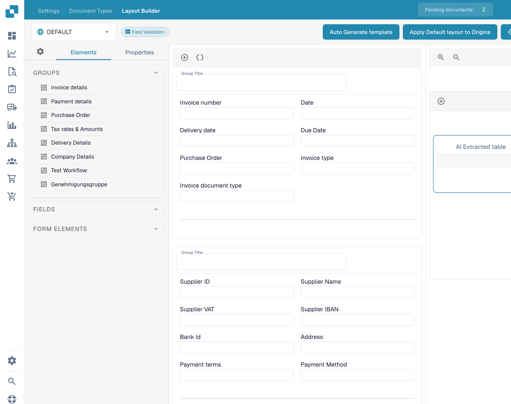

# Using the template preview

The **Layout Builder** preview lets you inspect the arrangement of groups, fields and tables while editing an existing layout.

<figure><figcaption>
Template preview in the English Layout Builder.
</figcaption></figure>

Open the intended document type and existing layout. Use **Elements** to inspect the available groups and controls. Click a field in the preview to open its **Properties**. Check labels, widths and visibility, then review how neighboring fields fit together.

Use the origin selector to inspect the configured origin context. Configured origin names remain unchanged when the interface language changes. The example shows an existing layout; it does not demonstrate a newly saved layout or a successful application to other origins.

Save only the intended changes and verify the resulting document view. See [Configuring field properties](configuring-field-properties.md) and [Layouts and selection rules](layout-selection-rules.md).
