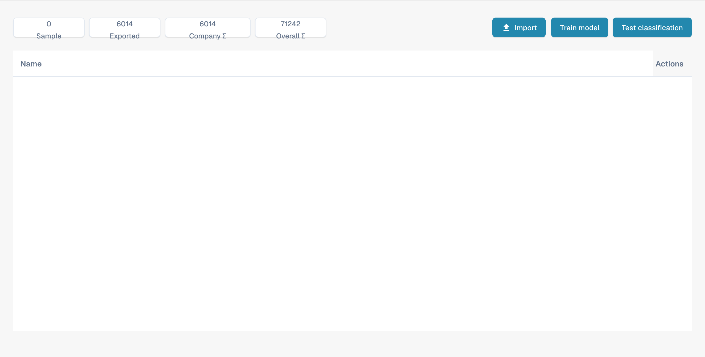

# Model Training

<figure><figcaption>
English model-training overview.
</figcaption></figure>

#### Overview

Model Training allows administrators to oversee and manage the training of machine learning models specific to each document type. By providing a structured interface for importing sample data, training models, and testing their performance, Docbits ensures that its data extraction capabilities continuously improve over time.

#### Key Features and Options

1. **Metrics Overview**:
   * **Sample**: Number of sample documents used for training.
   * **Exported**: Number of documents that have been successfully exported after processing.
   * **Company Σ**: Total number of company-specific documents processed.
   * **Overall Σ**: Total number of documents processed across all categories.
2. **Training and Testing Options**:
   * **Import**: Allows administrators to import new training data sets which are typically structured samples of documents that should be recognized by the system.
   * **Train Model**: Starts the training process using the imported data to enhance the document classification of the system.
   * **Test Classification**: Enables testing of the model to evaluate its performance on classifying documents from new or unseen documents.
3. **Action Buttons**:
   * **Actions**: This dropdown can include options such as view details, edit configurations, or delete training data.
