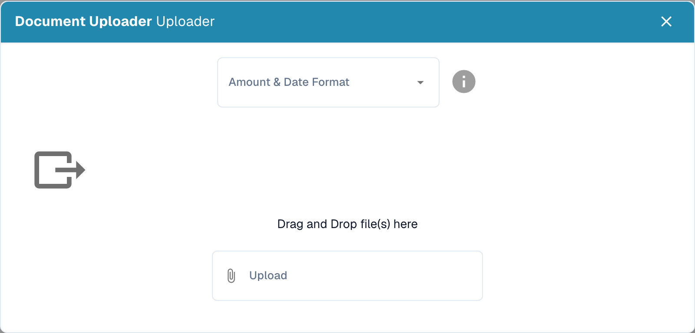

# Import sample documents for model training

Prepare documents that represent the formats, languages and document types your organization processes. Use only file formats accepted by your installation. Remove duplicates and keep training documents separate from documents reserved for evaluation.

## Open the import

Open model training in the relevant document type's settings and select the import function.

<figure><figcaption>
Model-training overview: available data and actions; no training or import was started.
</figcaption></figure>

## Select formats and files

Choose the number and date formats that match the files, then select the documents to import. For example, `1.234,56` and `1,234.56` use different separators. A date such as `05/06/2026` must also be interpreted according to the selected format.

<figure><figcaption>
Model-training import dialog: amount and date format, with no files selected or uploaded.
</figcaption></figure>

Check the selection before starting the import. Wait for processing to finish and review errors and assigned document types. Correct classification and extraction errors before using the examples for training.

## Train and evaluate

Train the model using the functions and permissions available in your version. Then evaluate it on a separate sample. Adding documents does not itself guarantee higher accuracy. See [Testing the model](testing-the-model.md).
