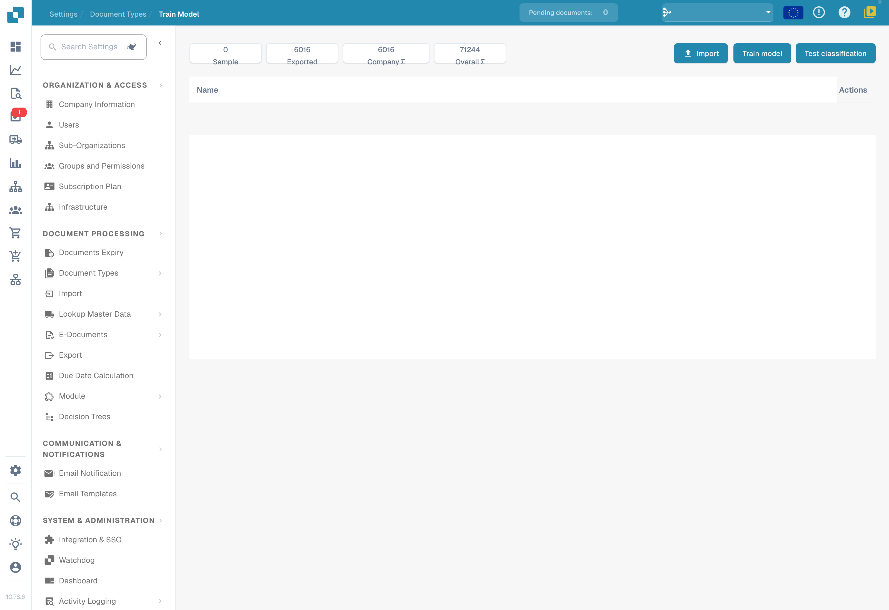

# Testing the model

Test with representative documents that were not used for training. Prepare the expected answers for each document: its type and, when evaluating extraction, its field values.

## Run the test

1. Open model training for the document type to evaluate.
2. Select the classification test if your version provides it.
3. Select the sample and start evaluation with the available options.
4. Wait for completion and record results and errors. A technical failure or incomplete test does not count as a correct classification.

<figure><figcaption>
Model-training overview: available data and actions; no training or import was started.
</figcaption></figure>

## Interpret results

Compare predictions with expected answers and analyze errors by type and format. If you calculate accuracy, precision, recall or F1 score, also report sample size and evaluated categories. Do not attribute metrics to the product that your version does not display; you can calculate them separately from exported or recorded results.

Classification and extraction rules are separate settings from model training. Check their effect when they participate in processing. Do not change a rule solely to hide an error in the test sample.

## Improve and repeat

Correct training data, labels or settings actually available in your installation, then retrain if needed. Repeat the test with the same protocol and retain an independent sample. Document the version, data, results and regressions. A good sample result does not guarantee the same performance on all future documents.
