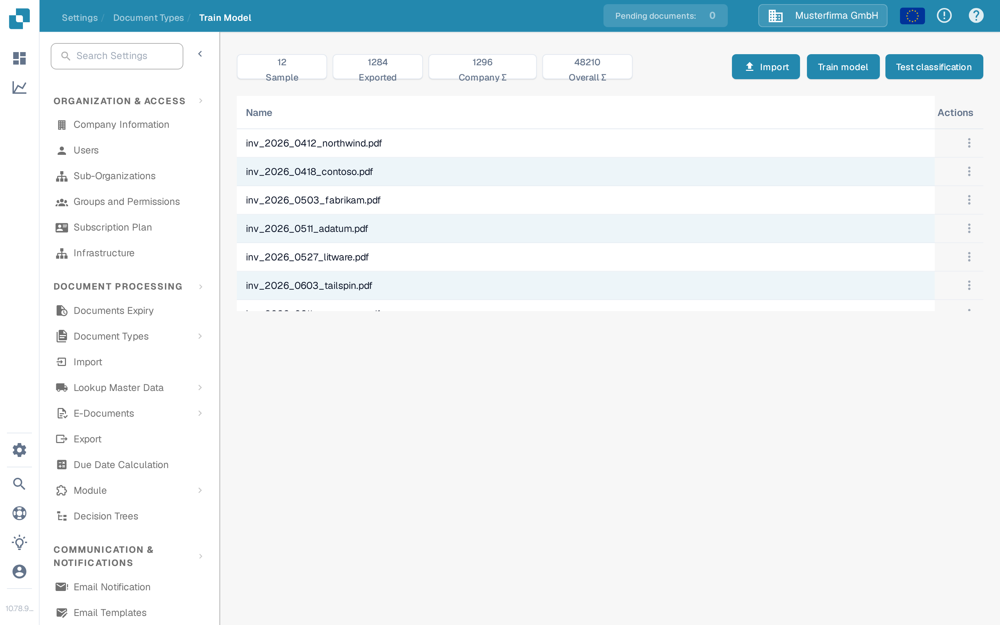
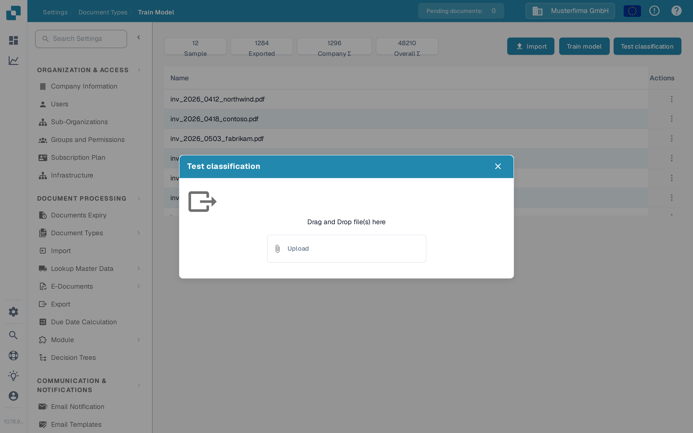
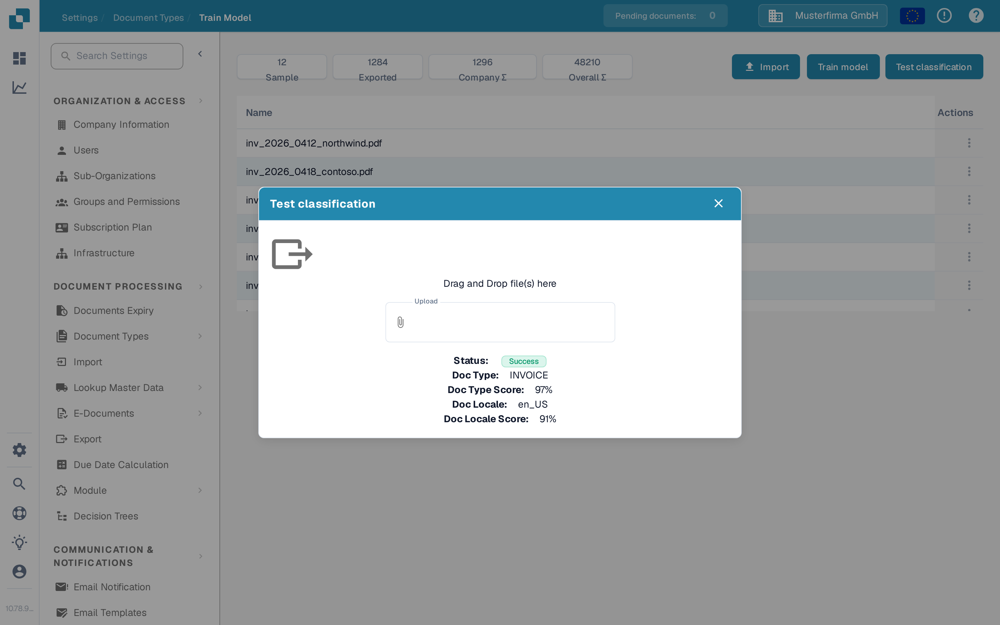

# Testing the model

## Check how reliably the trained model recognises a document type

Once a document type has training data and a trained model, you can test it with a single sample document. The test classifies that one document and shows the result. It does not change your training data, your documents, or the model itself.

### Step 1: Open the model training page of the document type

Go to **Settings** → **Document Types** and, in the row of the document type you want to test (for example **Invoice**), choose **Model Training**. The breadcrumb of the page shows **Document Types / Train Model**.

<figure><figcaption>
Model Training page of the Invoice document type with its counters, the three action buttons and the list of imported sample documents.
</figcaption></figure>

At the top the page shows four counters for this document type:

* **Sample** – number of sample documents that are available for training.
* **Exported** – number of documents that were exported after processing.
* **Company ∑** – total number of documents of your organization in this document type.
* **Overall ∑** – total number of documents in this document type, across all organizations.

Below the counters are the three buttons of the page:

* **Import** – add sample documents. See [Import Data: Model Training](import-data-model-training.md).
* **Train model** – train the model with the imported sample documents. See [Purpose and Use: Model Training](purpose-and-use-model-training.md).
* **Test classification** – test the trained model with a single document. This page describes that step.

The table under the buttons lists the imported sample documents with their **Name** and an **Actions** column. Use the actions of a row to download or delete a sample document. See [Manage training data](manage-training-data.md).

### Step 2: Start the test

Click **Test classification**. The test dialog opens.

<figure><figcaption>
The Test classification dialog: drop a file into the area or choose one, then click Upload.
</figcaption></figure>

### Step 3: Add the test document

Drag a file into the area labelled **Drag and Drop file(s) here**, or click **attach_file** to choose a file from your computer. The selected file name appears in the dialog. Click **Upload** to send it for classification.

Choose a document that was not used as training data, so the test shows how the model handles a document it has not seen before.

### Step 4: Read the result

After the upload the dialog shows how the model classified the document.

<figure><figcaption>
The result of a test classification: the model assigned the document type INVOICE with a high score.
</figcaption></figure>

* **Status** – **Success** means the model assigned the same document type as the page you started the test from. If it shows **Failed**, the model assigned a different document type and the values below are not shown.
* **Doc Type** – the document type the model assigned to the tested document.
* **Doc Type Score** – how confident the model is about that document type, in percent. A high value means the model is very sure.
* **Doc Locale** – the language and region the model recognised for the document, for example `en_US`.
* **Doc Locale Score** – how confident the model is about that language and region, in percent.

Close the dialog with **close** when you have read the result. The result belongs to this single test only; it is not stored in your training data.

### Evaluate and improve the model

* **Evaluate the accuracy.** Test several representative documents instead of a single one. The more often the status is **Success** and the higher the scores are, the more reliably the model works for that document type.
* **Analyse errors.** If a document is classified as a different type, check whether the model already has enough comparable sample documents for the correct type. See [Manage training data](manage-training-data.md).
* **Improve the model.** Add more or better sample documents with **Import**, train the model again with **Train model**, and repeat the test.
* **If a document type is consistently misclassified**, review the classification rules of your document types under **Settings** → **Document Types** → **Classification and Extraction** and adjust them if necessary.
* Keep notes about each test so you can compare results over time. See [Best practices](best-practices.md) and [Troubleshooting](troubleshooting.md).
