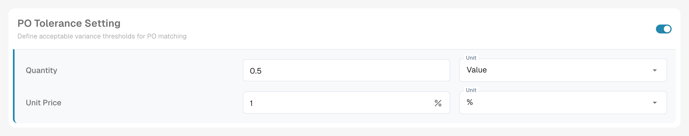
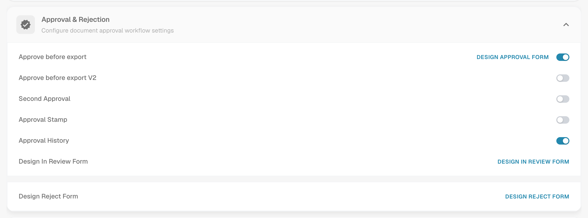
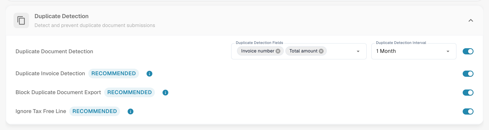

# More Settings

## Overview

**More Settings** holds the options that belong to one document type, for example the Invoice. A setting that you switch on here applies only to that document type. The page is made of collapsible cards, one per topic. Open a card to see its settings.

<figure><figcaption>
The cards of the More Settings page, all collapsed.
</figcaption></figure>

## How to Access

1. Navigate to **Settings** → **Global Settings** → **Document Types**.
2. Select the document type and click **More Settings**.

The breadcrumb at the top of the page shows **Settings / Document Types / More Settings**. The Settings Assistant on the right of the page explains the settings of the open card.

| Card | What you set there |
| ---- | ------------------ |
| [Purchase Order](#purchase-order) | PO matching, tolerances, export of PO lines, supplier item numbers |
| [Manage Layouts](#manage-layouts-custom-validation-rules-and-transformation-rules) | Switch for the Manage Layouts overview |
| [Custom Validation Rules](#manage-layouts-custom-validation-rules-and-transformation-rules) | Your own validation rules for this document type |
| [Transformation Rules](#manage-layouts-custom-validation-rules-and-transformation-rules) | Rules that read a value, change it in steps and write it back |
| [Approval & Rejection](#approval-and-rejection) | Approval workflow and the in-review and reject forms |
| [Vertex Tax Verification](vertex-tax-verification.md) | Design the form for the Vertex tax verification |
| [E-Invoice Validation](#e-invoice-validation) | Validation of XRechnung, ZUGFeRD and Factur-X invoices |
| [Table Extraction](#table-extraction) | Skip the validation of extracted tables |
| [Export Settings](#export-settings) | Multiple export, PDF format, alternate export |
| [Duplicate Detection](#duplicate-detection) | Detect and block duplicate documents |

## Purchase Order

The **Purchase Order** card (**PO Matching & Validation**) controls how documents of this type are matched with purchase orders.

<figure><figcaption>
The Purchase Order card with its options.
</figcaption></figure>

* [**Purchase Order**](purchase-order/purchase-order.md): Toggles whether the document is processed in the Purchase Order Matching screen. You can also specify which quantity the matching is based on.
* [**PO match server side**](purchase-order/purchase-order-matching-rules.md): Matches with the configurable rule set. **Configure PO Matching Rules** opens the [rules page](purchase-order/purchase-order-matching-rules.md).
* [**PO table in layout builder**](purchase-order/po-table-in-layout-builder.md): Enables the inclusion of purchase order tables in the layout builder for customized document layouts.
* [**Auto check for PO updates**](purchase-order/auto-check-for-po-updates.md): Shows a visual indicator in the Purchase Order Matching screen when a purchase order has been updated, prompting users to refresh.
* **Auto update PO data**: Updates the PO data automatically when new data is available. This switch belongs to **Auto check for PO updates**.
* [**Consumed PO line status**](purchase-order/consumed-po-line-status.md): Applies color coding to purchase order lines in the matching screen.
* [**Calculate PO unit price**](purchase-order/calculate-po-unit-price.md): Calculates the PO unit price using the net amount and quantity, instead of extracting it.
* [**Export not matched PO lines**](purchase-order/export-not-matched-po-lines.md): When off, only matched lines are exported. When on, all purchase order lines are exported, even if they are not matched.
* **Ignore Already Matched Lines**: Skips lines that have already been matched during a new matching process.
* [**Update Document Purchase Order Status**](purchase-order/update-document-purchase-order-status.md): Updates the PO Status column on the dashboard whenever the status of the purchase order changes.
* [**Allow Auto Export For Non Matchable PO Lines**, **Auto Match & Export visible to** and **Use Lines Net Amount for Matched Total visible to**](purchase-order/auto-match-and-export-options.md): Decide who sees the Auto Match & Export shortcuts and which documents may export automatically.

### See the matching rules as a diagram

The PO matching rules are more than a list. DocBits can draw the active rule set as a flow chart. You see in which order the rules are tried and where matching stops.

1. In the **Purchase Order** card switch **PO match server side** on and click **Configure PO Matching Rules**.
2. Click **Rule set as a diagram** at the top of the page. The diagram opens in a panel next to the rules.

<figure><figcaption>
The rule set as a diagram. Five stages, from top to bottom.
</figcaption></figure>

Read the chart from top to bottom. DocBits tries the stages in this order: **Single match validation**, **Multi match validation**, **Total match validation**, **Single mismatch validation** and **Fallback logic**. Each stage tries up to three passes: **Exact match for all rules**, **Tolerance-based match** and **Package criteria**. A green arrow means a match was found and processing stops. A red arrow means no match, so DocBits carries on with the next step. At the end the result is **Match found** or **No match found**.

Under the chart the panel lists **Rules by priority, per stage**. For every rule you see the columns it compares, the tolerance and the options **Auto match**, **Manual match** and **Fallback**.

<figure><figcaption>
Under the chart: the rules of each stage with the columns they compare.
</figcaption></figure>

**Example.** An invoice line has item number 4711, quantity 10 and unit price 10.40. The purchase order line has item number 4711, quantity 10 and unit price 10.00. The tolerance for the unit price is 5 %.

* Pass **1.1 Exact match for all rules** fails, because 10.40 is not 10.00. The red arrow leads to the next pass.
* Pass **1.2 Tolerance-based match** succeeds. The difference is 4 %, which is within 5 %. The green arrow leads to **Match found**, and processing stops.

In the diagram this is the path 1.1, then 1.2, then **Match found**. For the path that a single document took, see [PO matching diagnosis](../../../../touchless-po-matching-diagnosis.md). For all details of the rules page see [Purchase Order Matching Rules](purchase-order/purchase-order-matching-rules.md).

### PO Tolerance Setting

<figure><figcaption>
Tolerance for quantity and unit price.
</figcaption></figure>

[**PO Tolerance Setting**](purchase-order/purchase-order-tolerance-settings-additional-purchase-order-tolerance.md) lets you set tolerance levels for quantity and unit price, so that minor discrepancies are not flagged as mismatches. For each value you choose the amount and the unit, either an absolute **Value** or a percentage (**%**). The block also contains [**Additional PO Tolerance Setting**](purchase-order/purchase-order-tolerance-settings-additional-purchase-order-tolerance.md#setting-to-configure-additional-purchase-order-tolerance-settings) for freight, charges and taxes, and [**PO disable statuses**](purchase-order/purchase-order-disable-statuses.md).


When the document type attribute `CUSTOM_RANGE_FOR_PO_TOLERANCE` is on, the unit price and quantity tolerances come from these document type settings and not from the rule set. The rule diagram on the [PO matching rules page](purchase-order/purchase-order-matching-rules.md) shows a note when this is the case.


### Supplier Item Number Map

<figure><figcaption>
The Supplier Item Number Map.
</figcaption></figure>

The [**Supplier Item Number Map**](purchase-order/supplier-item-number-map-admin-documentation.md) maps supplier item numbers to your internal item numbers, so that lines match even when the supplier uses its own numbers. Search by column to find an entry.

## Manage Layouts, Custom Validation Rules and Transformation Rules

Three cards sit directly below the Purchase Order card:

* **Manage Layouts** switches the Manage Layouts overview on for this document type. See the [Layout Manager](../layout-manager/README.md).
* **Custom Validation Rules** switches your own validation rules on. **Manage Validation Rules** opens them. See [Custom Validation Rules](../custom-validation-rules.md).
* **Transformation Rules** switches the transformation rules on. **Manage Transformation Rules** opens them. See [Transformation Rules](../transformation-rules.md).

<figure><figcaption>
The three cards with their switches.
</figcaption></figure>

## Approval and Rejection

The **Approval & Rejection** card holds the approval workflow and the forms that users see while they review or reject a document.

<figure><figcaption>
The Approval &#x26; Rejection card.
</figcaption></figure>

* **Approve before export**: Documents must be approved before they can be exported. **Design Approval Form** opens the **Layout Builder** for the approval screen.
* **Approve before export V2**: Activates Approval V2, which supports dynamic fields in place of static ones.
* **Second Approval**: Adds an additional layer of approval.
* [**Approval Stamp**](approval/approval-stamp.md): Adds a stamp to the document when it is approved.
* [**Approval History**](approval/approval-history.md): Shows the approval history in the approval screen and in field validation.
* **Design In Review Form**: Configures the layout of the review form with the **Layout Builder**.
* **Design Reject Form**: Configures the layout of the reject form with the **Layout Builder**.

For the **Layout Builder** see the [Layout Manager](../layout-manager/README.md).

## Vertex Tax Verification

The **Vertex Tax Verification** card holds **Design Vertex Tax Verification**. It opens the Layout Builder for the form that users see when DocBits compares the vendor tax with the tax calculated by Vertex. See [Vertex Tax Verification](vertex-tax-verification.md) for the integration, the tolerance and the result.

## E-Invoice Validation

The **E-Invoice Validation** card switches the validation of incoming e-invoices on and lets you decide whether the supplier is notified when an invoice is rejected. See [E-Invoice Validation](../../../document-processing/e-documents/validation-rules.md).

## Table Extraction

<figure><figcaption>
The Table Extraction card.
</figcaption></figure>

* **Skip table validation**: Bypasses the standard validation of table data. Use it when flexible data handling is required or when certain validation steps can be skipped to improve performance.

## Export Settings

<figure><figcaption>
The Export Settings card.
</figcaption></figure>

* **Multiple Export**: Allows a document to be exported more than once.
* **Export PDF Format**: **Export File Format** sets the PDF format that is used when documents are exported, for example **Original Document**.
* [**Alternate Export**](purchase-order/alternate-export.md): Sets up an alternative export for a chosen document status. Pick the **Status** and the **Export Configuration** that runs for it, then switch the setting on.

## Duplicate Detection

<figure><figcaption>
The Duplicate Detection card.
</figcaption></figure>

The card contains **Duplicate Document Detection** with the fields that decide what counts as a duplicate and the interval in which documents are compared, plus the options **Duplicate Invoice Detection**, **Block Duplicate Document Export** and **Ignore Tax Free Line**. All three carry a **Recommended** label. See [Duplicate Detection](duplicate-document-handling.md) for how a flagged document is handled.
