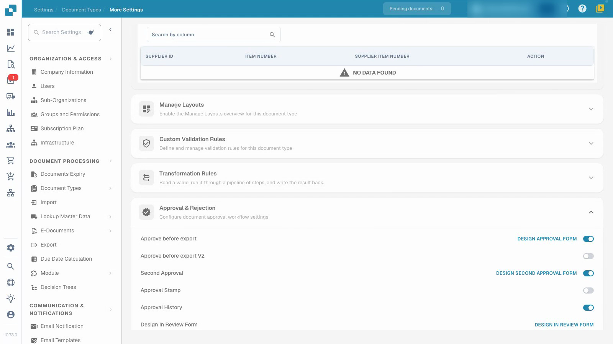
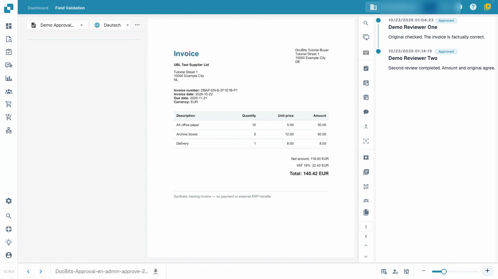

# Configure and test invoice approvals

Configure an isolated approval process and test first approval, a different second reviewer and rejection.


Configure and test invoice approvals


[Watch with subtitles](https://docbits-videos.fra1.cdn.digitaloceanspaces.com/settings-assistant/invoice-approval-admin/v2/en.html)

The recording shows the real application. Option wording may vary with the deployed version.

Configure approval for the document type used by your process. Identify the intended reviewers and decide whether you need a second independent review. The video uses a separate document type and temporary ordinary reviewer accounts.

## Configure the document type

Open **Settings → Document Types**, select the intended type and open **More settings → Approval & Rejection**. Choose the settings your process needs, then reload the page to check what was saved.

| Setting | Purpose |
| --- | --- |
| Approve before export | Require an approval decision before the document proceeds to export. |
| Second Approval | Add a second approval stage to the configured process. |
| Approval History | Keep the recorded decisions available for review. |
| Approval Stamp | Configure a mark on an approved document; see the separate stamp guide. |

The additional V2 option and the form designers are separate settings. This tutorial uses prepared standard approval forms.

## Test with the intended roles

1. Give the first and second reviewers separate groups and the intended assigned-document access. In this example, the first account has first-stage approval permission and the second account has second-stage permission. A switch alone does not assign a person or grant that permission.
2. Use the first ordinary account to check the assigned, already validated invoice, add a note and give first approval. Verify that the saved document still awaits second approval. Check that this account cannot perform the second stage when its permissions forbid it.
3. Assign the waiting invoice to the other authorized reviewer. Use that second ordinary account to check it and give second approval with a separate note.
4. Reopen the history and verify both different reviewers, times and notes. Also reject a separate test invoice with a reason and verify that decision after reloading.

<figure><figcaption>
Saved approval settings for the dedicated test document type.
</figcaption></figure>

<figure><figcaption>
Two different reviewers and both saved review notes.
</figcaption></figure>

## Verify the outcome

Keep first approval, outstanding second approval and rejection as different outcomes. Confirm that the invoice values remain unchanged after each decision. In this isolated test, the test channel waits for data retrieval and has no external ERP target. The technical status `pending_data_fetch`, when displayed, means waiting for data retrieval. Approval history alone does not prove an ERP transfer.

Test the configured roles, assignment and full decision path before applying the process to live documents.

## Related pages

- [Groups, users and permissions](../../../groups-users-and-permissions/README.md)
- [Approval history](approval-history.md)
- [Approval stamp](approval-stamp.md)
