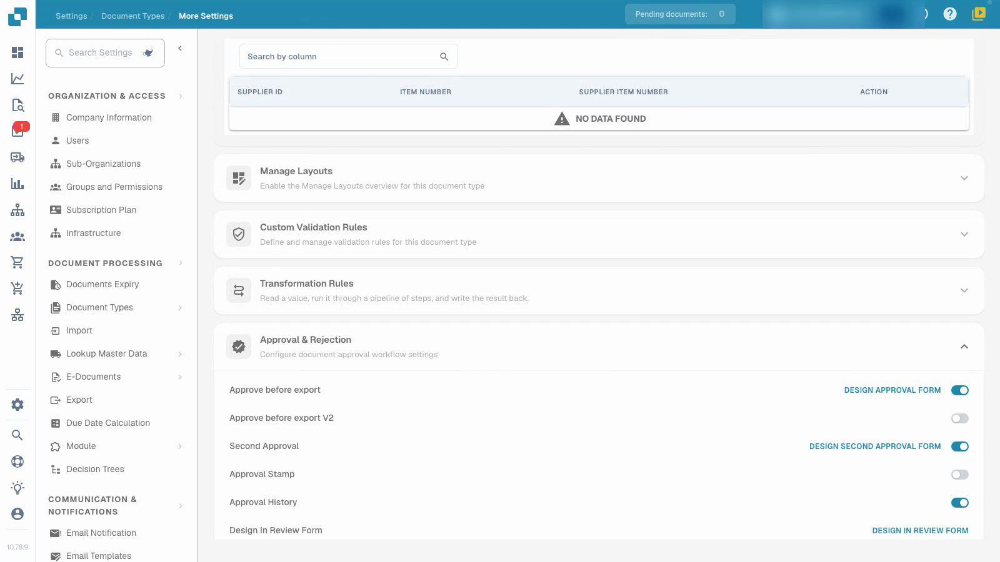
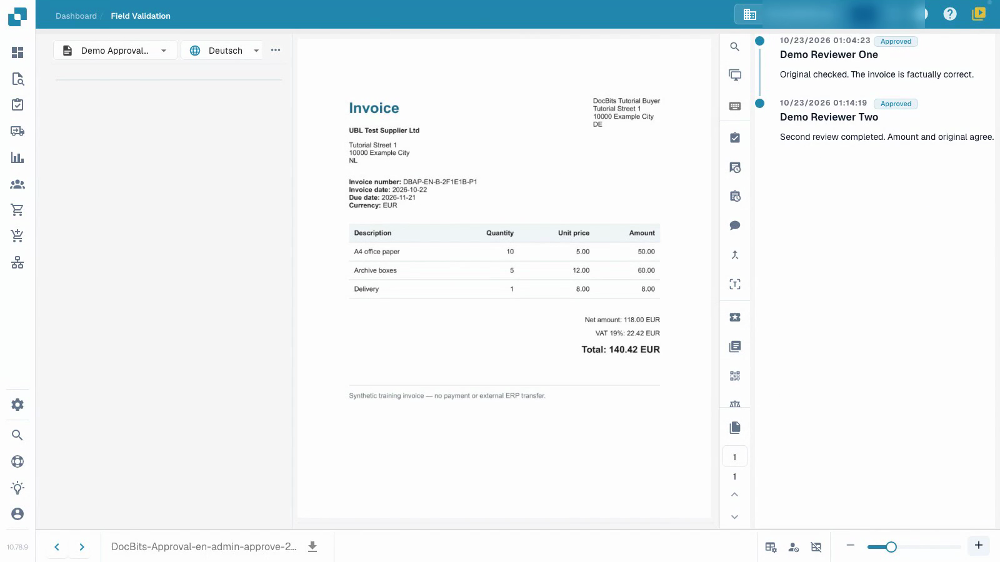
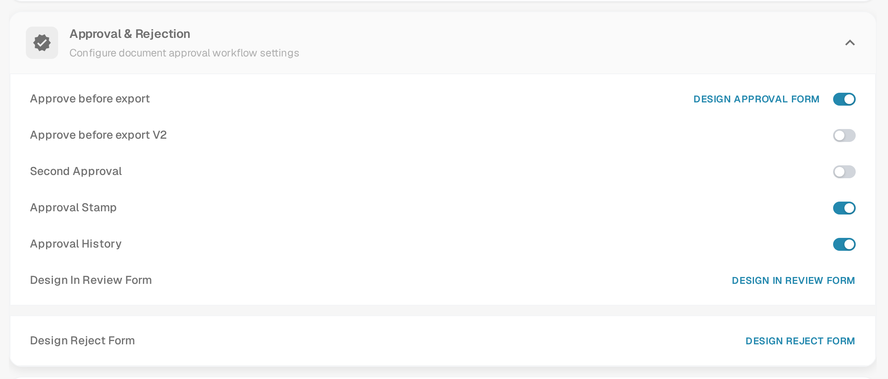

# Configure and test invoice approvals

Configure an isolated approval process and test first approval, a different second reviewer and rejection.


Configure and test invoice approvals


[Watch with subtitles](https://docbits-videos.fra1.cdn.digitaloceanspaces.com/settings-assistant/invoice-approval-admin/v2/en.html)

The recording shows the real application. Option wording may vary with the deployed version.

Configure approval for the document type used by your process. Identify the intended reviewers and decide whether you need a second independent review. The video uses a separate document type and temporary ordinary reviewer accounts.

## Configure the document type

Open **Settings → Document Types**, select the intended type and open **More settings → Approval & Rejection**. Choose the settings your process needs, then reload the page to check what was saved.

| Setting | Purpose |
| --- | --- |
| Approve before export | Require an approval decision before the document proceeds to export. |
| Approve before export V2 | Use the newer approval screen. With V2 on, the **Ready for approval** screen shows a rebuilt approval form that can restrict fields for the approver. Leave V2 off to keep the previous approval screen. See [Document Status](../../../../../../end-user-and-partner-section/end-user-section/dashboard/document-status.md) for where a document waits for approval. |
| Second Approval | Add a second approval stage to the configured process. |
| Approval History | Keep the recorded decisions available for review. |
| Approval Stamp | Configure a mark on an approved document; see the separate stamp guide. |

The form designers are described in [Design the approval forms](#design-the-approval-forms) below. This tutorial uses prepared standard approval forms.

## Test with the intended roles

1. Give the first and second reviewers separate groups and the intended assigned-document access. In this example, the first account has first-stage approval permission and the second account has second-stage permission. A switch alone does not assign a person or grant that permission.
2. Use the first ordinary account to check the assigned, already validated invoice, add a note and give first approval. Verify that the saved document still awaits second approval. Check that this account cannot perform the second stage when its permissions forbid it.
3. Assign the waiting invoice to the other authorized reviewer. Use that second ordinary account to check it and give second approval with a separate note.
4. Reopen the history and verify both different reviewers, times and notes. Also reject a separate test invoice with a reason and verify that decision after reloading.

<figure><figcaption>
Saved approval settings for the dedicated test document type.
</figcaption></figure>

<figure><figcaption>
Two different reviewers and both saved review notes.
</figcaption></figure>

## Verify the outcome

Keep first approval, outstanding second approval and rejection as different outcomes. Confirm that the invoice values remain unchanged after each decision. In this isolated test, the test channel waits for data retrieval and has no external ERP target. The technical status `pending_data_fetch`, when displayed, means waiting for data retrieval. Approval history alone does not prove an ERP transfer.

Test the configured roles, assignment and full decision path before applying the process to live documents.

## Design the approval forms

Every approval step shows its own form to the reviewer. Design the form before you switch the step on, so the reviewer sees the right fields in the right order.

With **Approve before export** on, the panel shows a link next to each approval step. Select the link to open the form builder for that form:

| Link in the panel | Next to | Form the reviewer sees |
| --- | --- | --- |
| **DESIGN APPROVAL FORM** | **Approve before export** | The standard approval form for a document that is waiting for approval. |
| **DESIGN APPROVAL FORM V2** | **Approve before export V2** | The approval form for the newer approval screen. |
| **DESIGN SECOND APPROVAL FORM** | **Second Approval** | The form for the second approval step. |
| **DESIGN IN REVIEW FORM** | its own row, shown while **Approve before export** is on | The form a reviewer uses while checking a document that is in review. |
| **DESIGN REJECT FORM** | its own row | The form a reviewer uses to reject a document, so they can record a reason. |

A link appears only when the matching step is switched on. The **Design In Review Form** row is shown as long as **Approve before export** is on; the **Design Reject Form** row is always available in the panel. The panel in the example above has **Approve before export** on, so it already shows the **DESIGN APPROVAL FORM** link plus the **Design In Review Form** and **Design Reject Form** rows:

<figure><figcaption>The approval steps and their Design links. Each link opens the form builder for that step.</figcaption></figure>

Selecting a link opens the **form builder** for that form. It is the same builder that is used for document layouts: the top bar starts with the language-origin selector (here **DEFAULT**) followed by a coloured badge that names the form you are editing — **Approval**, **Review** or **Reject**. The left panel has three tabs:

- **Settings** (gear icon) — control the behaviour of the form: **Show Tab Index** and **Auto generate tab index** for the tab order, **Disable Extraction**, and the **Validation time spent counter**.
- **Elements** — expand **GROUPS**, **FIELDS** and **FORM ELEMENTS** and drag what you need onto the canvas. **Fields** holds the document fields; **Form Elements** holds the controls you place on the form, such as **Text**, **Label**, **Check Box**, **Horizontal Separator**, **Notes** and **Button**, along with the approver controls **Document Approver** and **Second Approver**.
- **Properties** — select something on the canvas to change its label, size, colour and other settings.

The top bar also offers **Use default template** to discard your changes, **Edit JSON** to work on the form definition directly, and **Save**. Saving stores the form for that step and document type only, so the approval form, the in-review form and the reject form are kept apart and none of them changes the document layout.

See [Navigating the Layout Builder](../../layout-manager/navigating-the-layout-manager.md) for a walk-through of the panels and [Save and apply changes](../../layout-manager/save-and-apply-changes.md) for what saving does.

## Related pages

- [Groups, users and permissions](../../../groups-users-and-permissions/README.md)
- [Approval history](approval-history.md)
- [Approval stamp](approval-stamp.md)
