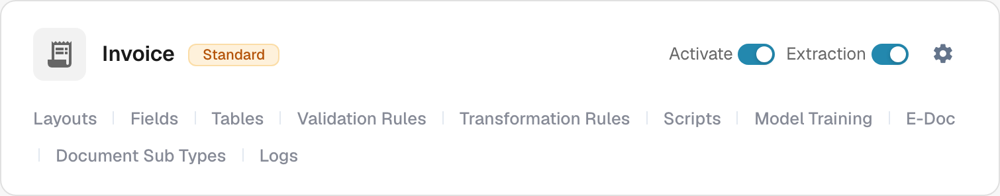
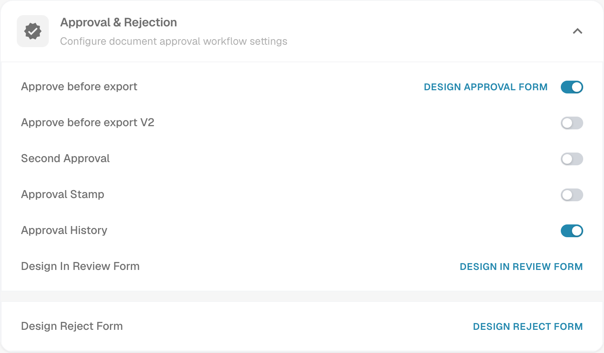

# Approval Stamp

An approval stamp is an annotation in the approval workflow when the option is enabled for that document type. It helps a reviewer check who approved a document and when. Verify the annotation and PDF result with a test invoice in the workflow your organisation actually uses.

## Find the option

1. With an administrator account, open **Document Types** in the administration settings. Find the type you want to configure, such as **Invoice**, and select the **gear icon** on its card. The gear opens **More settings** for that document type.

   <figure><figcaption>
Actual Invoice card in the English Dev interface. The gear opens More settings; no control was changed.
</figcaption></figure>

   **Activate** controls the document type's availability and **Extraction** its extraction mode. The links at the bottom of the card open separate areas: **Layouts**, **Fields**, **Tables**, **Validation Rules**, **Transformation Rules**, **Scripts**, **Model Training**, **E-Doc**, **Document Sub Types** and **Logs**. Available links depend on the type's modules and settings. Use the gear to find the stamp setting.

2. In **More settings**, expand **Approval & Rejection**. Find **Approval Stamp** next to **Approve before export**, **Second Approval** and **Approval History**. The image shows the existing stamp setting **off**; the state in your organisation may differ. It does not show an approved document.

   <figure><figcaption>
Actual Approval &amp; Rejection view in English Dev. The switch states were only read.
</figcaption></figure>

   **Approve before export**, **Approve before export V2**, **Second Approval** and **Approval History** are separate workflow settings. **DESIGN APPROVAL FORM**, **DESIGN IN REVIEW FORM** and **DESIGN REJECT FORM** open the respective form editors. You do not need to open these editors to inspect the stamp setting.

3. Change **Approval Stamp** only after agreeing how approvals and exports work in your organisation. **Changing the switch saves the setting immediately.** Keep a record of the previous state so you can verify the effect on a test invoice.

## Verify an approval

Send a synthetic invoice of this document type through the configured approval workflow. At that workflow's approval step, approve it with an authorised test account. Reopen the approved document and check that the annotation contains the expected name and date. Inspect the downloaded PDF your workflow actually uses as well. If the stamp is absent, check the document type, approval status, setting and export configuration.

An approval stamp is separate from **Second Approval** and **Approval History**. Enabling one does not prove that the others are configured. The available dashboard download actions and IDM export format depend on the environment and were not verified for this page, so this guide does not promise specific download menu labels or automatic IDM output.

Both captures show actual English Dev views. No switch was changed and no document was approved or exported during this check. The stamped end state requires a separate synthetic approved test invoice.
