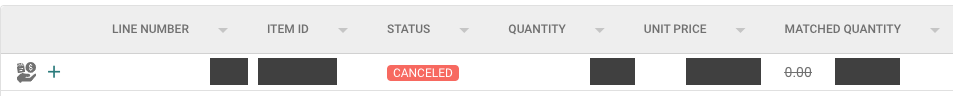
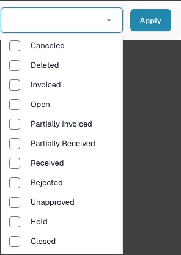

# Purchase order disable statuses

## **Overview**

The **PO disable statuses** setting specifies which purchase order (PO) line statuses are restricted in the matching screen. A line with a configured disabled status is shown with strikethrough and is not draggable for a match. Use the setting to control matching eligibility for the relevant document type.

## **Activation Steps**

1. Open **Settings → Document Types**.
2. Find the document type you want to configure. The example below uses **Invoice**. Open its gear button (**More settings**).

<figure><figcaption>
The existing Invoice card and its More settings gear. The Activate and Extraction controls are separate from the PO status selection.
</figcaption></figure>

3. Open the **Purchase Order** accordion and locate **PO disable statuses**.

<figure><figcaption>
The PO disable statuses field and its Apply button. The empty selection shown here is an example of the existing test configuration.
</figcaption></figure>

### **How to Identify a Disabled Purchase Order**

In the [Purchase Order Matching Screen](https://docs.docbits.com/end-user-and-partner-section/end-user-section/purchase-order-matching), a line whose status is disabled is marked with strikethrough and cannot be dragged into a match. Check the line's status and the disabled-status list for the document type when reviewing why the line is unavailable.

<figure><figcaption>
A retained historical PO matching example with Canceled status. Record identifiers, quantities, prices and matched values are masked for privacy.
</figcaption></figure>

### **How to set it up**

1. Click the **PO disable statuses** field to open the available statuses.
2. Select the checkboxes for the statuses your process excludes from matching. Clear a checkbox to remove that status from the selection.

<figure><figcaption>
The current status options with their existing unchecked state. The surrounding page content is masked; the dropdown and Apply button are unchanged.
</figcaption></figure>

3. Click **Apply** to save the selection for this document type. Opening the dropdown alone does not save a change.

**Available Statuses**

* Canceled
* Deleted
* Invoiced
* Open
* Partially Invoiced
* Partially Received
* Received
* Rejected
* Unapproved
* Hold
* Closed
