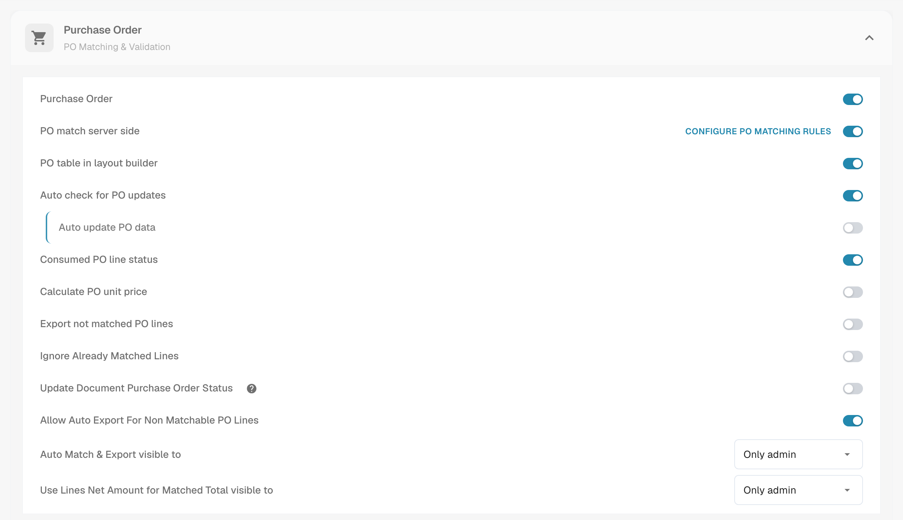
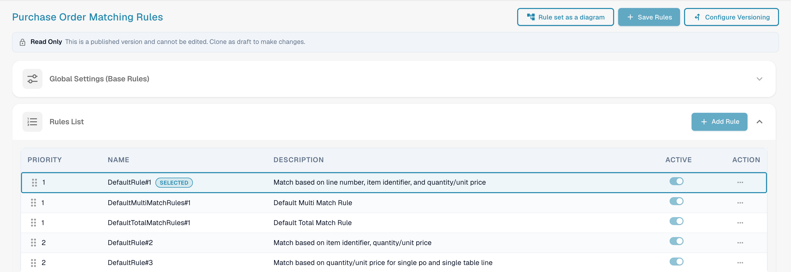
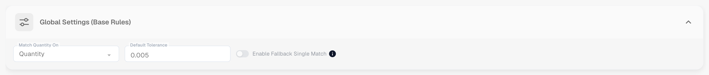
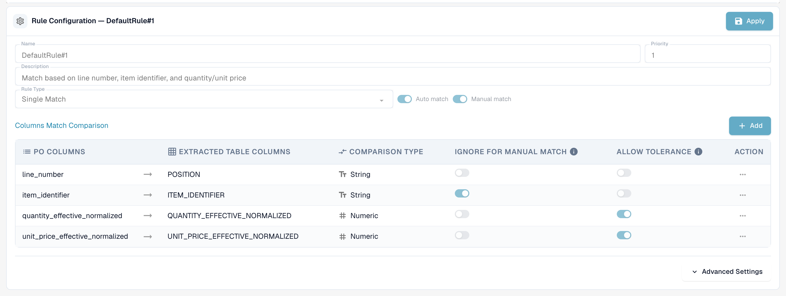
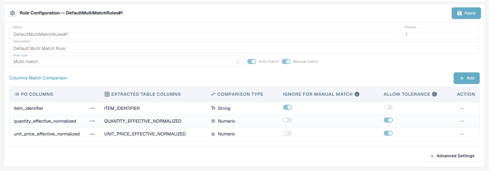
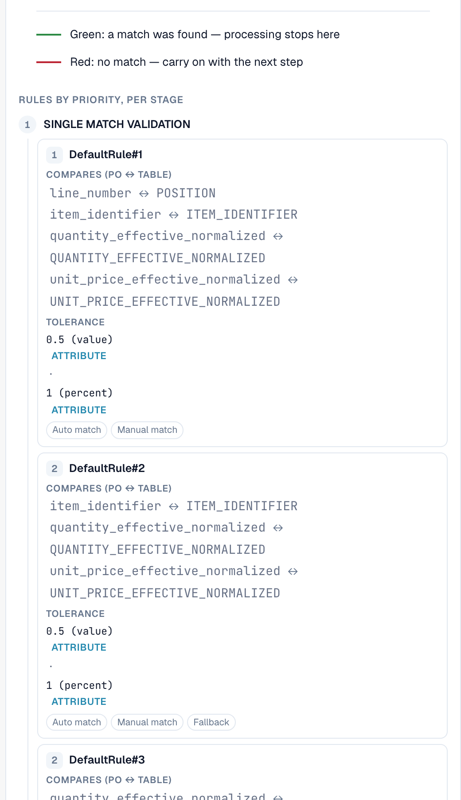
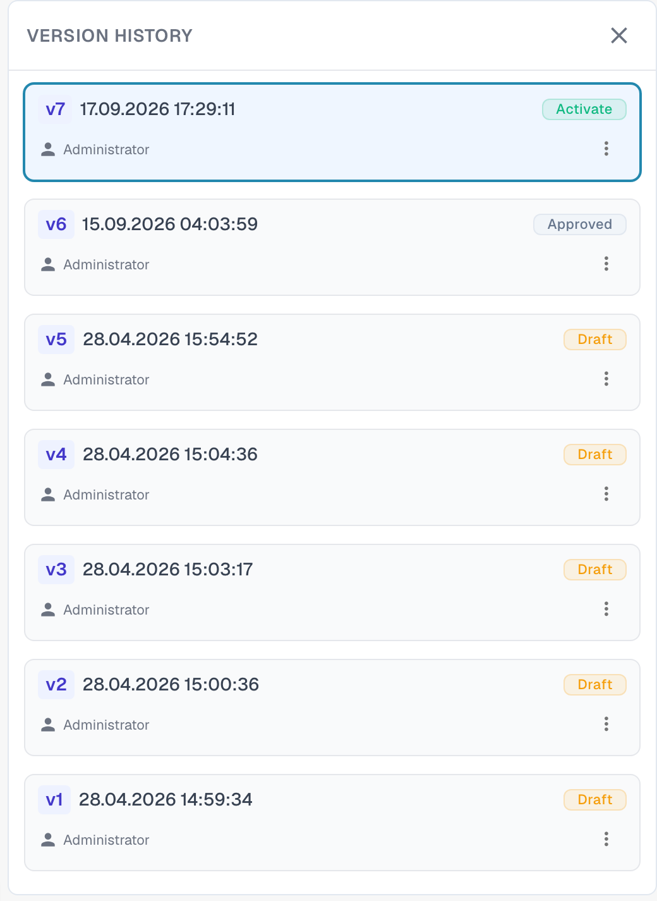

# Purchase Order Matching Rules

## Configure PO matching rules and tolerances

The walkthrough opens the invoice document type, checks the published rule version and clones an inactive draft. It explains rule types, priority within the matching stage, comparison columns, quantity basis, matching modes and tolerance calculations. Only the tutorial draft is saved; the active version and configured global tolerances are preserved. The five-percent calculation is an illustration, not a change to the active tolerance.



[Watch the video with subtitles](https://docbits-videos.fra1.cdn.digitaloceanspaces.com/settings-assistant/po-matching-rules-admin/v2/en.html)

## Introduction: Purchase Orders and PO Rule Management

Purchase Order (PO) Matching is a critical process for ensuring consistency between Purchase Orders (POs) and corresponding incoming invoices or goods receipts. A robust set of rules is essential to achieve a high rate of automatic matching, prevent fraud, and ensure correct payments.

This configuration page is used to define and manage the rules that determine _how_ PO line items are matched to the corresponding incoming document (Invoice, Order Confirmation).


**Prerequisite:** the matching rules are only used when **PO match server side** is switched on for the document type (Settings → Document Types → More Settings → Purchase Order). With the switch off, DocBits matches with its built-in matcher (quantity, unit price, item number, purchase order number) and ignores the rule set.


***

## How to Access

1. Navigate to **Settings** → **Global Settings** → **Document Types**, select the document type and click **More Settings**.
2. In the **Purchase Order** card switch **PO match server side** on.
3. Click **Configure PO Matching Rules** next to the switch.

<figure><figcaption>
The Purchase Order card. <strong>Configure PO Matching Rules</strong> sits next to <strong>PO match server side</strong>.
</figcaption></figure>

## The page at a glance

<figure><figcaption>
The Purchase Order Matching Rules page.
</figcaption></figure>

The page has three buttons at the top:

* **Rule set as a diagram** opens a flow chart of the active rule set. See [Rule set as a diagram](#rule-set-as-a-diagram).
* **Save Rules** saves your changes to the draft you are editing.
* **Configure Versioning** opens the version history. See [Versions and drafts](#versions-and-drafts).

Below the buttons a **Read Only** notice appears when you look at a published version: *This is a published version and cannot be edited. Clone as draft to make changes.* Below that come the **Global Settings (Base Rules)** card and the **Rules List**. Select a rule in the list to configure it in the **Rule Configuration** area under the list.

***

## Global Settings (Base Rules)

These settings establish the framework that applies to all matching rules:

<figure><figcaption>
The Global Settings (Base Rules) card, opened.
</figcaption></figure>

* **Setting:** Match Quantity On
  * **Purpose:** Defines which quantity of the purchase order line is compared with the document line — for example the ordered quantity or the **invoice open quantity** (ordered minus already invoiced), which is the usual choice for invoices.
  * **Valid Values:** Quantity or other available quantity fields in the system, depending on the data structure (e.g., an alternative normalized quantity field).
  * **Dependency:** Determines the basis for all matching rules that include quantity in their comparison criteria.
* **Setting:** Standard Tolerance (Default Tolerance)
  * **Purpose:** Defines how far a numeric value on the document may deviate from the purchase order value and still count as a match. It compensates for rounding differences. It applies to **every numeric column** with "Allow Tolerance" enabled — quantity as well as unit price.
  * **Valid Value:** A decimal number. Whether it is read as an **absolute value** (0.005 = a deviation of up to 0.005 in the compared quantity or price) or as a **percentage** (0.5 = 0.5 % of the compared value) is set by the **tolerance type** of the rule set (`value` or `percent`; new rule sets use `value`). Per-item tolerances (see [Tolerance settings](purchase-order-tolerance-settings-additional-purchase-order-tolerance.md)) override the standard tolerance for that item.
  * **Dependency:** Applies to rules that use numeric fields for matching and have the "Allow Tolerance" option enabled.
* **Setting:** Enable Fallback Single Match
  * **Purpose:** When enabled, a last remaining unmatched purchase order line is matched automatically even if the packing slip number differs. The match is flagged as a mismatch for your review.
  * **Valid Values:** On or off. The default is off.

***

## Rule List

The Rule List displays all available matching rules and manages their execution order.

<figure><figcaption>
The Rules List. The selected rule is marked <strong>Selected</strong>. A rule can be switched off with its <strong>Active</strong> switch.
</figcaption></figure>

#### Structure and Execution

* **Priority:** This numerical field (e.g., 1, 2, 3) dictates the execution sequence of the rules. Rules with a lower priority number are attempted first. This allows administrators to structure a hierarchy, typically starting with the most specific and stringent rules (e.g., matching by both line number and part number) and falling back to broader or less restrictive rules.
* **Name & Description:** Provides clear identification and context for the rule, explaining the primary criteria used (e.g., "Standard Rule No. 1: Match based on Line Number, Part ID, and Quantity").
* **Active:** A simple toggle switch that allows instant activation or deactivation of the rule without needing to delete its configuration.

**Execution Flow:** The system performs matching in a cascading sequence. If a rule (e.g., Priority 1) successfully matches a line item, the process for that item stops. If no match is found, the system proceeds to the next rule in the priority sequence (e.g., Priority 2). Every run is recorded on the document; the **matching history** in the Purchase Order Matching screen shows which rule was tried, which one matched, and which ones were skipped and why.

***

## Rule Configuration (Detail Settings)

This detailed configuration area defines the specific logic and criteria for an individual rule.

<figure><figcaption>
The Rule Configuration area for a single match rule. <strong>Apply</strong> keeps your changes on the draft.
</figcaption></figure>

#### Base Parameters

* **Rule Type:** Specifies the matching cardinality.

| Rule type          | What it does                                                                                                                                                                                                    | Typical use                                                               |
| ------------------ | --------------------------------------------------------------------------------------------------------------------------------------------------------------------------------------------------------------- | ------------------------------------------------------------------------- |
| **Single match**   | One purchase order line to one document line. Every configured column must agree (within tolerance where allowed).                                                                                              | The standard case.                                                        |
| **Multi match**    | Several purchase order lines to one document line, or several document lines to one purchase order line. Quantities are **summed**, the unit price is compared as an **average**, the other columns must agree. | Split deliveries, one invoice line that covers several order lines.       |
| **Match on total** | Compares one **amount** — usually the document line's net amount against the purchase order **total** — and matches the whole purchase order at once.                                                           | Suppliers that invoice one lump sum, service invoices, one-line invoices. |

<figure><figcaption>
A multi match rule compares item identifier, summed quantity and average unit price.
</figcaption></figure>

<figure><figcaption>
A match on total rule compares one amount, here the net amount with the purchase order total.
</figcaption></figure>

* **Auto match:** If enabled, the system will attempt to apply this rule entirely automatically. High confidence in the criteria is required for automatic processing.
* **Manual match:** If enabled, this rule can be presented or applied by a user during the manual reconciliation step, offering them a pre-defined set of comparison criteria to resolve exceptions.
* **Fallback:** A rule marked as fallback runs in a later phase, only for the line pairs that are still unmatched after all regular rules have run. Use it for the "looser" rule that should catch what the strict rules missed.

#### Activation conditions

A rule can carry **activation conditions** — expressions that must be true before the rule runs at all. If a condition is false, the rule is **skipped for this document** (the matching history shows it as "not run" with the reason). The expressions use the counts of the lines that are being matched:

| Expression               | Meaning                                                           |
| ------------------------ | ----------------------------------------------------------------- |
| `[[count(po_lines)]]`    | number of purchase order lines available for matching             |
| `[[count(table_lines)]]` | number of line items on the document that are mapped for matching |

Compare them with `==`, `!=`, `>`, `>=`, `<`, `<=` and combine several conditions with `&` (and). Examples:

* `([[count(po_lines)]] > 1) & ([[count(table_lines)]] > 1)` — only for documents with several lines on both sides (typical for a multi match rule).
* `([[count(po_lines)]] == 1) & ([[count(table_lines)]] == 1)` — only for one-line documents against a one-line order.
* `([[count(po_lines)]] >= 1) & ([[count(table_lines)]] >= 1)` — whenever there is anything to match.


Activation conditions are the most common reason why a rule "does nothing". A match-on-total rule with the condition `[[count(table_lines)]] > 1` never runs for a one-line invoice — and a [transformation rule](../../transformation-rules.md) that collapses the invoice into one total line produces exactly such a document. Check the counts in the matching history before changing the rule itself.


#### Column Comparison (Matching Criteria)

This is the core definition of the rule's logic, specifying which fields must align between the documents.

1. Defining the Columns to Compare:
   * **PO Columns:** The field drawn from the Purchase Order data (e.g., line number).
   * **Extracted Table Columns:** The corresponding field extracted or parsed from the incoming document (Invoice/Order Confirmation) (e.g., `POSITION`).
2. **Comparison Type:** Defines the nature of the required match (e.g., Tt for Text/String comparison, requiring an exact character-for-character match; # for Numerical comparison).
3. **Allow Tolerance:** For numerical fields (quantity, price), activating this option instructs the system to apply the Global Standard Tolerance defined earlier. If this is _not_ enabled for a numerical field, the values must match exactly.
4. **Ignore in Manual Match:** If checked, this criterion is relaxed during manual intervention. This is useful for fields like descriptions or internal references that may vary slightly, allowing the user to override minor non-critical mismatches.

**Which columns can be compared**

| Column                          | Document side                     | Purchase order side               | Note                                                                                                                                                                                                                        |
| ------------------------------- | --------------------------------- | --------------------------------- | --------------------------------------------------------------------------------------------------------------------------------------------------------------------------------------------------------------------------- |
| Line number                     | `POSITION`                        | `line_number`                     | Text, exact. Only useful when the supplier prints the order line numbers on the document.                                                                                                                                   |
| Item identifier                 | `ITEM_IDENTIFIER`                 | `item_identifier`                 | Text, exact. Item number or supplier item number, also via the [Supplier Item Number Map](supplier-item-number-map-admin-documentation.md).                                                                                 |
| Effective normalized quantity   | `QUANTITY_EFFECTIVE_NORMALIZED`   | `quantity_effective_normalized`   | Numeric. The quantity selected by **Match Quantity On**, converted to the same unit on both sides (unit code conversion, "per" quantities).                                                                                 |
| Effective normalized unit price | `UNIT_PRICE_EFFECTIVE_NORMALIZED` | `unit_price_effective_normalized` | Numeric. The unit price per single unit after discounts and after **Unit Price Per** — and, if [Calculate PO unit price](calculate-po-unit-price.md) is on, the price calculated from the order line's amount and quantity. |
| Net amount                      | `NET_AMOUNT`                      | `total_amount`                    | Numeric. Used by match-on-total rules.                                                                                                                                                                                      |

**Example: Stringent PO-Match Rule (`DefaultRule#1`)**

A typical stringent rule combines mandatory identity checks with value checks:

* **Mandatory Identity:** Line Number and Item Identifier must match exactly (Text comparison, no tolerance).
* **Value Checks:** Effective Normalized Quantity and Effective Normalized Unit Price must match (Numerical comparison, Tolerance Allowed). Only if all four criteria are met (with tolerance for values) is an automatic match executed.

***

#### Advanced Settings

Click **Advanced Settings** under the column table to open two more options for the rule.

<figure><figcaption>
Advanced Settings of a rule.
</figcaption></figure>

* **Allow packages:** Lets the rule match lines where the quantity and the unit price differ by a package size. The default package sizes are 10, 20, 100 and 1000. DocBits then adjusts the document quantity and unit price by the package size before it compares them. This is the **Package criteria** step of each stage in the [rule diagram](#rule-set-as-a-diagram).
* **Normalize unit before match:** Converts the unit of measure on both sides to the same unit before the quantity is compared. It is on by default.

***

## Rule set as a diagram

**Rule set as a diagram** opens a panel next to the rules. It shows the rules of the active version as a flow chart, so you can see in which order DocBits tries them and where matching stops.

<figure><figcaption>
The rule set as a diagram.
</figcaption></figure>

DocBits works through five stages from top to bottom. Each stage has up to three passes: **Exact match for all rules**, **Tolerance-based match** and **Package criteria**. The first pass that finds a match ends the process (green arrow). If a pass finds no match, DocBits carries on with the next one (red arrow).

| Stage | What it does |
| ----- | ------------ |
| 1. Single match validation | Applies the single match rules in order of priority. |
| 2. Multi match validation | Runs after the single match, for several lines on one side. |
| 3. Total match validation | Runs only when nothing matched at all. Compares the purchase order total with the sum of the table lines. |
| 4. Single mismatch validation | Applies the single match rules again, with the unit price ignored. |
| 5. Fallback logic | Pairs the last purchase order line with the last table line when exactly one line is left on each side. |

Under the chart the panel lists the rules of every stage by priority, with the columns each rule compares. A note at the top tells you where the tolerances come from: from the rule set, or, when `CUSTOM_RANGE_FOR_PO_TOLERANCE` is on, from the [document type settings](purchase-order-tolerance-settings-additional-purchase-order-tolerance.md).

<figure><figcaption>
Under the chart: the rules of each stage with the columns they compare, the tolerance and the options Auto match, Manual match and Fallback.
</figcaption></figure>

***

## The default rule set

Every organisation starts with the same default rule set. It is a good reference when you build your own:

| Rule                       | Type / priority                    | Columns compared                                                 | Activation condition                                 |
| -------------------------- | ---------------------------------- | ---------------------------------------------------------------- | ---------------------------------------------------- |
| `DefaultRule#1`            | single match, priority 1           | line number, item identifier, quantity (tol.), unit price (tol.) | always                                               |
| `DefaultMultiMatchRules#1` | multi match, priority 1, fallback  | item identifier, quantity (tol.), unit price (tol.)              | `count(po_lines) > 1` and `count(table_lines) > 1`   |
| `DefaultTotalMatchRules#1` | match on total, priority 1         | net amount ↔ purchase order total (no tolerance)                 | `count(po_lines) >= 1` and `count(table_lines) > 1`  |
| `DefaultRule#2`            | single match, priority 2, fallback | item identifier, quantity (tol.), unit price (tol.)              | always                                               |
| `DefaultRule#3`            | single match, priority 2, fallback | quantity (tol.), unit price (tol.)                               | `count(po_lines) == 1` and `count(table_lines) == 1` |

Reading it top down: first the strict rule (line number and item must be printed on the document), then the fallbacks without the line number, then a last resort for one-line documents that compares only quantity and price.

***

## Impact on the PO Matching Process

The defined rule set directly governs the efficiency and integrity of the PO-matching workflow:

* **Prioritization and Fallbacks:** The defined Priority ensures that the system first attempts the most reliable matching method. If the stringent, high-priority rules fail, the system falls back to broader rules, aiming to minimize the number of exceptions routed to users.
* **Controlling Match Quality:** Stricter rules (requiring more exact matches and less tolerance) result in fewer, but highly reliable, automatic matches. Looser rules increase the automatic match rate but raise the risk of false positives.
* **Exception Handling (Manual Match):** By enabling rules for Manual Match, the system provides structured options for users. If a transaction fails the automatic matching criteria, it becomes an exception. The user can then attempt to resolve the exception by applying a predefined manual rule, which might have relaxed criteria (e.g., ignoring a minor text mismatch as per the "Ignore in Manual Match" setting).

## What else influences the result

* **When matching runs:** during document processing, when a user clicks **Auto PO Match**, and **on every save** in which the purchase order number changed or was never looked up before (for example when master data filled it in after processing). A save never overwrites a match that already exists.
* [**Transformation rules**](../../transformation-rules.md) run before the match and can change the line items — and with them the line counts that the activation conditions look at. A table rule that rebuilds the lines keeps an existing match as long as the lines stay the same; if it replaces matched lines, the match is dropped and the rule's name is shown as the reason.
* [**Calculate PO unit price**](calculate-po-unit-price.md) changes which unit price the rules compare on the purchase order side.
* [**Tolerance settings**](purchase-order-tolerance-settings-additional-purchase-order-tolerance.md) and [**disabled statuses**](purchase-order-disable-statuses.md) decide how strict the comparison is and which purchase order lines are offered at all.

## Troubleshooting

| Symptom                                          | What to check                                                                                                                                                |
| ------------------------------------------------ | ------------------------------------------------------------------------------------------------------------------------------------------------------------ |
| "No match" although every value agrees           | Open the matching history: which rule ran, on which column did it fail (the deviation is shown per column), was the rule skipped by an activation condition? |
| Unit price under-matched by exactly the tax rate | The purchase order total carries tax; switch on [Calculate PO unit price](calculate-po-unit-price.md) (net amount first) or compare the line net amount.     |
| A match-on-total rule never runs                 | Its activation condition requires more than one document line. Set `[[count(table_lines)]] >= 1` or do not collapse the lines with a transformation rule.    |
| The rule set has no effect at all                | **PO match server side** is off for the document type, or the changed rule set is still a draft — activate the version.                                      |

***

## Versions and drafts

The matching rules are versioned. You can only edit a **draft**, and a published version can only be viewed. Click **Configure Versioning** to open the **Version History**.

<figure><figcaption>
The Version History with all versions of the rule set.
</figcaption></figure>

Each version shows its number, the date and time and its status, for example **Draft** or **Approved**. The menu on a version offers the actions for it. To change the default rule set, clone it first: open **Configure Versioning** and choose **Clone as draft** from the card options of the version. Edit the draft, click **Apply** on each rule you changed and **Save Rules**. The changed rules take effect when the version is activated.
