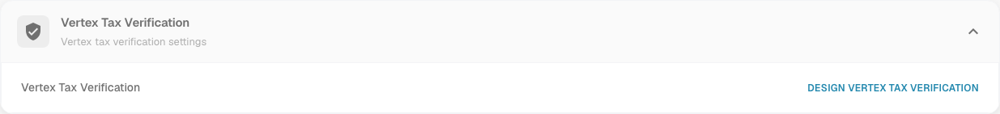
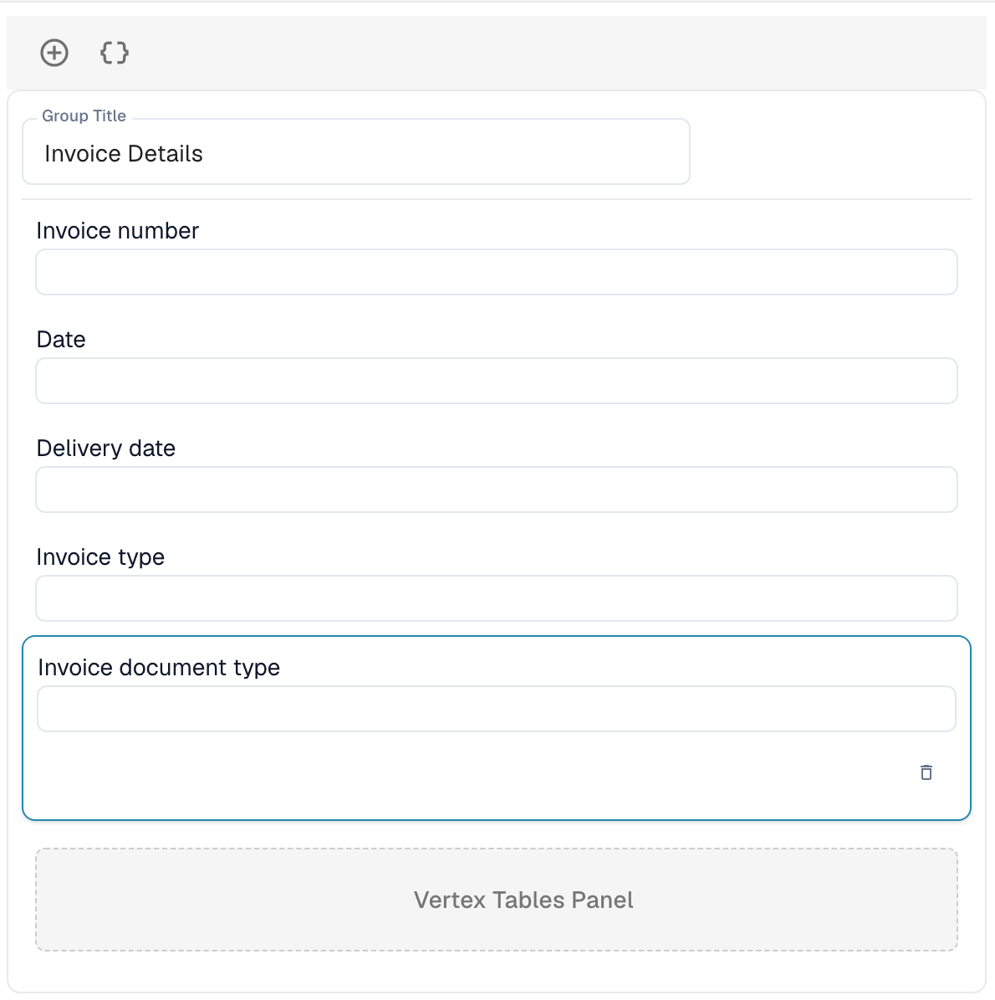

# Vertex Tax Verification

Vertex Tax Verification compares the tax a supplier charged on an invoice with the tax that Vertex calculates for the same lines. DocBits asks Vertex for the calculation, shows both amounts to the user and stops the document when the vendor tax is too high.

## How it works

1. The document reaches the trigger point. You choose it in the module settings: **Before Export** (default) or **Before Approval**.
2. DocBits sends the invoice lines to Vertex and receives the calculated tax.
3. DocBits writes the result back to the document: the **Vertex Tax Amount** and **Vertex Tax Rate** per line, and the header totals **Vendor Tax** (the tax charged on the invoice), **Vertex Tax**, the sub total and the **Variance**.
4. DocBits compares the vendor tax with the Vertex tax:

| Situation | Result |
| --------- | ------ |
| The vendor tax is higher than the Vertex tax by **more than the variance threshold** | The document is rejected. Its status becomes **Vertex Tax Rejected**. |
| The vendor tax is higher, but **within the threshold** | The document is accepted. |
| The vendor tax equals the Vertex tax | The document is accepted. |
| The vendor tax is **lower** than the Vertex tax | The document is accepted and the missing amount is accrued. |

The result message names the amounts, for example: *Rejected: vendor tax $380.00 exceeds Vertex calculated tax $140.00 by $240.00 (171.4%), above configured threshold of $25.00.*

Users open the result from the vertex icon in the dashboard row of the document. The **Vertex Tax Verification** screen shows a banner (**Verification Failed** with the message, or **Verification Successful**), the fields of the layout you designed and the Vertex tables with the tax per line.


The verification only runs for document types that have an export configuration of type **Vertex**. Without one, the document continues without verification.


## Set up the integration

Open **Settings** → **Module** → **Order & Finance** and go to the **Vertex Tax Integration** card. The page also holds the PO matching and auto accounting settings.

<figure><figcaption>
The Vertex Tax Integration card. Tenant and client values are replaced by placeholders in this screenshot.
</figcaption></figure>

1. Switch **Vertex Tax Integration** on. The feature needs the Vertex tax subscription.
2. Enter the **Base URL** of your Vertex token endpoint, your **Client ID** and your **Client Secret**.
3. Click **Test connection**, then **Save**.
4. Set the tolerance and the trigger:
   * **Variance Type:** **Fixed Amount** or **Percentage**.
   * **Variance Threshold:** The deviation that is still accepted. The default is a fixed amount of 25. In percentage mode enter the value as a decimal, for example 0.05 for 5 %.
   * **Verification trigger:** **Before Export** or **Before Approval**. With **Before Approval** the check runs while the document is processed, before it goes to approval. If the check itself fails, the document gets the status **Export Error**.

Then add an export configuration of type **Vertex** for the document type (**Settings** → **Export**). It uses a TOML mapping file.

## Design the verification form

The fields that users see on the verification screen are designed per document type.

1. Open **Settings** → **Document Types**, select the document type and click **More Settings**.
2. Open the **Vertex Tax Verification** card and click **Design Vertex Tax Verification**.

<figure><figcaption>
Current English Invoice More Settings card with Design Vertex Tax Verification.
</figcaption></figure>

The Layout Builder opens with the layout type **Vertex Tax Verification**. Drag groups and fields into the form, for example **Invoice details** with invoice number, date and delivery date. The **Vertex Tables Panel** shows the tax comparison and the line items with the Vertex tax per line. It is part of the layout.

<figure><figcaption>
A Vertex Tax Verification layout with the group Invoice Details and the Vertex Tables Panel.
</figcaption></figure>

For how the Layout Builder works see the [Layout Manager](../layout-manager/README.md).
