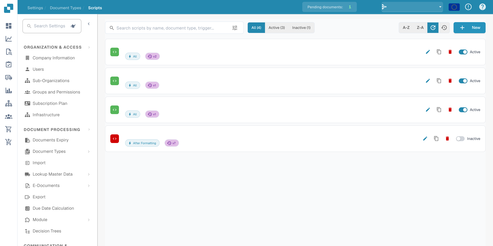
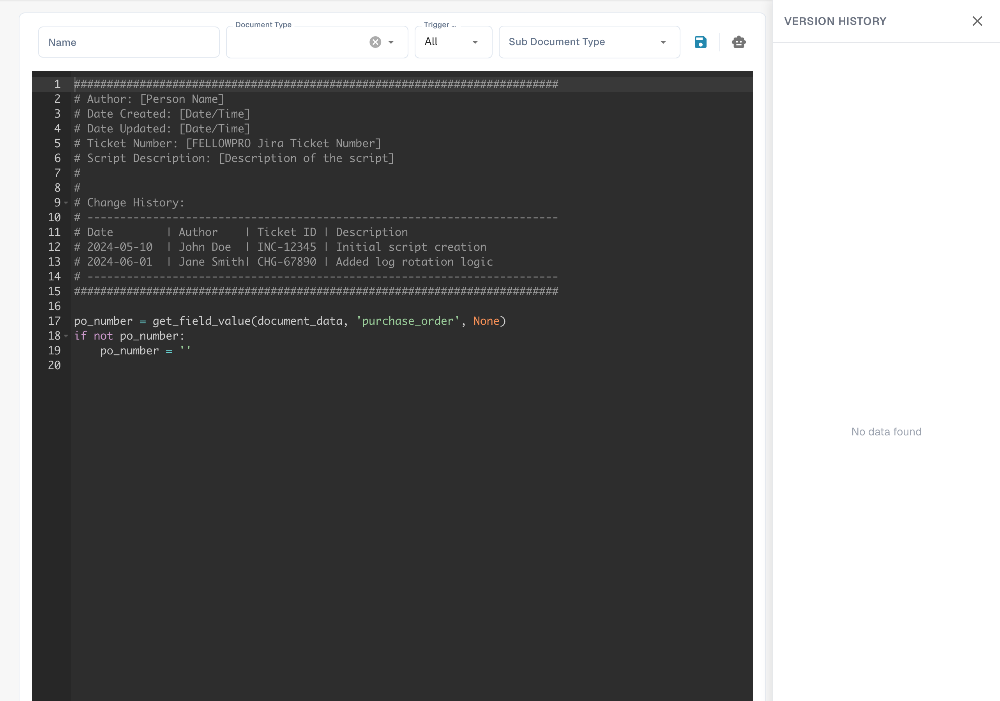

# Creating and Editing Scripts


DocBits Document Scripts Explained: Automate Custom Logic in Your Document Workflow


## To create a new script in DocBits, follow these detailed instructions:

**Choose the scripting language:**

Choose a script type and language actually offered by the editor and runtime in your DocBits installation. Available types and execution contexts depend on the deployed version.

**Open the script development environment:**

Log in to DocBits and navigate to the script development environment. This is in the administration area.

<figure><figcaption><p>Script list with names, dates and organization data hidden.</p></figcaption></figure>

**Create a new script:**

Click the "+ New" button to open a new script editor.

<figure><figcaption><p>New script editor with its supplied starter template; this is separate from the standalone Python example below.</p></figcaption></figure>

**Write the code:**

Use the editor to write the code for your script. Start with the basic syntax of your chosen scripting language.

For example, if you are using Python, your script might look like this:

## 1. Example script in Python

## Function to clean patient names

This standalone Python example demonstrates syntax. It is not a verified DocBits lifecycle hook; adapt it to the documented script context before using it.

```python
def clean_patient_name(name):
    cleaned_name = name.strip().title()
    return cleaned_name

if __name__ == "__main__":
    patient_name = " john doe "
    cleaned_name = clean_patient_name(patient_name)
    print("Cleaned patient name:", cleaned_name)
```

**Test the script:**

Check the code for errors and test it in a test environment. Make sure the script produces the expected results and works correctly.

**Save the script:**

Save the script in DocBits and give it a meaningful name that describes the purpose of the script.

**Mapping the script to document types:**

An important step is mapping the script to the appropriate document types. This determines when and how the script is applied. This can usually be done through a configuration interface in DocBits, where you can assign the script to a specific document type and specify under which conditions it should be applied.

**Review and publish:**

After you have created, tested and mapped the script, check it again for errors and inconsistencies. If everything is OK, you can publish the script to the DocBits production environment.

Before deployment, verify the script against the documented execution context and representative test documents. Retain the tested version and check its effect on processing.
