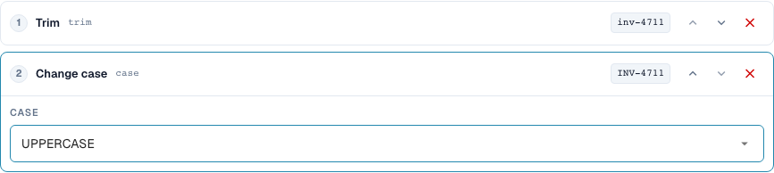
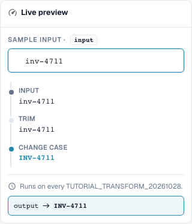
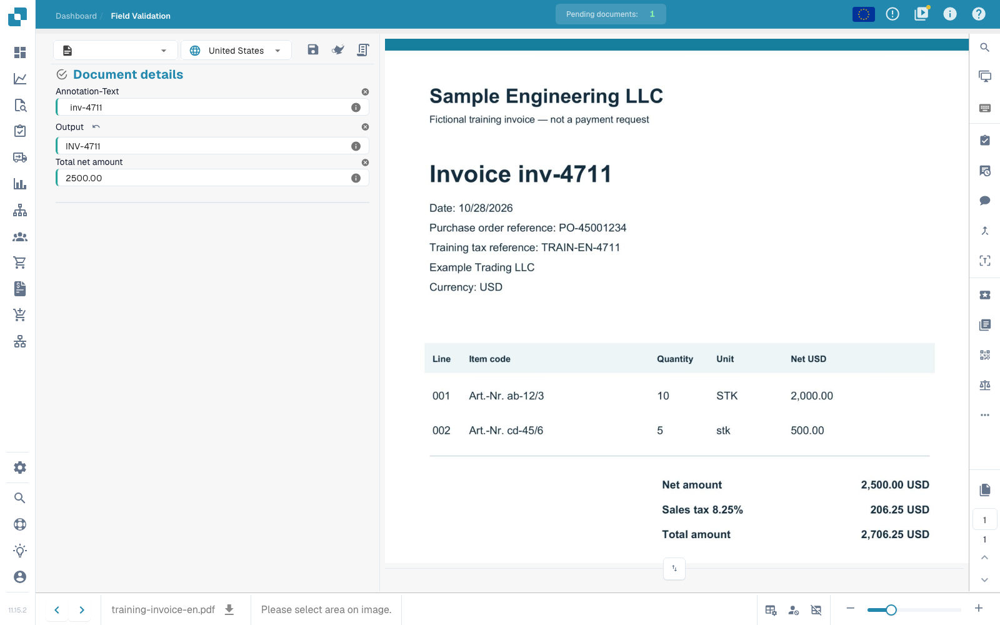

# Basics, Scopes, and Safe Tests

[Back to the full practice overview](complete-practical-guide.md)

Header field · Target Result · Source Original text · Trim → Uppercase → Prefix INV-.

## Procedure in the Editor

1. In the isolated training document type, create a new rule for a **header field**. Select `output` as the target and `header.input` as the separate source; the actual field names in your organization may differ.
2. Add the steps **Trim**, side both, character empty, and then **Change case**, mode upper. The order must be Trim → Uppercase.
3. Enter the test value `  inv-4711  `. The last preview value must read `INV-4711`; the intermediate values first show `inv-4711`.
4. Activate the rule exclusively for the training scope and save. Reopen the entry and check source, target, and both steps.
5. Save the training document, reload it, and check both fields: The source still contains the original spaces; the output reads `INV-4711`. Save again and repeat the same check.

<figure><figcaption>
Step configuration. Actual interface in English (United States). The preview does not change stored documents.
</figcaption></figure>

<figure><figcaption>
Live preview with training values. Actual interface in English (United States). The preview does not change stored documents.
</figcaption></figure>

## 1. Scope

A transformation modifies already extracted data. It does not replace text recognition. In the editor, I first select the scope. A header field is processed once per document. A table column is processed for each row. Table rules change entire line items. Routing assigns the document to a suborganization. These four tasks have different targets and different steps. I create my examples in a separate test document type so that no productive invoices are changed.

## 2. Source and Processing

Then I select the target field. The source can be this field itself or another field. The steps run from top to bottom. Each intermediate value becomes the input for the next step. My example reads an invoice number, removes outer spaces, and writes uppercase letters. A lowercase letter becomes an uppercase one. With a condition, I limit the rule to the matching vendor. For a table column, the condition can also check values of the current row. Multiple conditions can be combined with And, Or, and groups.

## 3. Verify Effect

The live preview does not save anything yet. I check a matching value, a counter-case, and an already corrected result. Then I save the rule, reopen it, and check the saved settings. For the actual document effect, I additionally need a test document, a save operation, and the reloaded result. A preview proves neither a completed export nor a successful purchase order match. Execution logs help me distinguish between applied and skipped conditions. In the next episodes, we will go through the individual transformations and their limits.

## Tested Examples and Counter-Cases

These values were checked server-side as a dry test. Such a test does not change saved documents.

| Case | Input | Server Result |
| --- | --- | --- |
| copy | `  po-4711  ` | `PO-4711` |

## Acceptance

Check a matching case, a counter-case, an empty value, and an already processed result. Repeat the document save operation. Check PO matching and ERP receipt additionally if they belong to the business objective.

## Saved Effect on the Training Document

<figure><figcaption>
The prepared original value is retained; output shows INV-4711. Two native save operations, reloading, and a separate server query confirm the stable result. This proves the rule effect on prepared test values, not the accuracy of an automatic extraction.
</figcaption></figure>

## Video tutorial


Configuration, worked examples and counterexamples.


[Open the video with English captions and chapters](https://docbits-videos.fra1.cdn.digitaloceanspaces.com/settings-assistant/transformation-rules-01-foundations-preview-admin/v1/en.html). This review version is awaiting the subject-matter and complete listening review.
