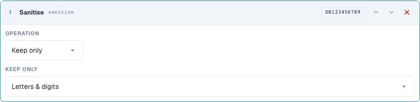
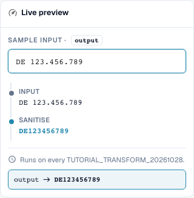

# Clean Text: Case, Trim, and Characters

[Back to the full practical overview](complete-practical-guide.md)

Header field · Target result · Test steps individually: case, trim, sanitize.

## Procedure in the Editor

1. Create a single step **Change case** for the training header field. Verify the modes upper, lower, title and capitalize in sequence using the table examples.
2. For the invoice number, start a new pipeline with **Trim**. Both sides and an empty character field remove outer whitespace; `47 11` must retain its inner space.
3. As a separate counter-test when trimming, set Side left and Character `0`: `004711` becomes `4711`, `000` becomes empty. Do not apply this step unchecked to real identifiers.
4. For a tax identifier, use **Sanitise** with keep set to alphanumeric. `DE 123.456.789` must yield `DE123456789`. Check the other keep modes with `DE-123` and `ACME GmbH!` respectively.
5. For capitalize, explicitly compare preview and server: For the tested `aCME GMBH`, these results differ. The server result is `Acme gmbh`; a matching browser display alone is not sufficient.

<figure><figcaption>
Step configuration. Actual interface in English (United States). The preview does not change stored documents.
</figcaption></figure>

<figure><figcaption>
Live preview with training values. Actual interface in English (United States). The preview does not change stored documents.
</figcaption></figure>

## 1. Case

Uppercase unifies, for example, an invoice number. Lowercase can unify a technical comparison key. Title Case and capitalizing the first character can also change the rest of the word. A company abbreviation can therefore become a different spelling. For proper names, I use these variants only with a clear business requirement. In the Capitalise first mode there is a discrepancy in the tested state: The browser preview leaves the remaining spelling unchanged, while the server lowercases the rest. Therefore, I do not rely on the preview alone here, but explicitly compare the server value.

## 2. Trim

Trim removes characters at the edge. Both sides removes outer whitespace, but no whitespace in the middle of a number. Left with the character zero removes all leading zeros. A value consisting only of zeros becomes empty as a result. Right works correspondingly at the end. The Character field is a set of individual characters and not a complete prefix. I therefore remove a fixed item prefix with Affix. We cover padding and truncation in the next installment.

## 3. Sanitize Characters

When sanitizing, I can keep only letters and digits, only letters, only digits, or additionally spaces. A German tax identifier with spaces and periods thus becomes a contiguous key. In an item number, however, hyphens can be functionally important. Removing such characters must match the spelling in the target system. The alternative character removal works with a regular expression character class. A hyphen requires special attention therein. For my example, I therefore check the actual server value in addition to the preview. Already sanitized values and empty inputs belong in every test.

## Verified Examples and Counter-Cases

These values were verified server-side as a dry test. Such a test does not change saved documents.

| Case | Input | Server Result |
| --- | --- | --- |
| case-upper | `inv-4711` | `INV-4711` |
| case-upper | `INV-4711` | `INV-4711` |
| case-lower | `INFO@BEISPIEL.DE` | `info@beispiel.de` |
| case-title | `acme gmbh` | `Acme Gmbh` |
| case-capitalize | `aCME GMBH` | `Acme gmbh` |
| trim | `  4711  ` | `4711` |
| trim | `47 11` | `47 11` |
| trim-zero | `004711` | `4711` |
| trim-zero | `000` | `` |
| sanitize | `DE 123.456.789` | `DE123456789` |
| sanitize-alpha | `DE-123` | `DE` |
| sanitize-numeric | `DE-123` | `123` |
| sanitize-space | `ACME GmbH!` | `ACME GmbH` |
| sanitize-strip | `ab-12/3.` | `ab123` |

## Acceptance

Check a matching case, a counter-case, an empty value, and an already processed result. Repeat the document save operation. Check PO matching and ERP receipt additionally if they belong to the business objective.

## Video tutorial


Configuration, worked examples and counterexamples.


[Open the video with English captions and chapters](https://docbits-videos.fra1.cdn.digitaloceanspaces.com/settings-assistant/transformation-rules-02-text-cleaning-preview-admin/v1/en.html). This review version is awaiting the subject-matter and complete listening review.
