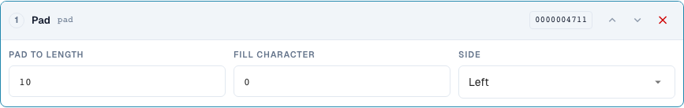
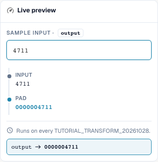

# Shaping Numbers: Padding, Truncating, Prefix and Suffix

> Known preview limitation (checked on 29 October 2026, version 11.15.2): when adding the prefix `INV-`, the preview incorrectly changes `INV-4711` to `INV-INV-4711`. The independently checked server test retains `INV-4711`. Check repeated execution with a server test as well; a correct preview result alone does not prove the complete save-time execution.

[Back to the full practice overview](complete-practical-guide.md)

Header field · pad: length 10, character 0, left; truncate: length 10; affix: exact prefix/suffix operation.

## Procedure in the Editor

1. Select the padding step for the number. Set minimum length 10, fill character `0`, and side left. `4711` must become `0000004711`.
2. Verify with an already eleven-digit input: padding must not truncate anything. For right-side additions, separately test length 6, character `_` and input `ABC`.
3. In a separate rule, configure **Truncate** with maximum length 10. `ABCDEFGHIJKL` becomes `ABCDEFGHIJ`, `ABC` remains preserved. Check whether different inputs could result in the same identifier.
4. Test **Affix** with add prefix `INV-`. Then check `INV-4711` as input: the exact existing prefix must not be added again.
5. Configure the other affix variants separately: add suffix `-DE`, remove prefix `Art.-Nr. ` and remove suffix ` EUR`. When removing, also test a non-matching edge and differing capitalization.
6. Use the output again as input. Especially when removing multiply occurring affixes, a second pass can alter further.

<figure><figcaption>
Step configuration. Actual interface in English (United States). The preview does not change stored documents.
</figcaption></figure>

<figure><figcaption>
Live preview with training values. Actual interface in English (United States). The preview does not change stored documents.
</figcaption></figure>

## 1. Length

Padding adds a single fill character to the left or right until the minimum length is reached. With ten positions and zero on the left, a four-digit number becomes a ten-digit identifier. A number that is already longer remains longer. Padding is therefore not a length check. Truncating, on the other hand, keeps only the first characters up to the selected maximum length. This information is lost. Before an ERP deployment, I check whether different numbers could become identical after truncating. Short values remain unchanged.

## 2. Prefix and Suffix

The following affix results describe the verified server execution.

Affix offers four variants: add prefix, add suffix, remove prefix and remove suffix. An added prefix is not added again if the value already begins with exactly that prefix. The same applies to a suffix. Remove, on the other hand, checks exactly the beginning or the end. Deviating capitalization is not automatically equated. If the text stands in the middle of the value, it is preserved. For arbitrary occurrences I use Find and Replace.

## 3. Reapplication

Even a simple pipeline needs a repetition test. If I remove a prefix from a doubly prepended prefix, one remains after the first pass. On the next pass, this one too would disappear. Therefore I check the entire rule and not only each step individually. The typical invoice number pipeline is: Trim, uppercase, add prefix. I test a raw number, an already finished number and a deviating supplier. The condition ensures that only the agreed case is changed.

## Verified Examples and Counterexamples

These values were checked server-side as a dry test. Such a test does not change saved documents.

| Case | Input | Server result |
| --- | --- | --- |
| pad | `4711` | `0000004711` |
| pad | `12345678901` | `12345678901` |
| pad-right | `ABC` | `ABC___` |
| truncate | `ABCDEFGHIJKL` | `ABCDEFGHIJ` |
| truncate | `ABC` | `ABC` |
| prefix-add | `4711` | `INV-4711` |
| prefix-add | `INV-4711` | `INV-4711` |
| suffix-add | `4711` | `4711-DE` |
| suffix-add | `4711-DE` | `4711-DE` |
| prefix-strip | `Art.-Nr. 4711` | `4711` |
| prefix-strip | `ART.-NR. 4711` | `ART.-NR. 4711` |
| prefix-strip | `Art.-Nr. Art.-Nr. 4711` | `Art.-Nr. 4711` |
| suffix-strip | `123 EUR` | `123` |
| suffix-strip | `123 EUR netto` | `123 EUR netto` |

## Acceptance

Check a matching case, a counterexample, an empty value and an already processed result. Repeat the document save operation. Check PO matching and ERP receipt additionally if they belong to the business objective.

## Video tutorial


Configuration, worked examples and counterexamples.


[Open the video with English captions and chapters](https://docbits-videos.fra1.cdn.digitaloceanspaces.com/settings-assistant/transformation-rules-03-numbers-and-affixes-preview-admin/v1/en.html). This review version is awaiting the subject-matter and complete listening review.
