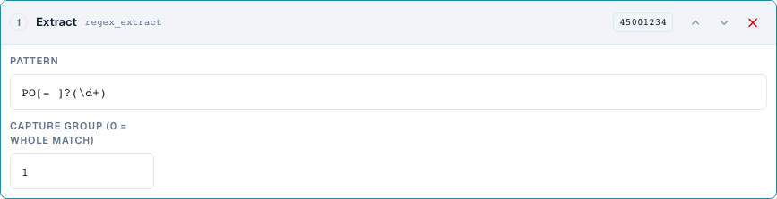
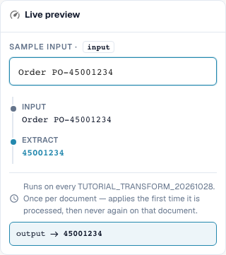

# Substrings and Patterns: Cut, Extract, Replace

[Back to the full practical overview](complete-practical-guide.md)

Header field · Source field header.input · Target output · regex_extract: PO[- ]?(\d+), Group 1. Source and target remain separate.

## Procedure in the Editor

1. For all three steps, choose a target such as `output` and a **separate original source** such as `header.input`. Even "one-time execution per document" does not permit a self-source.
2. For **Take a slice**, first set Start 0 and Length 4: `2026-10-28` yields `2026`. Then test Start 3 and End 7 with `DE-4711-X`; the end is exclusive.
3. As your own variant, test Start −4 without length/end: `INV-4711` yields `4711`. A shorter input is a necessary negative case.
4. For **Extract**, use pattern `PO[- ]?(\d+)` and capture group 1. `Order PO-45001234` yields `45001234`; `Invoice 4711` yields empty. Group 0 returns the entire match, by contrast.
5. For **Find & replace**, configure pattern `\s+`, replacement one space, and count 0. `ACME    GmbH` must yield `ACME GmbH`. Then test pattern `-`, replacement `/`, count 1 with `AB-CD-EF`: Only the first hyphen is replaced.
6. Also test the concrete patterns server-side. A successful browser pattern alone does not demonstrate identical server processing for complex expressions.

<figure><figcaption>
Step configuration. Actual interface in English (United States). The preview does not change stored documents.
</figcaption></figure>

<figure><figcaption>
Live preview with training values. Actual interface in English (United States). The preview does not change stored documents.
</figcaption></figure>

## 1. Substring

A substring is defined by start and length or by start and end. The index is zero-based. The end is exclusive. A negative start counts from the right edge. For the last four characters, I use a start of minus four and no end. I choose a source field other than the target. This way, each run reads the original text again. The server rejects these steps on its own target field because the value could otherwise be changed further with each reprocessing. One-time execution does not replace this separate source field here.

## 2. Extract

Extract searches for the first match of a regular expression. My pattern recognizes the letters P and O, optionally a hyphen or a space, and then digits. Group one returns only the digits, group zero the full match. With no match, an empty string is returned. Therefore, I set a suitable condition or deliberately check whether an empty target value is desired in this case. Multiple order numbers in a text are not automatically turned into multiple results.

## 3. Replace

Find and Replace processes matches of a pattern. With a count of zero, all matches are replaced. One changes only the first match. I can replace multiple spaces with a single space. Here, too, I use a separate original source field. The preview in the browser and the processing on the server may use different rules for complex regular expressions. Therefore, I test simple patterns first and then compare the actual server value. A matching case, no match, and multiple matches form my minimum check.

## Verified Examples and Negative Cases

These values were verified server-side as a dry test. Such a test does not modify saved documents.

| Case | Input | Server Result |
| --- | --- | --- |
| substring | `2026-10-28` | `2026` |
| substring | `AB` | `AB` |
| substring-end | `DE-4711-X` | `4711` |
| substring-negative | `INV-4711` | `4711` |
| regex-extract | `Order PO-45001234` | `45001234` |
| regex-extract | `Invoice 4711` | `` |
| regex-replace | `ACME    GmbH` | `ACME GmbH` |
| regex-count | `AB-CD-EF` | `AB/CD-EF` |

## Acceptance

Check a matching case, a negative case, an empty value, and an already processed result. Repeat the document save operation. Also check PO matching and ERP receipt if they belong to the business objective.

## Video tutorial


Configuration, worked examples and counterexamples.


[Open the video with English captions and chapters](https://docbits-videos.fra1.cdn.digitaloceanspaces.com/settings-assistant/transformation-rules-04-substrings-and-patterns-preview-admin/v1/en.html). This review version is awaiting the subject-matter and complete listening review.
