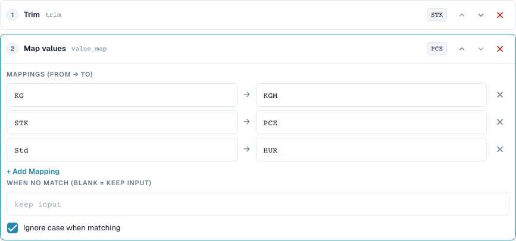
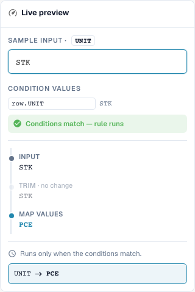

# Value Mappings and Rules per Table Row

[Back to the full practice overview](complete-practical-guide.md)

Table column UNIT · Trim → value_map: STK→PCE, KG→KGM, Std→HUR · Ignore case.

## Procedure in the Editor

1. Select scope **Table column**, table `INVOICE_TABLE` and target column `UNIT`. Here each table row is processed individually.
2. Place **Trim** before **Map values**. Enter pairs `STK→PCE`, `KG→KGM` and `Std→HUR` and enable ignore case.
3. Leave the field for replacement without match empty so that unknown codes are retained. `stk` must yield `PCE`, `BOX` must remain `BOX`.
4. Check a preview with a matching row condition and with a non-matching condition. The condition must not unintentionally capture the other rows.
5. Prepare initial values `STK`, `STK`, `BOX` for a real multi-row test. In the checked server test, `PCE`, `PCE`, `BOX` are produced; quantity and price remain to be checked separately from a functional perspective.
6. Check each target code again as input. A blanket replacement such as `C62` and chained mappings can conceal unknown values or change them further in subsequent runs.

<figure><figcaption>
Step configuration. Actual interface in English (United States). The preview does not change stored documents.
</figcaption></figure>

<figure><figcaption>
Live preview with training values. Actual interface in English (United States). The preview does not change stored documents.
</figcaption></figure>

## 1. Value Pairs

A value mapping translates entire input values. My example assigns Piece to code P C E, Kilogram to code K G M, and Hours to code H U R. I enter the actual supplier codes and the expected target codes as pairs. With case ignored, a lowercase-written code is also recognized. This does not yet remove spaces. Therefore I place a trim step before the mapping. I explicitly test an unknown code.

## 2. No Match

An empty field for the value without match means: keep input. It does not mean: delete input. A fixed replacement value, on the other hand, replaces every unknown code. This can conceal errors. For functionally different units, I would not assign a blanket replacement code. A mapping is also not automatically idempotent in every combination. If the output of one pair is simultaneously the input of another pair, a subsequent run can map further. Therefore I also test each target code as new input.

## 3. Per Table Row

For tables I select the specific table and the target column. The pipeline then runs for each row. A condition can connect the unit code of the current row with a supplier characteristic from the header. In the example, two matching rows are changed while an unknown unit code is retained. This does not change quantities or prices through a unit conversion. Renaming a string is not a mathematical conversion. I check the actual purchase order matching and an export separately from the transformation.

## Checked Examples and Counterexamples

These values were checked server-side as a dry test. Such a test does not change saved documents.

| Case | Input | Server result |
| --- | --- | --- |
| map | `stk` | `PCE` |
| map | `PCE` | `PCE` |
| map | `BOX` | `BOX` |
| map-fallback | `BOX` | `C62` |
| item-pipeline | `Art.-Nr. ab-12/3` | `AB123` |

## Acceptance

Check a matching case, a counterexample, an empty value, and an already processed result. Repeat the document save operation. Check PO matching and ERP receipt additionally if they belong to the business objective.

## Video tutorial


Configuration, worked examples and counterexamples.


[Open the video with English captions and chapters](https://docbits-videos.fra1.cdn.digitaloceanspaces.com/settings-assistant/transformation-rules-05-value-mapping-preview-admin/v1/en.html). This review version is awaiting the subject-matter and complete listening review.
