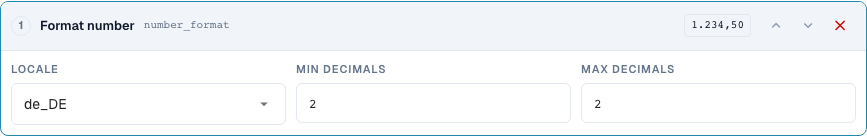
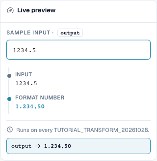

# Formatting Dates and Numbers Correctly

[Back to the full practical overview](complete-practical-guide.md)

Text target · date_format: %d.%m.%Y; number_format: de_DE, min. 2, max. 2 decimal places.

## Procedure in the Editor

1. For a clearly readable first attempt, use a **text target** and the step **Reformat date**. Set output pattern `%d.%m.%Y` and input `2026-10-28`; `28.10.2026` is expected.
2. Compare the variants `%m/%d/%Y`, `%Y-%m-%d`, and `%d %b %Y` each with the same unambiguous input. The patterns do not reliably detect every arbitrary date format.
3. Verify with `kein Datum` and an ambiguous input. For an actual DATE header field, additionally check the stored ISO value and the visible display separately.
4. In a separate rule **Format number**, select locale `de_DE`, minimum and maximum decimal places both 2. The server input `1234.5` must yield `1234,50`.
5. Check the same input with `en_US`: server result `1234.50`. The thousands separator of the verified browser preview is not written on the server side.
6. Check zero, a negative amount, and additional decimal places. Then reprocess the output and verify the actually stored value.

<figure><figcaption>
Step configuration. Actual interface in English (United States). The preview does not change stored documents.
</figcaption></figure>

<figure><figcaption>
Live preview with training values. Actual interface in English (United States). The preview does not change stored documents. The visible thousands separator belongs to the browser preview; the verified server result is 1234,50.
</figcaption></figure>

## 1. Date and Data Type

Formatting a date writes a date according to the selected pattern. An unambiguous ISO date is good test input. Day, month, and year can be output with periods, for example. For an actual date header field, the internal value can remain in ISO format while the display changes. A text field or a table cell, on the other hand, can contain the formatted text. Therefore, I compare not only the visible field but also the stored value and subsequent use.

## 2. Illegible and Ambiguous Data

An illegible date is not simply invented. In my server test, the text remains unchanged, and the result states the reason. Ambiguous entries such as day and month with small numbers need an unambiguously agreed context. A formatted date must not be read as a different day on the next save. Therefore, I verify a second pass. This transformation cannot make a reliable date from arbitrary text without a valid date.

## 3. Number Format

Format number uses a locale and a minimum as well as maximum number of decimal places. This changes the display and possibly rounding, but not an exchange rate and not a unit of measure. For my input one thousand two hundred thirty-four point five, the current server with two decimal places yields German comma notation or English dot notation. A thousands separator is not contained in the verified server result. Therefore, I do not adopt any prettier browser display as proof for export. Zero, negative amounts, additional decimal places, and the stored result value need their own tests.

## Verified Examples and Counterexamples

These values were verified on the server side as a dry test. Such a test does not change stored documents.

| Case | Input | Server result |
| --- | --- | --- |
| date | `2026-10-28` | `28.10.2026` |
| date | `kein Datum` | `kein Datum` |
| number-de | `1234.5` | `1234,50` |
| number-us | `1234.5` | `1234.50` |

## Acceptance

Check a matching case, a counterexample, an empty value, and an already processed result. Repeat the document save operation. Check PO matching and ERP receipt additionally if they belong to the business objective.

In the verified state, number preview and server differ with regard to the thousands separator. The table gives the actual server value.

## Video tutorial


Configuration, worked examples and counterexamples.


[Open the video with English captions and chapters](https://docbits-videos.fra1.cdn.digitaloceanspaces.com/settings-assistant/transformation-rules-06-dates-and-numbers-preview-admin/v1/en.html). This review version is awaiting the subject-matter and complete listening review.
