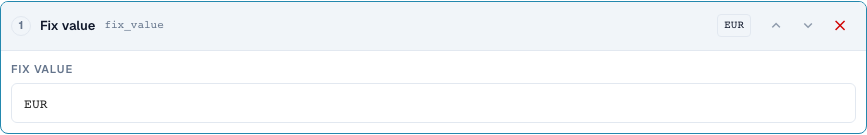
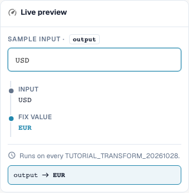
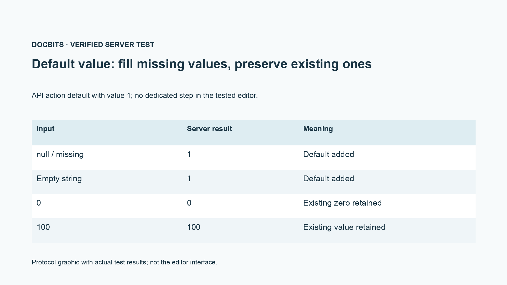

# Adopt Fields, Fixed Values, Clearing, and Default Values

[Back to full practice overview](complete-practical-guide.md)

Target result · Source original text for field adoption; fixed value only under strict condition; clearing tested separately.

## Procedure in the Editor

1. For a **field adoption**, choose a different source field than the target field. Within the exercise scope, the target is `output`, the source `header.input`.
2. Configure the steps Trim → Uppercase and test `  po-4711  `. The output will be `PO-4711`; the original source must not be cleared in the process.
3. For a productive purchase order number, use an additional condition that only applies when the target is empty. Test an already existing correct target value as a counter-case.
4. In a separate rule, create a **fixed value** with `EUR`. Even an input `USD` will be overwritten by this; this is not a currency conversion.
5. Verify **Clear** separately with `Altwert`. The output is the empty string. Note the business difference between intentional clearing and a missing output value.
6. Test the interface step `default` only via the designated API contract; in the tested normal step menu, there is no separate entry for it. The protocol graph shows: missing and empty are supplemented, `0` and `100` are retained.

<figure><figcaption>
Step configuration. Actual interface in English (United States). The preview does not change stored documents.
</figcaption></figure>

<figure><figcaption>
Live preview with training values. Actual interface in English (United States). The preview does not change stored documents.
</figcaption></figure>

## 1. Field Adoption

For a field adoption, I first select the target field and then a different source. If the purchase order number is in the wrong field, I can read it from that field, trim it, and save it in the correct target field. A condition target is empty protects an already existing purchase order number. The source remains intact. This is a copy with processing, not a move. I verify an empty target, an already populated target, and an empty source.

## 2. Fixed Value and Clearing

A fixed value ignores the previous content. If I set the currency to Euro, the rule also overwrites an existing different currency. For this I need a strict business condition. Clearing writes an empty string into the target field. It is not a deletion of the entire field or document. In the preview, I primarily check the counter-case so that the rule does not remove valid values. Saving the rule alone does not yet prove a change to a document.

## 3. Default Values

The server interface additionally supports a default value action. It supplements a value only when the input is missing or empty. An existing zero remains zero. This action is not present as a separate step in the tested step selection of the normal editor. In the editor, I can often represent the desired default case with the condition target is empty and a fixed value. I show this distinction openly and do not claim an additional menu item. A default value is always a business decision, especially for price basis, quantity, or currency.

## Verified Examples and Counter-Cases

These values were verified server-side as a dry test. Such a test does not modify saved documents.

| Case | Input | Server Result |
| --- | --- | --- |
| fixed | `USD` | `EUR` |
| fixed | `null` | `EUR` |
| clear | `Altwert` | `` |
| clear | `` | `` |
| default-api | `null` | `1` |
| default-api | `` | `1` |
| default-api | `0` | `0` |
| default-api | `100` | `100` |
| copy | `  po-4711  ` | `PO-4711` |

## Acceptance

Verify a matching case, a counter-case, an empty value, and an already processed result. Repeat the document save operation. Additionally verify PO matching and ERP receipt if they belong to the business objective.

<figure><figcaption>
Actual server and persistence test results shown as a protocol graphic. This is not a recreated editor interface.
</figcaption></figure>

## Video tutorial


Configuration, worked examples and counterexamples.


[Open the video with English captions and chapters](https://docbits-videos.fra1.cdn.digitaloceanspaces.com/settings-assistant/transformation-rules-07-field-copy-and-defaults-preview-admin/v2/en.html). This review version is awaiting the subject-matter and complete listening review.
