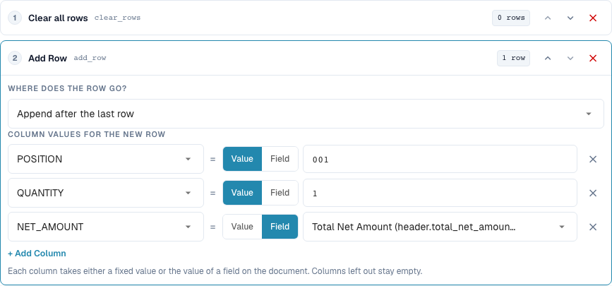
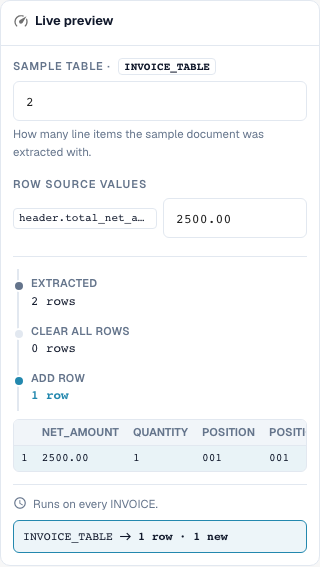

# Rebuilding Table Rows

[Back to full practice overview](complete-practical-guide.md)

Table INVOICE_TABLE · clear_rows → add_row at end · POSITION=001, QUANTITY=1, NET_AMOUNT from header.total_net_amount.

## Procedure in the Editor

1. Select scope **Table rows** and the specific table `INVOICE_TABLE`. A suitable supplier condition limits the complete rebuild.
2. First configure **Clear all rows**, then configure **Add row**. For the new row, set fixed values `POSITION=001`, `QUANTITY=1` and for `NET_AMOUNT` the source `header.total_net_amount`.
3. Test with a header amount `2500.00` and two existing rows: Exactly the newly defined total row remains. Also check for a missing header amount before the rule becomes active.
4. When adding, compare the position before the first row versus after the last row. For this position test, remove the prior deletion or test separately, otherwise there is no existing row as reference.
5. Deliberately check the reversed step sequence **Add → Delete** as a negative case: The result is empty. Then restore the intended sequence.
6. Check saving twice. Adding without prior deletion can multiply rows; a rebuild can irretrievably remove supplier positions from the work result. Verify the purchase order matching separately.

<figure><figcaption>
Step configuration. Actual interface in English (United States). The preview does not change stored documents.
</figcaption></figure>

<figure><figcaption>
Live preview with training values. Actual interface in English (United States). The preview does not change stored documents.
</figcaption></figure>

## 1. Building Rows

Delete all rows removes the existing rows of the selected table. Add row subsequently builds a new row. For each column I choose either a fixed value or the value of a header field. In my example, a total line item is created with quantity one and a net amount from the invoice header. Unfilled columns remain empty. The new row can be at the beginning or at the end. This is not an automatic grouping or summation of selected existing line items.

## 2. Step Sequence

The sequence is decisive. Delete and then add yields the desired new row. Add and then delete removes even the just-generated row. Without preceding deletion, another pass would append yet another row. For this the rule requires a suitable one-time execution. A preview with a row count checks the structure, but does not yet replace a test with a real extracted table. I check the column values and the row count after saving.

## 3. Check Purchase Order Matching Separately

A table rule runs before the column rules. A subsequent column rule can therefore also clean up newly added rows. Rebuilding line items can change existing row identifiers and purchase order assignments. For an invoice that is deliberately matched to the total amount, I additionally need the suitable purchase order matching rule. The transformation alone does not confirm complete matching. I test this only with an isolated document and check the row count and matching status separately after saving again.

## Acceptance

Check a suitable case, a negative case, an empty value, and an already processed result. Repeat the document save operation. Check PO matching and ERP receipt additionally if they belong to the business objective.

## Video tutorial


Configuration, worked examples and counterexamples.


[Open the video with English captions and chapters](https://docbits-videos.fra1.cdn.digitaloceanspaces.com/settings-assistant/transformation-rules-08-table-rows-preview-admin/v1/en.html). This review version is awaiting the subject-matter and complete listening review.
