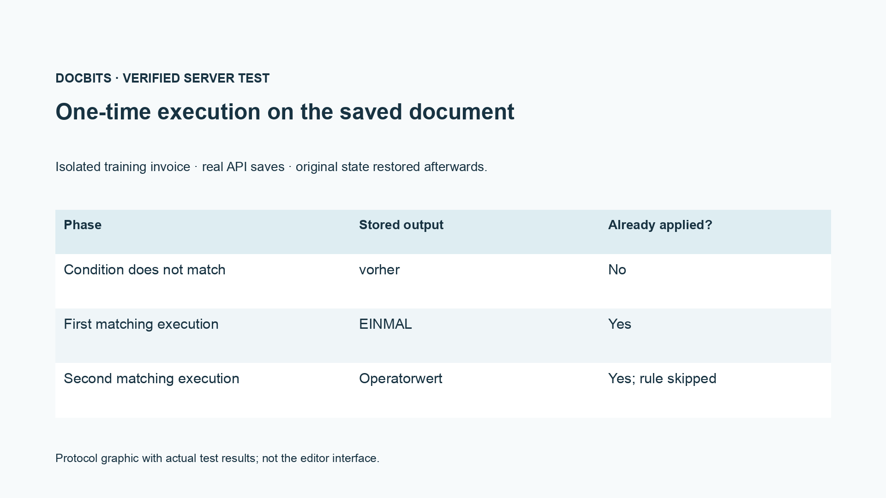
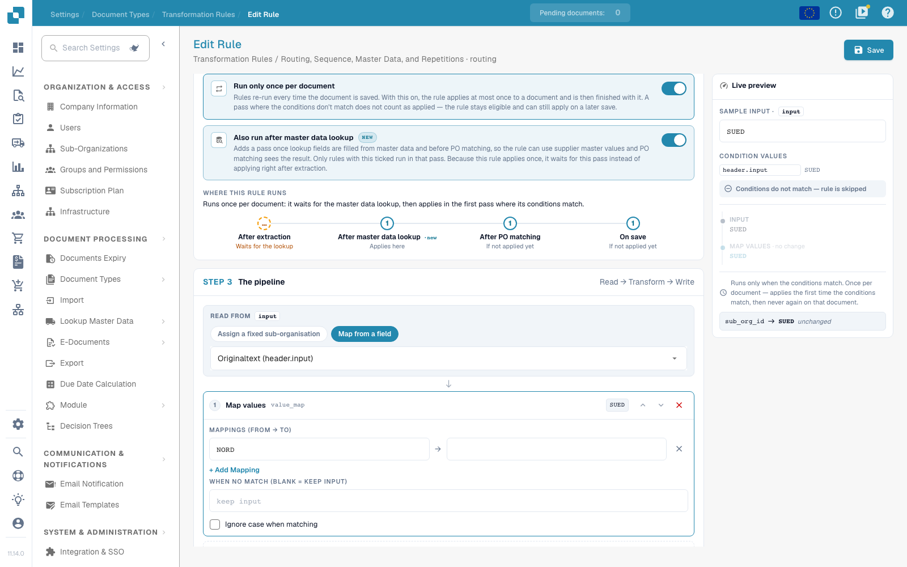

# Routing, Sequence, Master Data, and Repetitions

[Back to the full practice overview](complete-practical-guide.md)

Routing · Target Suborganization · use existing target; check conditions, execution phases, and repetition separately.

In the video recording, the name and internal identifier of the existing routing target are hidden. For your own configuration, the target must come from the actually available suborganization selection.

## Procedure in the Editor

1. For **Routing**, select the offered document attribute `sub_org_id`. Use exclusively an actually existing suborganization as a fixed target or as the result of a value mapping.
2. Add a suitable supplier or identifier condition. In the exercise example, `NORD` must satisfy the condition and `SUED` must skip it. The recording shows only the preview and does not move any productive documents.
3. Compare the phase display with the sequence Header field → Routing → Table rows → Table column. Priority and rule key order only within the same scope.
4. Enable **Also run after master data lookup** and note the additional phase before the purchase order matching. A source that only comes from master data requires a suitable pass.
5. Check **Run only once per document** first with a non-matching condition, then execute matching for the first time. In the verified training case, the first skipped pass does not consume the application.
6. After the first matching application, insert an operator value and save again. The test must show that the one-time rule does not overwrite this value again; check condition, result, phase, and application proof in the log.

## 1. Suborganization

Routing currently writes the document's suborganization. I can set a fixed target from the available selection or map a source value to a suborganization. A suitable supplier condition limits the assignment. This is neither a user authorization nor an approval decision. I use only valid existing suborganizations and check the opposite case. In this episode, the routing example remains a preview; it does not move any productive documents.

## 2. Execution Phases

The scopes run in the sequence header field, routing, table rows, and table column. Within a scope, priority and rule key apply. A cleansed header source can therefore already be read by routing. With the additional execution after the master data lookup, a rule can use values that are only supplemented from master data. This option adds a pass before the purchase order matching. It does not move all other executions there.

## 3. One-Time Rules and Proof

Execute only once per document limits an actually applied rule. A non-satisfied condition does not yet consume this execution. Together with the lookup option, the rule waits during the first extraction pass for the later phase. For substrings and regular expressions, the separate source remains required nonetheless. I check a first-time application, a non-matching case, and a repeated save. In the log, I look for condition, result, and execution phase. Only a newly loaded document proves the stored effect. An ERP receipt and a purchase order matching each require their own proof.

## Acceptance

Check a matching case, an opposite case, an empty value, and an already processed result. Repeat the document save operation. Check PO matching and ERP receipt additionally if they belong to the business objective.

<figure><figcaption>
Actual server and persistence test results shown as a protocol graphic. This is not a recreated editor interface.
</figcaption></figure>

In the saved integration test, a non-matching condition did not consume the one-time execution. Upon the first matching save, EINMAL was written. Upon the second matching save, the prepared operator value remained preserved, and the stored application proof was still set. The test document was subsequently restored. The dry server test can still calculate a hypothetical result; therefore additionally check its note `already_applied` and the actually saved document.

<figure><figcaption>
One-time execution and the additional lookup phase in the actual editor. The non-matching sample condition is skipped; internal routing target identifiers are hidden. These options are an unsaved preview.
</figcaption></figure>

## Video tutorial


Configuration, worked examples and counterexamples.


[Open the video with English captions and chapters](https://docbits-videos.fra1.cdn.digitaloceanspaces.com/settings-assistant/transformation-rules-09-routing-and-execution-preview-admin/v1/en.html). This review version is awaiting the subject-matter and complete listening review.
