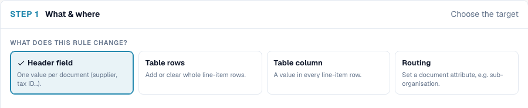

# Transformation Rules: Complete Practical Overview

Transformation rules change values that DocBits has already extracted. Use them to clean a reference number, standardize item or unit codes, copy a value into another field, rebuild table rows, or assign a document to an existing sub-organization.

Start with the result you need, choose the right scope, and then configure the source, conditions, and steps. The examples below use synthetic training values reviewed on **28 October 2026 in Dev NOVA**. Available controls and behavior depend on your deployed version, document type, and organization configuration.

**For your first rule:** read sections 1–2, then follow Recipe 1 in section 4. Use section 3 as a reference when choosing an operation.

**A preview is a first check.** It does not prove that a document was saved correctly, that a purchase order matched, or that an ERP received an export. Test the saved result as well.

## 1. Understand the four scopes

In **Step 1 — What & where**, choose what the rule changes:

| Scope | What it changes | Typical use |
| --- | --- | --- |
| **Header field** | One header value per document | Clean an invoice number or fill a purchase order number |
| **Table rows** | The entire selected table | Remove existing rows or add a defined row |
| **Table column** | One column in each row of the selected table | Standardize every line's item number or unit code |
| **Routing** | The document's `sub_org_id` attribute | Assign an existing sub-organization |

<figure><figcaption>
Step 1 in the English editor: choose Header field, Table rows, Table column or Routing. Header field is selected in this training example.
</figcaption></figure>

These scopes execute in this order:

**Header field → Routing → Table rows → Table column**

Within a scope, priority and rule key determine rule order. Within a rule, the steps run from top to bottom. Each step receives the previous step's result, and a later rule can read values that an earlier rule changed. Changing one rule's priority does not reverse the order of the four scopes.

### When rules run

Rules can run during processing and again when a document is saved. The processing relationship is:

1. DocBits reads and extracts the document.
2. The regular transformation pass runs.
3. Master data lookup fills available values.
4. Rules configured for **Also run after master data lookup** get an additional pass before PO matching.
5. Purchase order matching and validation continue.
6. A later **Save** can run applicable transformation rules again.

This is a guide to the relevant phases, not a promise that every save repeats the whole processing pipeline. The after-lookup pass is optional; the other regular passes still exist. Combined with one-time execution, a configured rule waits for the later phase during the first extraction pass. If that phase does not occur, a later regular pass may apply. Check the editor's phase display and test the deployed version.

## 2. Configure a rule in three steps

### Step 1 — Choose the target

Select the scope and the value to change. A table-column rule needs a table and a column; a table-row rule changes the whole selected table. Routing is limited to the offered sub-organization attribute.

For example, a header rule can write into `purchase_order`. The **target** is where the result goes; the **source** is where its input comes from. Copying a value does not move or erase the source.

### Step 2 — Decide when it runs

Use **Always** for every document of the selected type, or **Only when…** to add conditions. For example, fill a purchase order number only when `header.purchase_order` is empty, so a correct existing number is protected.

Condition contexts are:

- `header.*`: header fields.
- `doc.*`: document attributes.
- `row.*`: the current row, available only for table-column rules.

Combine conditions with nested **AND/OR** groups. A matching example alone is not enough: also test a document or value that should be skipped.

### Step 3 — Build the pipeline

Choose whether to read the target itself or **another field**, then add the transformation steps in order.

Example: target `purchase_order`, source `header.invoice_id`, steps **Trim → Change case: UPPERCASE**. The source value `  po-4711  ` becomes `PO-4711` in the target. The source remains unchanged unless another rule modifies it.

The foundations video uses the isolated training fields `header.input` → `output` to demonstrate this pattern. For your own document type, select the actual source and target fields you need.

**Separate-source requirement:** In the reviewed server contract, `substring`, `regex_extract`, and `regex_replace` must not read their own target. Select another original source field. **Run only once per document** (`run_once`) does not override this requirement.

### Watch the foundations walkthrough

See the four scopes and follow a real Trim → UPPERCASE example, including matching, skipped, and already corrected inputs.


Choose a scope, configure the source and target, and verify the result.


[Open with English captions and chapters](https://docbits-videos.fra1.cdn.digitaloceanspaces.com/settings-assistant/transformation-rules-01-foundations-preview-admin/v2/en.html). This corrected review version is awaiting subject-matter and complete listening review.

## 3. Choose the transformation step

The reviewed editor has **14 value steps** for header fields and table columns, **two table-row steps**, and **one fixed routing assignment**. The API also supports `default`, which is separate from the normal step menu. Use **Ctrl+F / Cmd+F** to find a step or task below, such as “zeros”, “prefix”, “date”, or “unit”.

### Change case (`case`)

Choose **UPPERCASE**, **lowercase**, **Title Case**, or **Capitalise first** (`upper`, `lower`, `title`, `capitalize`).

- UPPERCASE: `inv-4711` → `INV-4711`.
- Title Case: `acme gmbh` → `Acme Gmbh`.
- Capitalise first: the reviewed server changes `aCME GMBH` → `Acme gmbh`.

**Check:** abbreviations and proper names may change undesirably. For `capitalize`, the reviewed browser preview leaves the remaining letters unchanged while the server lowercases them; verify the server value separately.

### Trim (`trim`)

Choose **Both**, **Left**, or **Right**. Leave the characters empty to remove outer whitespace, or specify the characters to remove.

`  4711  ` → `4711`. With Left and `0`, `004711` → `4711`.

**Check:** characters form a set, not a complete word or prefix. Left `0` changes `000` to empty. Internal spaces, such as `47 11`, remain.

### Pad (`pad`)

Set a minimum length, one fill character, and Left or Right.

Length 10, fill `0`, Left: `4711` → `0000004711`. Length 6, fill `_`, Right: `ABC` → `ABC___`.

**Check:** padding never shortens a value. An existing 11-character value stays 11 characters when the minimum is 10.

### Truncate (`truncate`)

Set the maximum length. Length 10 changes `ABCDEFGHIJKL` → `ABCDEFGHIJ`; `ABC` remains `ABC`.

**Check:** the removed part is lost. Different reference numbers can become identical after truncation.

### Affix (`affix`)

Choose **Add prefix**, **Add suffix**, **Strip prefix**, or **Strip suffix**, and enter the text.

Add prefix `INV-`: `4711` → `INV-4711`. The reviewed server does not add an already present exact affix twice. Strip prefix `INV-`: `INV-4711` → `4711`.

**Check:** removal is case-sensitive and acts only at the matching edge. Repeated removal can keep shortening a multiply prefixed value. Test a second run and choose an appropriate one-time rule when needed; it is not a substitute for testing the whole pipeline. The browser's add-prefix discrepancy is recorded under Known limitations below.

### Clean characters (`sanitize`)

Keep **letters and digits**, **letters**, **digits**, or **letters, digits and spaces**. Alternatively, remove a character class.

Keeping letters and digits: `DE 123.456.789` → `DE123456789`. The remove input is a regular-expression character class; protect a hyphen correctly, for example `.\-/`.

**Check:** punctuation can carry meaning. Do not remove characters unless the target system expects that result.

### Take a slice (`substring`)

Set the start index and either a length or an end index. Counting starts at `0`; the end index is excluded. Negative indices count from the end.

Start 3, end 7: `DE-4711-X` → `4711`. Start −4 takes the last four characters.

**Check:** a separate original source is required. The target must not feed its shortened result back into this step.

### Extract (`regex_extract`)

Enter a regular-expression pattern and capture group. Group `0` returns the complete match; group `1` returns the first parenthesized part.

Pattern `PO[- ]?(\d+)`, group 1: `Order PO-45001234` → `45001234`.

**Check:** only the first match is used. No match produces an empty value. A separate source is required; test matching and non-matching inputs.

### Find and replace (`regex_replace`)

Set the pattern, replacement, and count. Count `0` replaces every match; `1` replaces only the first.

Pattern `\s+`, replacement one space: `ACME    GmbH` → `ACME GmbH`.

**Check:** no match leaves the input unchanged. A separate source is required. Compare browser and server results for complex regular expressions, and test inputs with multiple matches.

### Map values (`value_map`)

Add complete From → To pairs, choose whether to ignore case, and set an optional replacement when no pair matches.

With `STK→PCE` and Ignore case, `stk` → `PCE`. With an empty fallback, `BOX` stays `BOX`; fallback `C62` would overwrite it with `C62`.

**Check:** spaces are not trimmed automatically. Add Trim first if needed. Pairs `A→B` and `B→C` can change `A` into `C` across two runs. Test every output code again as an input.

### Reformat date (`date_format`)

Choose an output pattern, for example `%d.%m.%Y`, `%m/%d/%Y`, `%Y-%m-%d`, or `%d %b %Y`.

For a text target, `2026-10-28` → `28.10.2026` with `%d.%m.%Y`.

**Check:** for a DATE header field, the saved value may remain ISO while its displayed format changes. Verify stored and displayed values separately. Unreadable text stays unchanged; the server test states the reason.

### Format number (`number_format`)

Choose a locale (`de_DE`, `en_US`, `en_GB`, or `fr_FR`) and the minimum/maximum decimal places.

With both decimal limits set to **2**, the reviewed server result for `1234.5` is `1234,50` or `1234.50`, depending on locale.

**Check:** the reviewed result has no thousands separator. This is formatting, not a currency or quantity conversion. Test rounding and a second processing pass.

### Fix value (`fix_value` in the editor, `set_value` in the API)

Enter one fixed value. For example, `USD` → `EUR`.

**Check:** this overwrites an existing value; it does not convert an amount between currencies. To fill only empty targets, add the condition **target is empty**.

### Clear (`clear`)

No parameters are needed. The value becomes `""`.

**Check:** this empties the value; it does not delete the field definition or the document.

### Clear all rows (`clear_rows`)

**Table rows only.** Deletes the rows of the selected table: two positions → zero.

**Check:** this can invalidate row references and an existing purchase order match. Verify downstream matching separately.

### Add row (`add_row`)

**Table rows only.** Insert before the first row or after the last row. For each column, use a fixed value or a header source. For example, quantity `1` and net amount from `header.total_net_amount`.

**Check:** repeated execution can add another row on every save. A rebuild usually uses **Clear all rows → Add row**; an intentional append needs suitable one-time execution. This step does not aggregate existing positions automatically.

### Set a sub-organization (`set_value`, Routing)

Choose an existing target from the sub-organization selection. For example, supplier A → sub-organization North. Routing can alternatively use `value_map` and a source value.

**Check:** the supported attribute is `sub_org_id`. Routing cannot assign arbitrary document statuses, users, or permissions.

### API default values (`default`)

This is **not a dedicated step in the reviewed standard editor**. The API's `default` fills missing or empty input only. With default `1`:

| Input | Server result |
| --- | --- |
| `null` | `1` |
| `""` | `1` |
| `0` | `0` |
| `100` | `100` |

A simple editor equivalent can often use **target is empty → Fix value**. That is a condition with assignment, not a hidden default menu item. Existing numeric zero stays zero.

## 4. Try a complete recipe

### Recipe 1 — Fill a missing purchase order reference

1. Choose **Header field**, target `purchase_order`.
2. Add the condition **`header.purchase_order` is empty**.
3. Read from `header.invoice_id`.
4. Add **Trim → Change case: UPPERCASE**.
5. Test `  po-4711  ` → `PO-4711`, then check that an already filled purchase order number is skipped.

Keep the source intact. Copying and processing a value does not move it.

### Recipe 2 — Standardize an item number

Choose table `INVOICE_TABLE`, column `ITEM_NUMBER`. Apply **Strip prefix** `Art.-Nr. ` → **keep letters and digits** → **UPPERCASE**.

`Art.-Nr. ab-12/3` → `AB123`. Use this only when the target system expects that exact form, and test the result again as an input.

### Recipe 3 — Rebuild a summary row

For a clearly restricted supplier, use **Clear all rows → Add row**. Set `POSITION=001`, `QUANTITY=1`, and `NET_AMOUNT` from the header net amount.

Check row count, column values, and the second save. A correct summary row does not prove that matching a purchase order against the total is appropriate; that needs its own PO configuration and match test.

## 5. Test beyond the preview

Use an isolated test scope before enabling a rule for production documents.

1. Define the required result, target, scope, and target-system format.
2. Prepare a matching input, a non-matching input, an empty value, and an already processed value.
3. Check conditions and every intermediate preview result.
4. Run a server-side test against the same inputs, especially for patterns and date/number formats.
5. Save the rule, reopen it, and verify the preserved configuration.
6. Save an isolated test document, reload it, and check both the stored value and its display. For tables, check row count and columns too.
7. Save again. Values must not keep changing and rows must not multiply unexpectedly.
8. Verify the PO match and actual target-system receipt when the business process requires them. A transformation log alone proves neither.

**Run only once per document:** a rule is marked as applied only after it actually executes. A condition that does not match does not consume the application. If reliable document/application proof cannot be read, the one-time rule is deferred. This protects neither an incorrect source nor an incorrect pipeline: test both.

## 6. Know the limits

### Known preview and server differences

**Checked on 29 October 2026, version 11.15.2:** adding prefix `INV-` to `INV-4711` produced `INV-INV-4711` in the browser preview. The independently checked server test kept `INV-4711`. Verify repeated execution server-side, and check the behavior of your deployed version.

The `capitalize` browser/server difference is described under Change case. A correct preview alone does not establish the complete save-time result.

### What these rules do not establish

Transformations do not run OCR again, perform mathematical unit or currency conversion, aggregate arbitrary table positions, or complete an ERP posting. Routing is limited to the offered sub-organization attribute. A preview, a saved value, a PO match, and an ERP receipt are separate checks.

## 7. Continue with the nine practical lessons

Each lesson adds detailed setup, examples, counterexamples, and its video:

- [01 · Basics, Scopes, and Safe Testing](01-foundations.md)
- [02 · Clean Text: Case, Trim, and Characters](02-text-cleaning.md)
- [03 · Shape Numbers: Pad, Truncate, Prefix and Suffix](03-numbers-and-affixes.md)
- [04 · Substrings and Patterns: Cut, Extract, Replace](04-substrings-and-patterns.md)
- [05 · Value Mappings and Rules per Table Row](05-value-mapping.md)
- [06 · Format Dates and Numbers Correctly](06-dates-and-numbers.md)
- [07 · Carry Over Fields, Fixed Values, Clear, and Default Values](07-field-copy-and-defaults.md)
- [08 · Rebuild Table Rows](08-table-rows.md)
- [09 · Routing, Order, Master Data, and Repetitions](09-routing-and-execution.md)

### Download the training document


Download training invoice


The fictitious invoice contains two positions, different unit representations, and a purchase order reference in free text. Initial values are prepared deliberately for repeatable tests; this is not proof of automatically error-free OCR extraction.
