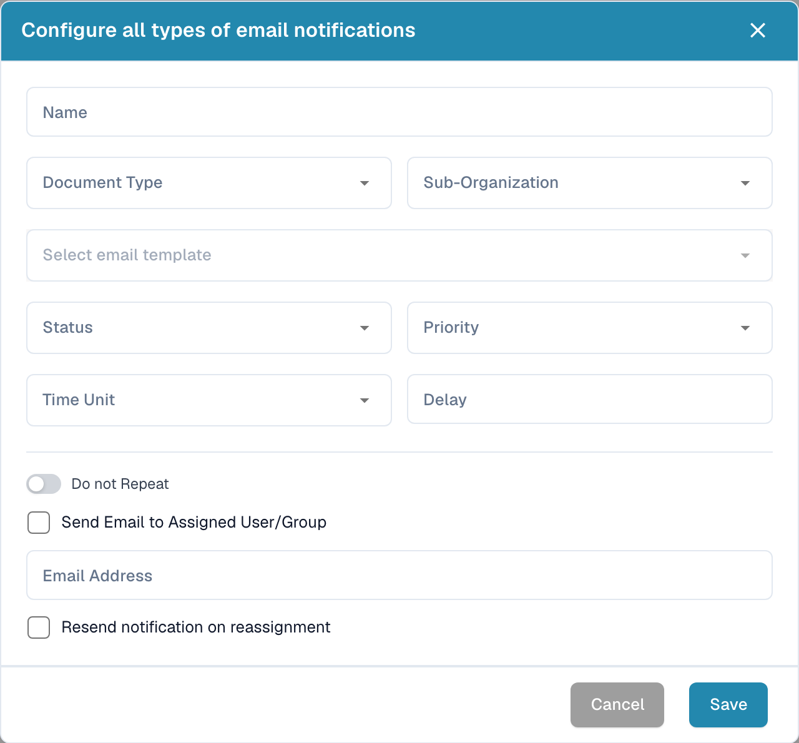

# Configuring email notifications

Open **Settings → Email Notifications** and select **New**. Configure when DocBits should send a notification and which recipients should receive it.

<figure><figcaption>
English dialog for an email notification.
</figcaption></figure>

1. Enter a **Name**, then select the **Document Type** and, where applicable, **Sub-Organization**.
2. Select the intended email template and document **Status**.
3. Set **Priority**, **Time Unit** and **Delay** for the notification.
4. Choose whether the notification should repeat. **Do not Repeat** controls repeated sending.
5. Select **Send Email to Assigned User/Group** if the document's assignee should receive the message, or enter the intended **Email Address**.
6. Review **Resend notification on reassignment** if responsibility can change.

Check recipients, timing and template content before selecting **Save**. The image shows a blank, unsaved configuration and does not demonstrate a sent email.
