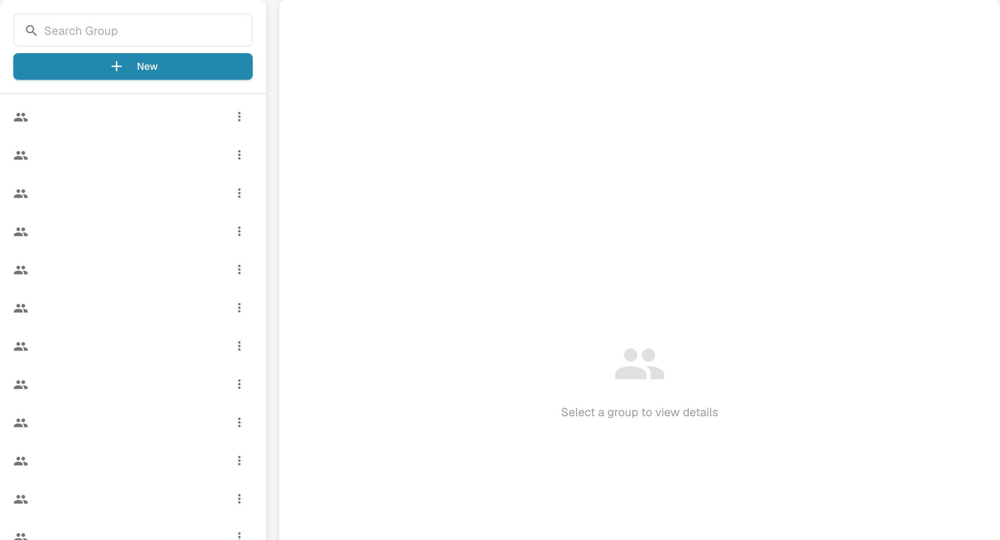

# Groups, Users and Permissions

## Create a group and test document access

With group permissions already enabled, create an isolated reviewer group and add a non-admin test user. Allow listing, viewing and editing assigned invoices; leave deletion, bulk changes and approvals unavailable. Save and reopen the settings, then sign in as the ordinary user: the assigned invoice is visible and an unassigned control document is absent.



[Watch with subtitles](https://docbits-videos.fra1.cdn.digitaloceanspaces.com/settings-assistant/groups-permissions-admin/v1/en.html)

These settings answer three different questions: who can sign in, which sub-organisation they work in, and what their group may do.

| If you need to… | Open… |
| --- | --- |
| Add or edit a person's account | **Settings** → **Users**; then read [Users](users/README.md). |
| Organise access across company units | **Settings** → **Sub-Organizations**; then read [Sub-Organizations](sub-organizations/README.md). |
| Control access by group | **Settings** → **Groups and Permissions**; then read [Groups and Permissions](groups-and-permissions/README.md). |

<figure><figcaption>
Group selection panel.
</figcaption></figure>

If a user cannot see a document or action, check their account and organisation first. Then check the relevant group permissions. Use a non-admin test account to confirm the access a normal user will actually have before changing a live organisation.
