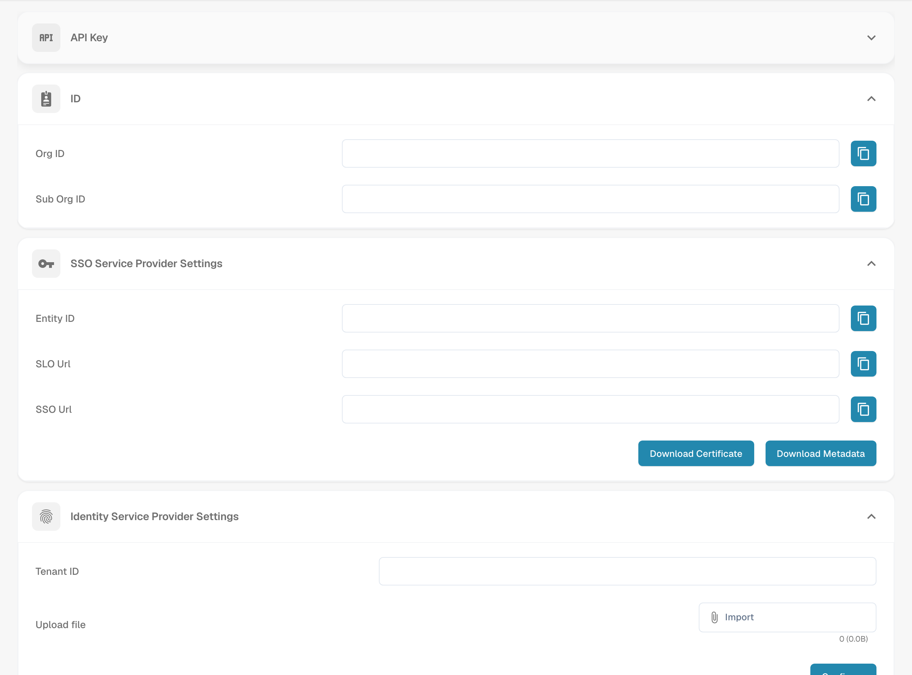

# Configuring Single Sign-On (SSO)

Configure DocBits as a SAML service provider (SP) and connect your identity provider (IdP). You need administrator access to the relevant settings on both sides.

## Open the SSO settings

Sign in to DocBits as an administrator and open Single Sign-On in the integration settings.

<figure><figcaption>
SSO configuration with organization data hidden.
</figcaption></figure>

## Read the DocBits service provider values

DocBits displays Entity ID, SSO URL and SLO URL as read-only values. Copy these values or use the SP metadata when configuring the DocBits application at your IdP; do not enter replacement values into these DocBits fields. Entity ID identifies the service provider. Use the displayed endpoint values according to your IdP's SAML setup requirements.

## Download the SP certificate and metadata

Use Download Certificate and the metadata download in the DocBits service provider settings. These downloads describe DocBits as the SP. Supply the SP metadata and, if required, the downloaded SP certificate to your IdP. This certificate download is separate from the IdP metadata that you upload to DocBits.

## Configure the identity provider

1. At your IdP, configure DocBits using the SP values displayed in DocBits or the downloaded SP metadata.
2. Use the DocBits Tenant ID if your provider requires it. Check that the tenant and provider context in the DocBits identity provider settings are correct.
3. Obtain the SAML XML metadata for the configured application from your IdP and upload that IdP XML metadata to DocBits. Do not upload the downloaded DocBits SP metadata in its place.
4. Use the Configure/Save action in the DocBits identity provider settings to save the configuration.

## Test sign-in and supported sign-out

Test that a user can sign in to DocBits through the configured IdP. Test Single Log-Out only if both the IdP and DocBits support it and it is configured on both sides. Logging out of DocBits does not by itself guarantee logout from every other connected application.
