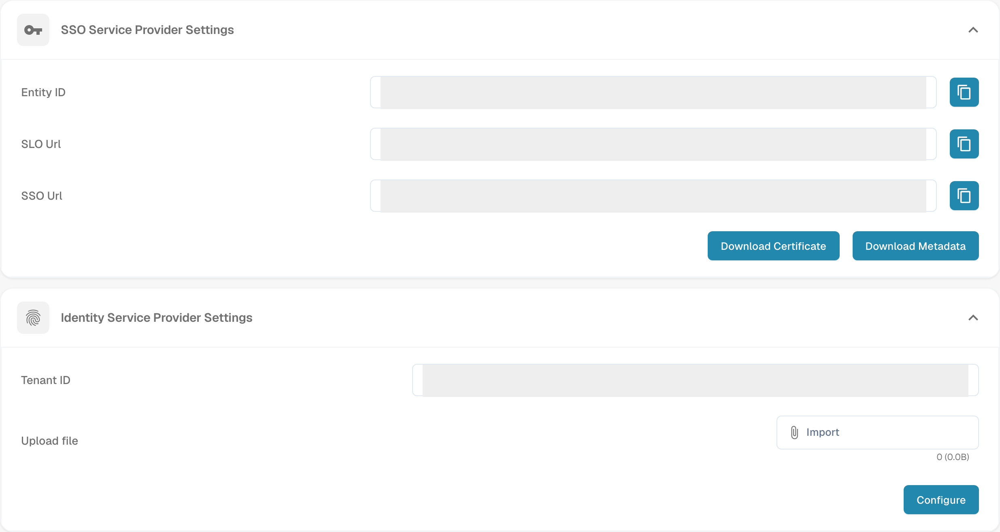

# Microsoft Entra SSO

Use this guide if your organisation wants users to sign in to DocBits through Microsoft Entra ID. You need an administrator for both DocBits and the Microsoft Entra tenant. Test with one assigned user before changing sign-in for everyone.

## 1. Get the DocBits service provider details

In DocBits, open **Settings → Integration & SSO**. Under **SSO Service Provider Settings**, choose **Download Metadata** to obtain the service provider metadata XML. It contains the Entity ID, Assertion Consumer Service (ACS) URL and single logout URL needed for the Entra configuration. **Download Certificate** provides the DocBits certificate if your identity provider asks for it. Use the file from your own organisation and environment; the image hides organisation-specific values.

The copy buttons beside **Entity ID**, **SSO Url** and **SLO Url** copy the displayed values. Before using them, compare each complete address with the downloaded XML. If a value differs, use the corresponding metadata value and report the discrepancy. Keep the full scheme, host and path, including any path prefix.

<figure><figcaption>
English DocBits SSO settings in a Dev test organisation: inspect the service provider values or download its metadata and certificate above; select the identity provider XML and configure it below. Organisation-specific values are hidden.
</figcaption></figure>

## 2. Create the Microsoft Entra application

In the [Microsoft Entra admin center](https://entra.microsoft.com/), create an **Enterprise application** using **New application → Create your own application** and the non-gallery option. Open **Single sign-on → SAML**. In **Basic SAML Configuration**, use the Entity ID from the DocBits metadata (`EntityDescriptor` → `entityID`) as the Microsoft **Identifier (Entity ID)**. Use the ACS address (`AssertionConsumerService` → `Location`) as the **Reply URL (ACS URL)**. Set the logout URL from `SingleLogoutService` → `Location` if your configuration requires it. Check any additional sign-on URL and claims requirements with your identity administrator.

Assign a test user or group under **Users and groups**. Microsoft's [current SAML setup and user assignment guide](https://learn.microsoft.com/en-us/entra/identity/enterprise-apps/add-application-portal-setup-sso) shows the Entra portal steps and explains these fields. Its portal images are maintained by Microsoft; the old Azure AD screenshots have been removed from this page.

## 3. Import Microsoft metadata into DocBits

In the Entra application's SAML setup, download **Federation Metadata XML**. Microsoft documents this file in its [federation metadata guide](https://learn.microsoft.com/en-us/entra/identity/enterprise-apps/add-application-portal-setup-sso-rpsts#download-metadata-and-certificates-from-microsoft-entra). Return to **Settings → Integration & SSO → Identity Service Provider Settings** in DocBits. Enter the Microsoft **Tenant ID**. In the **Upload file** row, use **Import** to select the Federation Metadata XML file, then select **Configure** to upload and save it. Select the XML file before choosing **Configure**; a Tenant ID alone is insufficient. Keep a working admin sign-in available while you test SSO.

## 4. Test the sign-in

Ask the assigned test user to start a new browser session and sign in through the configured Microsoft account. Check that the user reaches the intended DocBits organisation and has the expected access. If sign-in fails, compare the Entity ID, ACS URL, tenant, assignments, claims and metadata in both systems before changing the configuration.
