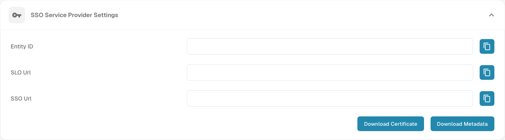

# V2: Infor OS Portal SSO

Use this guide if your organisation launches DocBits from **Infor OS Portal V2**. An administrator for both Infor and DocBits is required. Keep an existing DocBits administrator session open while testing SSO. The Infor menu and field names depend on the tenant's release; confirm them with your Infor administrator.

## 1. Get the DocBits SAML values

In the correct DocBits organisation, open **Settings → Integration & SSO → SSO Service Provider Settings**. Copy **Entity ID**, **SSO Url** and **SLO Url**. Use **Download Certificate** if the Infor service provider form requires the signing certificate. **Download Metadata** is the DocBits *service provider* XML; it is not the Infor identity provider metadata used in step 3. Use the values from your own organisation; the organisation-specific URLs are hidden in the Dev image below.

<figure><figcaption>
Use your organisation’s Entity ID, SSO Url and SLO Url for the Infor mapping in step 2. The copy controls sit beside the three read-only fields; Download Certificate and Download Metadata are below them. Organisation-specific URL values are hidden in this Dev view.
</figcaption></figure>

## 2. Add DocBits as a service provider in Infor

In Infor OS Portal, open **OS → Security → Security Administration → Service Provider** if this is the route in your tenant. Add a SAML service provider and use the following mapping:

| Infor field | DocBits value |
| --- | --- |
| Entity ID | Entity ID |
| SSO Endpoint | SSO Url, the assertion consumer endpoint |
| SLO Endpoint | SLO Url, the logout endpoint |
| Signing Certificate | Download Certificate, if required |
| Name ID Format / Mapping | Email address, after checking it matches the DocBits user |

The previous guide instructed users to put **SLO Url** into **SSO Endpoint**. That is incorrect: each URL goes in its corresponding field. Save the service provider. Infor's [service provider guide](https://docs.infor.com/inforos/latest/en-us/useradminlib_cloud/inforos_security/jho1449385888462.html) explains the navigation and required role; its [SAML field guide](https://docs.infor.com/inforos/2026.09/en-us/useradminlib_cloud/mineeag/min1772650388038.html) explains the endpoint roles.

## 3. Import Infor's identity provider metadata

Open the saved service provider in Infor and **View → Export SAML Metadata** for the Infor identity provider. Back in DocBits, open **Settings → Integration & SSO → Identity Service Provider Settings**. Enter the Infor **Tenant ID**, choose the Infor XML under **Upload file**, then select **Configure**. Confirm the tenant ID and metadata with your Infor administrator. Do not upload the DocBits service provider XML from step 1 here.

## 4. Add a DocBits tile in Infor OS Portal

In Infor OS Portal, open **Portal → Applications → Add Application**. Register DocBits as a non-Infor application for your tenant, provide a display name, icon and unique Logical ID, and set the **application URL** to your normal DocBits sign-in or launch URL. The portal application URL opens the user interface; it is **not** the SAML SSO/ACS endpoint from step 2. Follow Infor's [non-Infor application guide](https://docs.infor.com/inforos/latest/en-us/useradminlib_cloud/inforospag/lsm1436532874794.html) for the current form, navigation options and permissions. Grant the test user access to the portal application.

## 5. Verify with one user

Sign out in a separate browser session, open the DocBits tile from Infor, and confirm that the assigned user's email resolves to the right DocBits account and organisation. Check sign-out as well. If either fails, compare Infor metadata, SSO/SLO URLs, certificate, Name ID and portal tile URL with the two administrators. Keep the original administrator session until the test is complete.

**Verification scope:** The service-provider panel above was captured in English in the authorised DocBits Dev test organisation. The read-only values and visible controls were checked; copying, certificate and metadata downloads, and identity-provider configuration were not performed. No Infor tenant was available, so Infor portal menus, metadata import, tile creation and live SSO were not tested for this update. Old externally hosted Infor images, including private mail attachments, were removed; use the linked Infor documentation and your tenant administrator for that interface.
