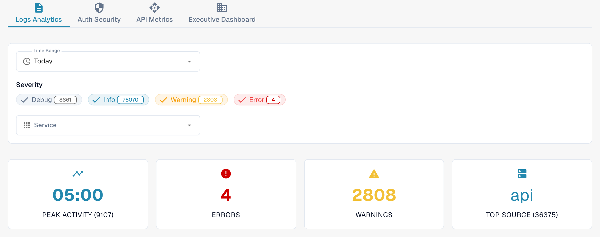
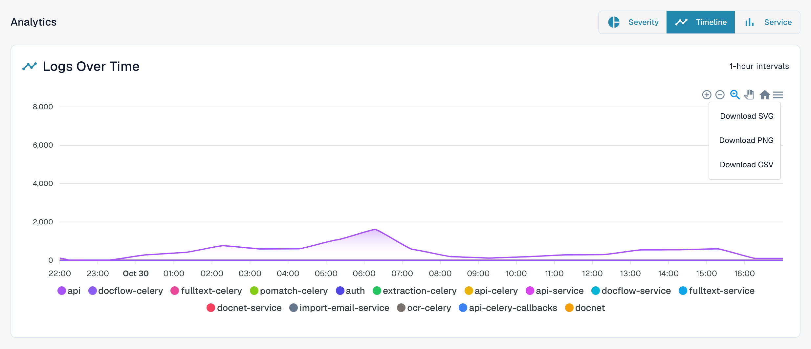
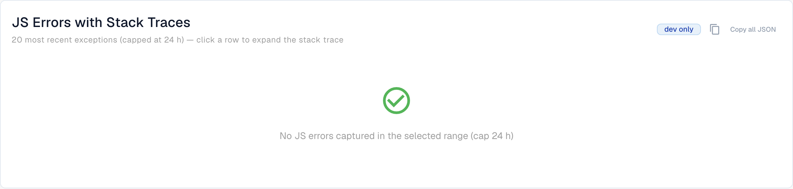

# Analytics

Open **Settings → Activity Logging → Analytics** with an organization administrator account. The page brings together log activity, authentication events, API usage, and an executive overview. Start with **Logs Analytics**. Choose **View Event Logs** to open the underlying event list when you need to investigate an individual entry.

<figure><figcaption>
Current English Dev view. The counts belong to the test environment and will differ in your organization.
</figcaption></figure>

## Tabs

| Tab | Description |
|-----|-------------|
| **Logs Analytics** | Log severity distribution, timeline charts, and service breakdown. |
| **Auth Security** | Authentication events, login attempts, and security-related metrics. |
| **API Metrics** | API request volumes, response times, and error rates. |
| **Executive Dashboard** | Higher-level overview for organization administrators; availability depends on your role. |

The tabs have their own period controls. Check the selected period again after changing tabs.

## Log filters

| Filter | Description |
|--------|-------------|
| **Time Range** | Choose **Last Hour**, **Today**, **Last 7 Days**, **Last 30 Days**, or **Custom**. Custom reveals start and end date/time fields. |
| **Severity** | Click **Debug**, **Info**, **Warning**, or **Error** to include or exclude that level. A number on a chip shows its current count. |
| **Service** | Select one or more services whose events you want to inspect. |

## Summary cards

Four summary cards appear below the log filters:

| Card | Description |
|------|-------------|
| **Peak Activity** | Time with the highest log volume and the corresponding count. |
| **Errors** | Error count for the selected period. |
| **Warnings** | Warning count for the selected period. |
| **Top Source** | Service producing the most logs, with its count. |

## Real User Monitoring (RUM)

When browser telemetry is available, the RUM section shows frontend performance metrics. Data availability depends on the environment and selected period. An empty chart, an unavailable message, or a loading placeholder is not a measured result.

## Log charts and downloads

In **Logs Analytics**, select one of the three chart buttons:

| View | Description |
|------|-------------|
| **Severity** | Pie chart showing log level distribution. |
| **Timeline** | Line chart showing log volume over time. |
| **Service** | Bar chart breaking down logs by service. |

For the **Timeline** chart, open the menu at the upper right of the chart and choose **Download SVG**, **Download PNG**, or **Download CSV**. These options concern the displayed chart; other charts may not provide the same toolbar.

<figure><figcaption>
Timeline chart menu in Dev.
</figcaption></figure>

If a chart says that no data is available, try a wider **Time Range** or fewer **Severity** filters.

## JS Errors with Stack Traces

Where this card is available, its environment badge identifies the scope of the errors; the example below shows **dev only**. The card lists recent browser exceptions, capped at 24 hours. **Copy all JSON** copies the entries currently loaded in this card, rather than the complete event log. The button is disabled when there are no entries.

For an available entry, click its message to expand the stack trace. The row actions copy that entry as JSON or copy its stack trace. A trace link appears only when the entry has a trace ID.

<figure><figcaption>
Empty Dev error list: Copy all JSON is disabled.
</figcaption></figure>
