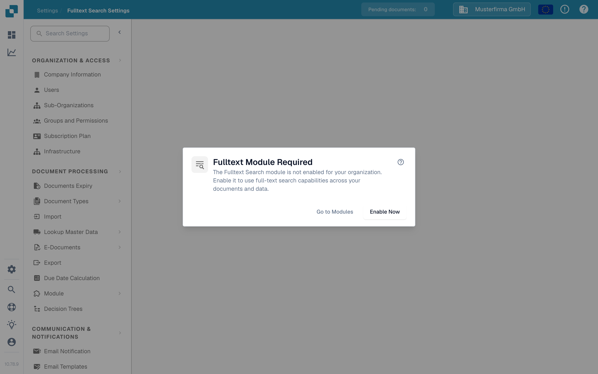

# Fulltext Search Settings

<figure><figcaption>
When Fulltext Search is disabled, this dialog explains the next steps.
</figcaption></figure>

Fulltext Search Settings configures what DocBits indexes and how it makes that content searchable across documents, ERP master data, and templates. The settings page displays a requirement dialog until the **Fulltext Search module** is enabled — see [Fulltext Search](../document-processing/module/fulltext-search.md) for the user-facing query language.

## Prerequisites

The Fulltext Search module must be activated in **Settings → Module → Dashboards & Analytics → Full text search**. If the module is not enabled, the dialog offers three actions:

* **Help (?)** — Open the Fulltext Search documentation in a new tab before changing any setting.
* **Go to Modules** — Open the Dashboards & Analytics module settings to review the configuration.
* **Enable Now** — Open the subscription dialog. Review and confirm that dialog before the module is enabled; clicking this button alone does not enable it.

The settings page itself becomes available once the module is active.

## Page layout

The settings page is organised into four tabs: **Documents**, **Pipeline**, **ERP** and **Templates**. Documents, ERP and Templates each scope a different content type that Fulltext Search can index; Pipeline shows how indexed data flows into the search index.

### Documents tab

The Documents tab covers everything related to indexing processed documents:

* **Indexing statistics** — totals for documents indexed and pending, refreshed on demand.
* **Vector preferences** — three organisation-level toggles that control whether vector indexing runs alongside the text index for documents. Vector indexing powers the `vector:` query mode and the "Find Similar" feature.
* **Reindex actions** — start a full or incremental reindex. While a reindex runs, you see live progress (documents per minute, ETA), the current stream status, and the last failure (if any).
* **Sync diagnostics** — on-demand diagnostics for cases when the index appears out of sync with the underlying document store.

<mark>Reindexing is non-destructive — existing search continues to work while the new index is being rebuilt.</mark>

### Pipeline tab

The Pipeline tab is a read-only diagram of how document data reaches the search index. It does not change any setting; use it to check where the data comes from, which region each component runs in, and how far the indexing has progressed.

* **Region banner** — at the top, DocBits confirms whether all components run in your organisation's region (for example, *All components in the org region*). If a component runs in a different region, the banner shows a warning and names the expected region. A cross-region note that does not block indexing, such as the OCR text source, is listed separately as *Cross-region (non-blocking)*.
* **Live status** — next to the banner, a status indicator shows the current state of the indexing stream.
* **Sources** — the **Postgres** box shows the number of documents in the database. The **Spaces (OCR)** box is the OCR text source. Each box carries a small region label.
* **OpenSearch index** — the target box lists three indexing phases with the number of indexed documents, the total and a percentage: **slim** (documents in the base index), **text** (the OCR text) and **vector** (embeddings for semantic search). While a phase is still catching up, the connectors in the diagram are animated.
* **Vector off** — if no vector preference is enabled on the Documents tab, the vector phase shows **off** instead of a count. Turn on a vector preference on the Documents tab to see it fill.

If the diagram shows *Pipeline topology is not available for this environment yet*, the region details are not provided for your environment; the Documents tab still shows the indexing statistics.

### ERP tab

The ERP tab controls indexing for ERP master data — suppliers, customers, items, and similar entities. Each entity has its own toggle:

* **Indexing** — text-index the entity so it is searchable from the dashboard.
* **Vector** — vector-index the entity so it can be matched by semantic queries.

Use the **Toggle all** action at the top of the list to apply the same on/off state to every entity at once. Indexing kicks off in the background; an indicator on each row shows when it is in progress.

### Templates tab

The Templates tab lists the template versions known to the Fulltext index. Use this view to confirm that the template versions you depend on are present in the index after a redeploy.

## What gets indexed

Once enabled and configured, Fulltext Search lets users:

* Search across all document content (not just metadata fields).
* Find documents by text contained within uploaded files.
* Use advanced search operators for precise queries.
* Access search results directly from the dashboard.
* Use semantic search (`vector:` prefix) when vector indexing is on for that content type.

See the [Fulltext Search](../document-processing/module/fulltext-search.md) module page for the complete query language reference, including range queries, smart filters, and the AI search mode.
