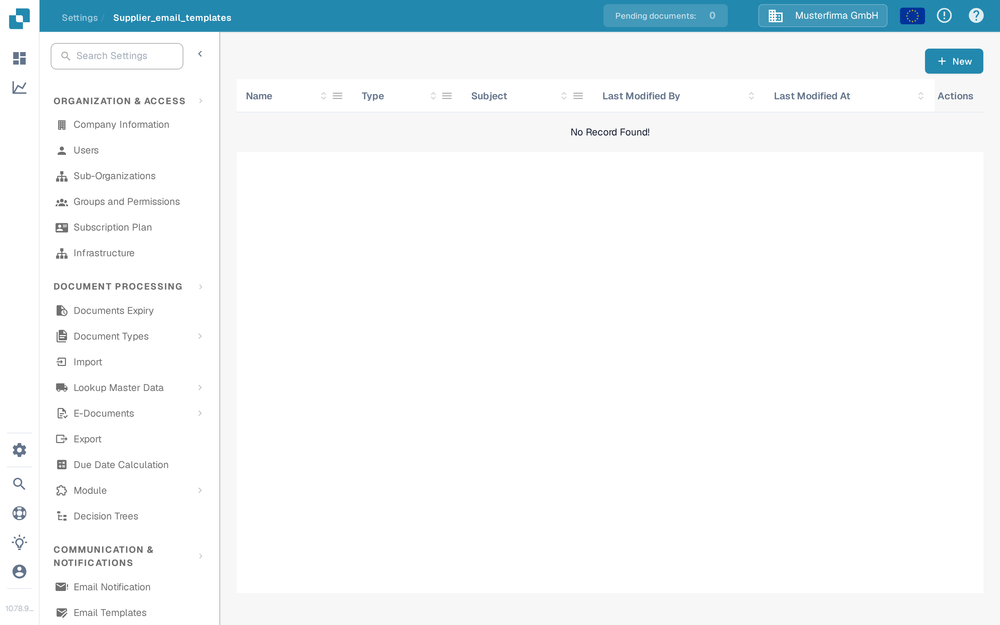
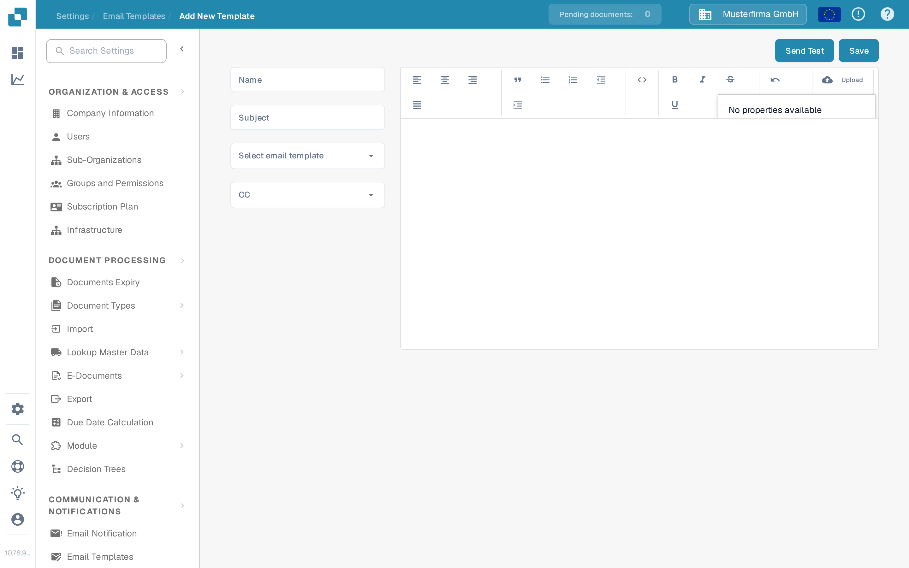

# Editing Email Templates

<figure><figcaption><p>Supplier Email Templates list</p></figcaption></figure>

The **Email Templates** page under **Settings → Supplier → Email Templates** lets administrators design the emails that DocBits sends to suppliers automatically. Each template is assigned to one of four fixed email types, so the right message always goes out when a supplier is invited, completes registration, or is approved or rejected in the supplier portal.

Access requires an administrator account. See [Supplier Permissions](supplier-permissions.md) for the roles suppliers themselves receive.

## Template List

The list shows one row per template with these columns:

| Column | Description |
|--------|-------------|
| **Name** | The internal name of the template. |
| **Type** | The email type the template is used for, e.g. Supplier Invitation Email. |
| **Subject** | The subject line recipients see. |
| **Last Modified By** | The user who last edited the template. |
| **Last Modified At** | When the template was last changed. |

You can sort the list by any column. The **Name**, **Type** and **Subject** columns also offer a filter via their column menus; active filters appear as removable badges above the table. You can drag column headers into your preferred order, and that order is remembered for your next visit.

**Row actions**: every row has an **Edit** action (the pencil icon in the last column) that opens the template in the editor, and a **Delete** action (the trash icon) that removes the template after a confirmation dialog. Clicking anywhere in a row also opens the template for editing.

**New**: the **New** button above the table creates a new template.

## Creating or Editing a Template

<figure><figcaption><p>Creating a new supplier email template</p></figcaption></figure>

Click **New** (or **Edit** on an existing template) to open the template editor:

1. **Name** — enter an internal name for the template. This name appears in the list, not in the email.
2. **Subject** — enter the subject line of the email. You can use placeholders such as `{{supplier_name}}`.
3. **Select email template** — choose the email type. There are exactly four types:
   * **Supplier Invitation Email** — sent when you invite a supplier to the supplier portal.
   * **Supplier Registration Completion Email** — sent when a supplier completes their registration.
   * **Supplier Approval Email** — sent when the supplier's account is approved.
   * **Supplier Rejection Email** — sent when the supplier's account is rejected.

   The type of an existing template cannot be changed later; the field is read-only when editing. Create a new template instead.
4. **CC** — optionally select who else receives a copy: **Assigned User** (the user responsible for the supplier) and/or **Referrer** (the user who invited the supplier). Leave empty to send to the supplier only.
5. Design the email body in the rich-text editor on the right. You can format text, insert lists and quotes, and align content. The **Upload** toolbar button inserts an uploaded image directly into the email or attaches other files as a link. The code icon switches to the HTML source view, where you can edit the underlying HTML directly and format it.
6. **Placeholders**: the properties menu in the toolbar inserts the available placeholders for the selected email type, e.g. `{{magic_link}}` and `{{supplier_name}}`.
7. Click **Save** to store the template.

### The `{{magic_link}}` Placeholder

The `{{magic_link}}` placeholder is replaced with a unique sign-in URL when the email is sent. It directs the recipient to an action in the supplier portal, such as completing their registration. To make it a clickable button, format it as a link in the HTML source view:

```html
<a href="{{magic_link}}" target="_blank" style="
    background-color: #B7184B;
    border-radius: 25px;
    font-family: 'Montserrat', Arial, sans-serif;
    font-size: 14px;
    font-weight: bold;
    padding: 12px 25px;
    color: #FFFFFF;
    text-decoration: none;
    display: inline-block;
    cursor: pointer;">
    Complete Registration
</a>
```

Adjust the text between the `<a>` and `</a>` tags to tell the recipient what to do, for example "Complete Registration" or "Access Your Account".

## Sending a Test Email

Before putting a template into use, check how it looks:

1. Click **Send Test** in the top-right corner of the editor.
2. Enter the **Receiver Email** address the test email should go to.
3. Fill in the sample values shown for the placeholders (e.g. a sample supplier name and a sample link).
4. Click **Send**. DocBits sends the email with the sample values so you can verify the layout, the placeholder replacement and the magic link.

The test email does not go to a supplier and does not change any data.

## Related Pages

* [Email Notification](../global-settings/email-notification/README.md) — notifications for internal document events
* [Supplier General Settings](supplier-general-settings.md)
* [Supplier Permissions](supplier-permissions.md)
* [Supplier Portal](../../setup/supplier-portal/README.md) — activating the portal and inviting suppliers
