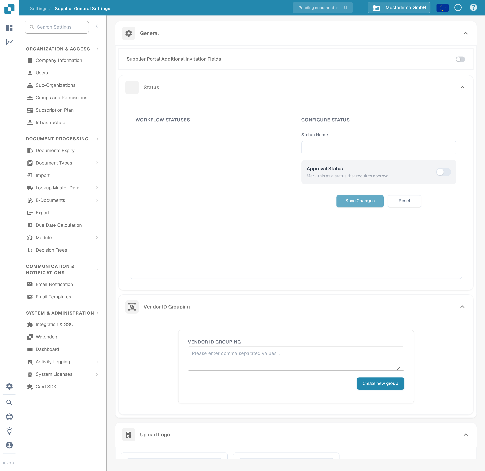

# Supplier General Settings

<figure><figcaption>
Supplier General Settings page. From top to bottom: General (additional invitation fields, Status, Vendor ID Grouping), Upload Logo, Policy and Privacy Statement, and Supplier Registration Reference Documents.
</figcaption></figure>

### Overview

The **Supplier General Settings** page configures how the supplier portal looks and behaves for your suppliers. It contains six sections:

* **General** — three modules that shape the supplier onboarding workflow:
  * **Supplier Portal Additional Invitation Fields**: add extra fields to the supplier registration form.
  * **Status**: define the workflow statuses a supplier can pass through and who may approve each one.
  * **Vendor ID Grouping**: group several vendor IDs so they are treated as one supplier.
* **Upload Logo** — the company logo shown in the supplier portal and in invitation emails.
* **Policy and Privacy Statement** — the legal documents suppliers must accept.
* **Supplier Registration Reference Documents** — reference documents suppliers can view during registration.

The sections are only meaningful once the **Supplier Portal** module is enabled; see [Supplier Portal](../../setup/supplier-portal/README.md) for how to activate it.

### Supplier Portal Additional Invitation Fields

By default, suppliers register with the standard fields of the supplier layout. This section lets you additionally request fields from your supplier master data (for example **VAT ID**, **Website**, **IBAN**, or **Contact Person**) during registration.

1. Switch the **Supplier Portal Additional Invitation Fields** toggle on.
2. In the **Fields** drop-down that appears, select one or more fields. The list contains the fields defined for the supplier master data type; if it is empty, the supplier master data fields have not been set up in your organisation yet.
3. The selection is saved automatically. Invited suppliers now see the selected fields in the registration form.

### Status

The **Status** section defines the workflow a supplier registration moves through. The left panel lists all statuses in order; the right panel configures the status you select. For the meaning of the built-in statuses (Open, Pending Registration, Pending Approval, Approved, and so on), see [Supplier Portal — Supplier Status](../../setup/supplier-portal/README.md#supplier-status).

* **Reorder statuses**: drag a status by the handle on its left. The new order is saved automatically.
* **Select a status**: click a status in the list to load it into the **Configure Status** panel. Built-in statuses are locked: their name and approval settings cannot be changed, and they cannot be deleted.
* **Status Name**: type a name to create a new custom status (when none is selected), or rename the selected custom status.
* **Approval Status**: turn on **Mark this as a status that requires approval** if a supplier may only leave this status after an explicit approval. The status then carries an *Approval* badge in the list.
* **Who Can Approve**: once a status requires approval, choose which roles may approve it — **Admin User**, the **Referrer** (the user who invited the supplier), the **Assignee**, and any number of **User Groups**.
* **Save Changes** stores the selected status; **Reset** clears the form.
* **Delete a custom status**: click the trash icon next to it and confirm. Built-in statuses cannot be deleted.

### Vendor ID Grouping

Use **Vendor ID Grouping** when the same supplier appears in your system under several vendor IDs (for example after a merger or across plants). All IDs in one group are treated as a single supplier in the supplier portal.

1. In the input field, enter the vendor IDs separated by commas (for example `1001, 1002`).
2. Click **Create new group**. Each group needs at least two IDs; otherwise a warning is shown and no group is created.
3. Each group appears as a row of ID chips labelled **GROUP 1**, **GROUP 2**, and so on. Changes are saved automatically.
4. **Edit a group**: click its row, adjust the comma-separated list, then click **Save** (or **Cancel** to discard).
5. **Delete a group**: click the trash icon at the end of the row.

### Upload Logo

#### Purpose

The **Upload Logo** feature allows administrators to customize the supplier portal by uploading their company's logo. This enhances brand recognition and provides a consistent visual experience for users accessing the portal.

#### Steps to Upload a Logo

1. **Access Supplier General Settings**:
   * Navigate to the **Supplier General Settings** section from the main menu.
2. **Locate the Upload Logo Section**:
   * Scroll down to the **Upload Logo** section within the settings page.
3. **Upload a New Logo**:
   * Click on the **Upload Logo** area to open the file selection dialog.
   * Select the image file you wish to upload. Supported formats typically include `.png`, `.jpg`, or `.jpeg`.
   * The uploaded logo will be displayed in the preview area.
4. **Save the Uploaded Logo**:
   * Once the logo is uploaded, click the **Save** button to apply the changes.
   * The new logo will now be displayed across the supplier portal.

#### Best Practices

* **Logo Dimensions**: Ensure that the logo's dimensions are optimized for both desktop and mobile views. The system might offer guidelines or automatic resizing.
* **File Size**: Use a compressed image file to reduce load times and enhance user experience.
* **Brand Consistency**: Use the same logo across all platforms to maintain a consistent brand identity.

### Policy and Privacy Statement

#### Purpose

The **Policy and Privacy Statement** section allows administrators to upload or define the legal documents that govern the use of the supplier portal. These documents are critical for compliance with legal and regulatory requirements, outlining the terms of use, data protection policies, and other essential information for users.

#### Steps to Upload Policy and Privacy Statement

1. **Access Supplier General Settings**:
   * Navigate to the **Supplier General Settings** section from the main menu.
2. **Locate the Policy and Privacy Statement Section**:
   * Scroll down to the **Policy and Privacy Statement** section.
3. **Upload or Update the Documents**:
   * Click on the **Upload Document** button to select the relevant file(s).
   * Choose the document file from your local storage. Supported formats typically include `.pdf`, `.docx`, or `.txt`.
   * Uploaded documents will be listed in this section for review.
4. **Save the Changes**:
   * After uploading or updating the documents, click the **Save** button to ensure the new policies are applied.

#### Best Practices

* **Regular Updates**: Regularly review and update the Policy and Privacy Statement to ensure they comply with the latest legal requirements and company policies.
* **Clarity and Accessibility**: Ensure that the uploaded documents are clear, concise, and accessible to all users. Consider providing translations if your supplier base is international.
* **Legal Review**: Have all documents reviewed by legal counsel before uploading to ensure compliance with relevant laws and regulations.

### Supplier Registration Reference Documents

This section holds documents that support suppliers during registration — for example a VAT registration form or a trade license template. Uploaded documents are listed in a table with the columns **Name** and **File Type**.

* **Upload**: click **Upload**, then choose the file. It appears in the table once the upload finished.
* **Preview**: click the eye icon next to a document name to open the document in a preview window.
* **Copy link**: use the copy action in the **Actions** column to copy a link to the document to the clipboard, for example to add it to your own instructions.
* **Delete**: use the delete action in the **Actions** column and confirm the prompt.
