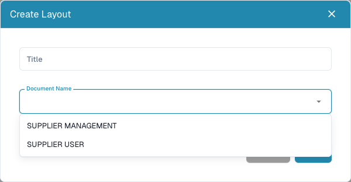

# Supplier Layout

<figure><figcaption>
Choose the supplier-facing or internal audience before saving a new layout.
</figcaption></figure>

Supplier layouts define forms for suppliers and internal supplier-management staff. They do not define the printed invoice or train invoice extraction. You need administrative access and agreed information requirements for each audience.

## Choose the audience

1. Open **Settings → Supplier Settings → Supplier Layout**.
2. Review existing layouts; open the intended one before creating another.
3. For a new layout, choose **New**, enter a recognizable **Title** and select **Document Name**: **Supplier User** for suppliers or **Supplier Management** for internal staff.
4. Save the definition, open its layout from the list and verify its audience.

## Configure fields and form

1. Open **Supplier Fields**. Review title, **ERP Field Name**, list of values and **Required**, **Read Only** and **Hidden** settings.
2. Choose **Create Field** for a new definition. Supply name, title and type. Selection/search/radio fields need the appropriate list of values. File fields need their document type; for other fields, check the ERP field name.
3. Save correct field settings. Definitions and layout arrangement are separate steps.
4. In the intended layout, use **Elements** and **Fields** to arrange groups and fields. Select an element and review its available **Properties**.
5. Provide valid group names and titles. Do not leave a required field hidden/read-only without an appropriate existing value or process.
6. Save and reopen the layout to verify its stored arrangement. **Cancel** leaves the editor. **Use default template** can replace the current arrangement; use it deliberately.

## Test both audiences

With a synthetic supplier and test supplier account, check supplier registration and internal Supplier Details separately. Verify required-field messages, selectable values, file uploads and hidden/read-only behavior. A builder save does not establish successful registration, approval or ERP export.

For missing fields, check definition, hidden setting, layout and audience. For missing ERP values, also inspect the supplier export mapping.

See [Supplier Portal](../../setup/supplier-portal/README.md), [Supplier General Settings](supplier-general-settings.md) and [Supplier Permissions](supplier-permissions.md).
