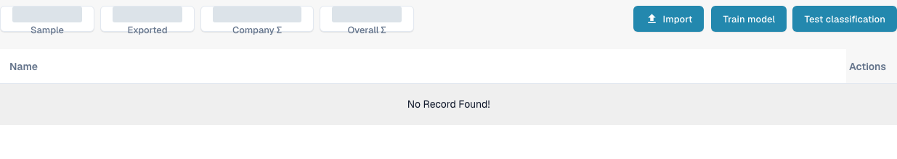

# Document Training

Document training teaches DocBits where to find values on documents it does not yet read correctly. Train header fields and line items separately.

To review document-type classification training, open **Settings** → **Document Types**, then choose **Model Training** on an existing document-type card. The view lists the training samples and offers **Import**, **Train model**, and **Test classification**. Review existing samples before making changes, and use approved test files for any later training or classification test.

<figure><figcaption>
English Model Training view for an existing Invoice document type. No sample documents are listed; aggregate counts are covered. Import, training and classification testing were not run.
</figcaption></figure>

* [Training Header Fields](training-header-fields.md): mark where a header value, such as a date or total, appears on the document.
* [Training Line Fields/Table Training](training-line-fields-table-training/README.md): define the line item table structure for a specific supplier.

Training results depend on the documents you use, so check the extracted values on a further test document before relying on them.
