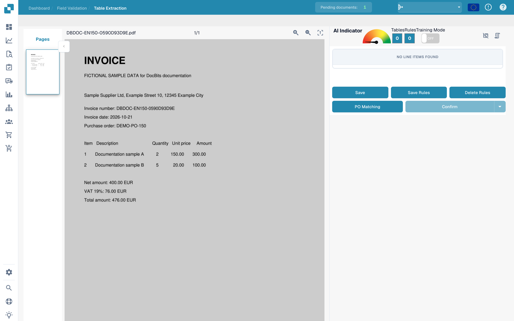
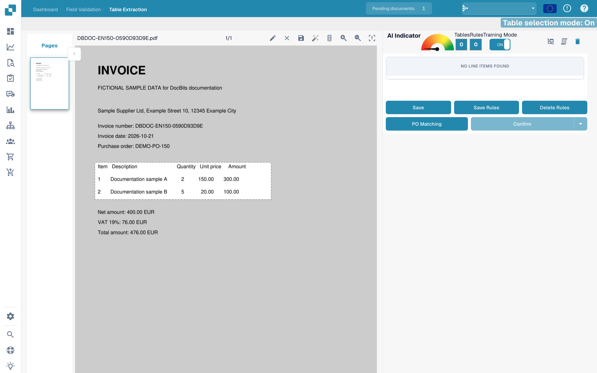
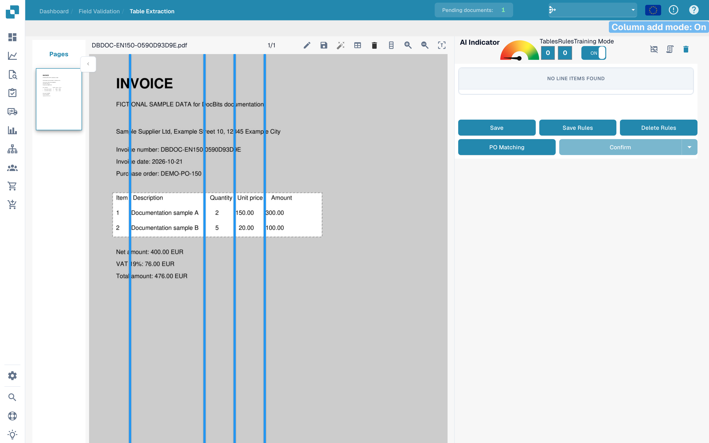
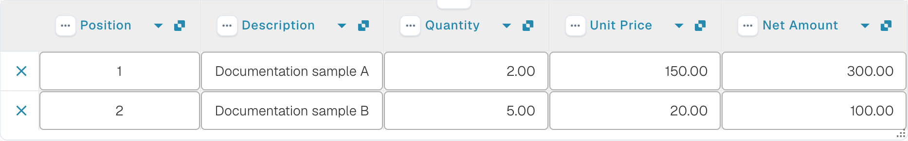

# Defining tables and columns

If a table is not recognized completely, use table training to define its area and columns. These examples use a fictional invoice. The illustrated training areas are unsaved drafts.

## Open table training

Open the document in **Field Validation**, then open **Table Extraction**. The document appears on the left and the training controls on the right.

<figure><figcaption>
English interface for defining tables and columns.
</figcaption></figure>

## Enable training mode

Turn on **Training Mode** to make the table-selection and column tools available.

<figure><figcaption>
Table training with training mode enabled.
</figcaption></figure>

The toolbar includes automatic table detection. Check its result against the document before defining columns. This image shows the available tools; it does not demonstrate a completed automatic detection.

<figure><figcaption>
Table-training tools including automatic detection.
</figcaption></figure>

## Select the table area

For a manual selection, choose the pencil tool and drag a rectangle around the column headings and line items. Exclude totals below the table.

<figure><figcaption>
Unsaved table area around the fictional invoice&#x27;s line items.
</figcaption></figure>

## Position the column separators

Choose the column tool, then place or drag vertical separators between the actual columns.

<figure><figcaption>
Table area in edit mode with vertical column separators.
</figcaption></figure>

Check the separation of item, description, quantity, unit price and amount. The separators in this example follow the five columns of the invoice.

<figure><figcaption>
Table area with column separators positioned for the training draft.
</figcaption></figure>

Review the complete area and column assignments before using **Save** or **Save Rules**.

<figure><figcaption>
Table area and column separators in an unsaved training draft.
</figcaption></figure>

## Check the extracted values

Compare the extracted line items with the original document. This image shows the example invoice's already automatically extracted rows in validation. They are not a result of the unsaved training draft above.

<figure><figcaption>
Automatically extracted line items of the fictional invoice in validation.
</figcaption></figure>

Use **Save Rules** when you intend to retain the training, then test it with further documents from the same supplier. One example does not establish reliable extraction for other layouts.
