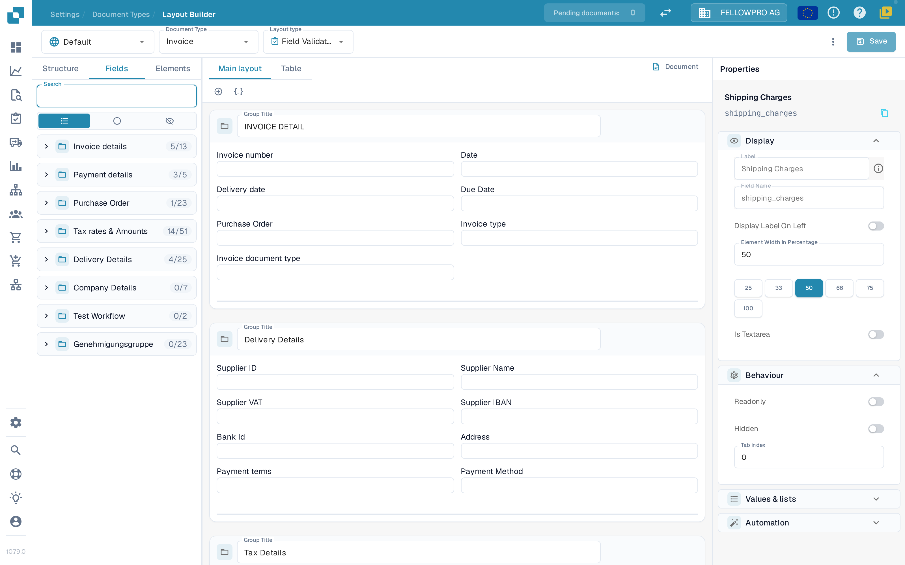
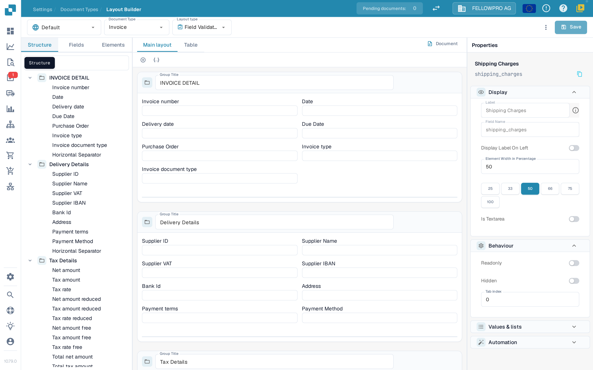

# Layout Builder

Use the Layout Builder to arrange the fields and controls that people see when they validate or approve a document. A layout belongs to one document type, one origin and one layout type, so check those three at the top of the page before you save.


DocBits Layout Builder Tutorial: Create Custom Document Layouts for Faster, Cleaner Validation


## Open the layout

1. Open **Settings → Document Types**.
2. Select the document type you want to edit and open **Layout Builder**. For a document subtype, open that subtype's Layout Builder action.
3. Check the header. The left selector is the **origin** (for example **Default**), followed by **Document Type** (for example **Invoice**) and **Layout type** (for example **Field Validation**). Each selector opens a list; choosing another entry loads that layout. If Layout Builder is unavailable, an administrator may need to enable the module for your organization.

<figure><figcaption>
The Layout Builder: the header selectors, the element lists on the left, the canvas in the middle and the Properties panel on the right.
</figcaption></figure>

## Work with the header

* **Document Type** and **Layout type** switch between layouts. The page reloads the layout you choose.
* Next to **Save**, DocBits shows whether the layout has **unsaved changes**. After a save it shows when the layout was last saved.
* **Save** stores the layout for the selected document type, origin and layout type.
* The **More** menu (three dots) holds **Auto Generate template**, **Apply Default layout to Origins**, **Use default template**, **Edit JSON**, **Copy JSON** and **Layout settings**. **Auto Generate template** and **Use default template** replace a custom layout, so check the selected document type and layout first. **Edit JSON** is for advanced configuration and should only be used when you understand the template format.
* If you leave the page with unsaved changes, DocBits asks whether to save or discard them.

## Find elements: Structure, Fields, Elements

The left side has three tabs:

| Tab | Use it for |
| --- | --- |
| **Structure** | See the layout as a tree. Groups and their fields are listed in the order they appear on the canvas, with the number of fields placed and available. |
| **Fields** | All fields configured for the document type, grouped by field group and collapsed by default. The filter switches between **All**, **Unused** and **Hidden** fields, and the technical field name is shown under the field label. |
| **Elements** | Presentation and interaction controls such as Text, Label, Check Box, separators, tables, buttons and subgroups. |

<figure><figcaption>
The Structure tab shows the built layout as a tree of groups and fields.
</figcaption></figure>

Select an item to add it, or drag it into the canvas. A group title tells the person validating the document what belongs in that section. Create or rename reusable document fields in [Document Types](README.md) first.

## Work on the canvas

* **Main layout** shows the layout of the document itself. **Table** shows the table layout used for line items.
* **Document** opens or closes the example document next to the canvas, so you can compare the layout with a real document.
* Groups are drawn as cards; the fields inside a group can be arranged in rows and given different widths.

## Change an element's properties

Select an element or a group on the canvas. **Properties** on the right is always visible and is organised in sections:

* **Display** – label, field name, label position and element width.
* **Behaviour** – read-only, hidden and tab index.
* **Values & lists** – the values offered for the element.
* **Automation** – rules that fill or change the element.
* **Borders & spacing** – the appearance of the element.

For the width, choose one of the presets (25, 33, 50, 66, 75 or 100 percent) instead of typing a value; check the result on the canvas. Which sections and options appear depends on the selected element. For more detail, see [Configuring Field Properties](../../settings/global-settings/document-types/layout-manager/configuring-field-properties.md).

## Review and save

Arrange the groups and fields, check the layout on the canvas and use **Save** in the header when the result is correct. For origin-specific layouts, see [Origin Layouts](origin-layouts.md).


The screenshots show synthetic settings in the DocBits test organization with English selected in the application. No layout was saved or replaced while capturing them.

