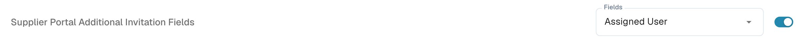
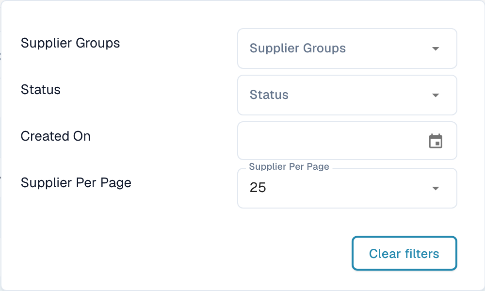
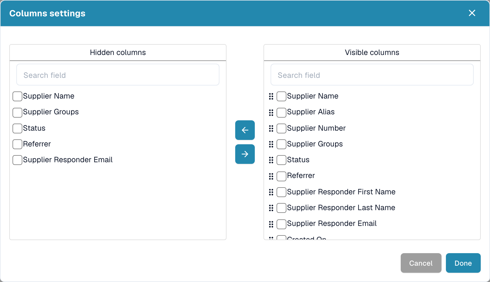
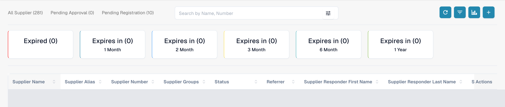
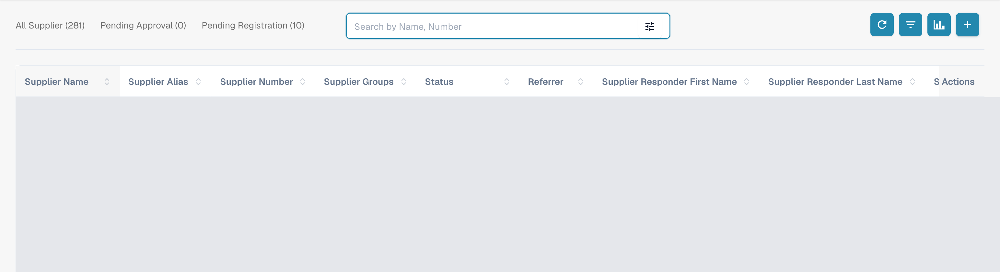
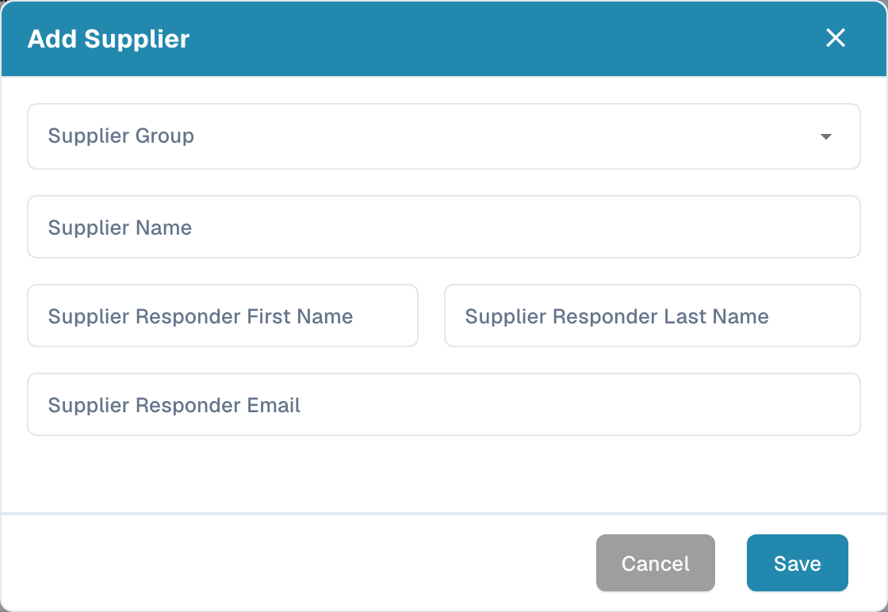

# Supplier Portal

The **Supplier Portal** lets an administrator give their company’s suppliers access to **DocBits**. The administrator enables the portal and configures which suppliers can use it and which information they can see.

An invited supplier registers and signs in with their own account. They can then view the information made available to them, such as the status of their purchase orders and invoices. The organisation’s configuration determines which features are available.

## Video: Prepare the Supplier Portal and supplier access

An administrator explains the portal option and plan selection, invitation preparation and the registration entry. Activation, sending, registration and approval are explained as separate steps.



[Open the video with English captions and chapter selection](https://docbits-videos.fra1.cdn.digitaloceanspaces.com/settings-assistant/supplier-portal-access-admin/v1/en.html)

## Admin: enable the portal

1. In Settings, open Modules and select **Document Integration**.
2. Expand **Shipping & Supplier** and enable **Supplier Portal**.
3. If an activation dialog appears, review the displayed plan and confirm the activation you need.

<figure><figcaption>
The Supplier Portal option is already enabled in this example. The switch controls organisation availability; it does not send an invitation or register a supplier.
</figcaption></figure>

## Admin: configure the portal

Configure the portal for your organisation before sending the first invitations:

- [General supplier settings](../../settings/supplier-setting/supplier-general-settings.md): Additional invitation fields, statuses, logo and privacy information.
- [Email templates](../../settings/supplier-setting/editing-email-templates.md): Invitation message content and presentation.
- [Supplier layout](../../settings/supplier-setting/supplier-layout.md): Fields for supplier registration and internal supplier administration. Select the appropriate layout type.
- [Supplier permissions](../../settings/supplier-setting/supplier-permissions.md): Assign internal employees to supplier groups. These internal responsibilities are separate from a supplier’s own portal access.

<figure><figcaption>
Additional invitation fields are already enabled in this example. The Fields selector shows Assigned User. Configure the fields needed by your organisation before preparing invitations.
</figcaption></figure>

## Admin: search and filter the Supplier Dashboard

Open **Supplier Dashboard** to manage suppliers internally. The status totals at the top let you display **All Supplier**, **Pending Approval** or **Pending Registration**. Search by supplier name or number with the search field.

Open the filter control inside the search field to refine the list by **Supplier Groups**, **Status** and **Created On**. **Supplier Per Page** controls the page size; **Clear filters** removes the active search filters. These are supplier-list controls, not purchase-order filters.

<figure><figcaption>
The filter menu narrows the supplier list. Created On uses a date selector; Supplier Per Page controls the number of suppliers on a page.
</figcaption></figure>

## Admin: choose visible columns

Use the column settings control beside Refresh to open the available-column list. Select fields in **Hidden columns** or **Visible columns**, then use the arrow controls to move them between the lists. Reorder visible fields with their drag handles and use **Done** to apply the choice for the organisation. **Cancel** closes the dialog without applying changes. Available columns include supplier identity, group, status, responder and date information; use horizontal scrolling when the table is wider than the screen.

<figure><figcaption>
Column settings control which supplier fields appear in the dashboard. Review the selection before Done; Cancel leaves the current settings unchanged.
</figcaption></figure>

## Admin: view expiry Analytics

Use **Analytics**, the chart control beside column settings, to show or hide the expiry summary. The cards show **Expired** and upcoming expiry periods of one, two, three or six months and one year. Selecting a card filters the supplier list for that expiry period. These counters describe the supplier expiry data, not purchase-order performance.

<figure><figcaption>
Analytics adds expiry counters above the supplier table. Open the view to inspect the periods, and select a card when you need the corresponding filtered supplier list.
</figcaption></figure>

## Admin: invite suppliers

Open supplier administration. Before inviting someone, check the company, supplier group, contact person and email address. Saving a new supplier requests the registration invitation to be sent; it does more than store a draft. For an existing supplier, use the relevant invitation action. A send confirmation does not prove email delivery or completed registration.

<figure><figcaption>
The internal dashboard provides status totals, search, refresh, column settings, Analytics and Add Supplier. Existing supplier rows are covered in this documentation image.
</figcaption></figure>

<figure><figcaption>
Add Supplier asks for the supplier group, supplier name and responder contact details. Additional fields depend on your configuration. Saving requests a registration invitation; Cancel closes the form without sending it.
</figcaption></figure>

## Admin: open Supplier Details from the Supplier Dashboard

Internal staff open the same **Supplier Details** view that a supplier fills in. In the Supplier Dashboard, click a supplier's row. Supplier Details opens with its six sections and the supplier's status. Use it to review the submitted data, maintain it afterwards and approve the supplier.

## Supplier: register and access DocBits

The supplier opens their invitation, creates or uses the intended personal account, and follows the configured registration steps. They can then view the information made available to them in DocBits. The exact process and available functions depend on the organisation.

[Supplier registration guide](supplier-registration.md).

## Understand access and status

Portal activation, invitation sent, registration completed and approval granted are different states. A supplier record or saved master data does not prove that portal access is ready. The supplier view follows assigned permissions and differs from the internal admin view.
