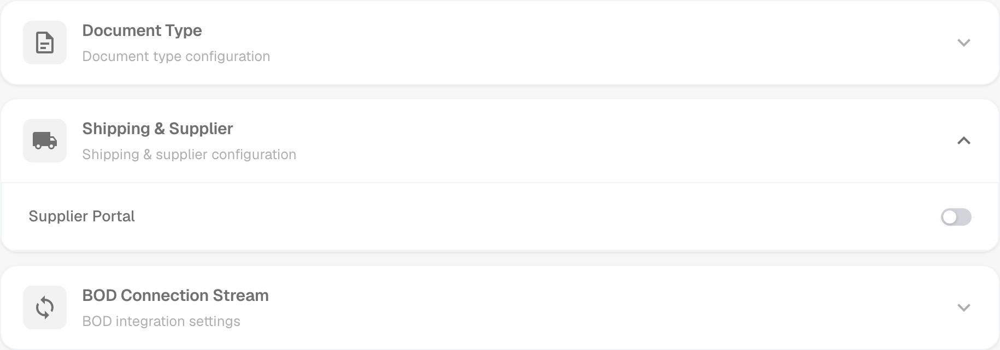
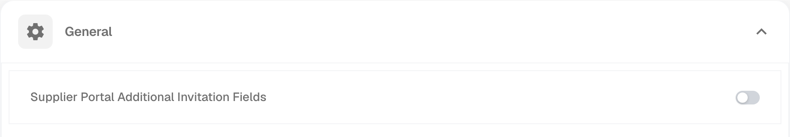
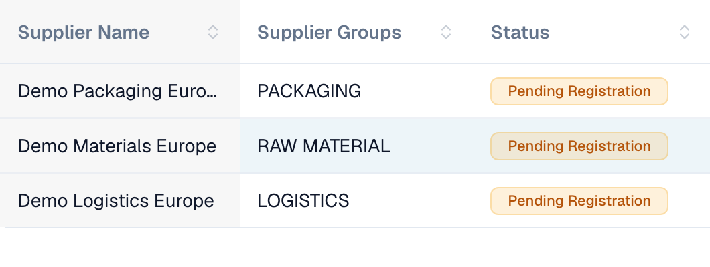
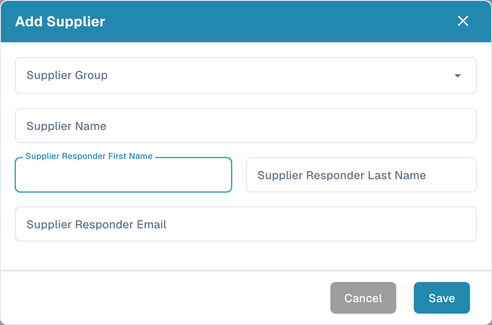

# Supplier Portal

The **Supplier Portal** lets an administrator give their company’s suppliers access to **DocBits**. The administrator enables the portal and configures which suppliers can use it and which information they can see.

An invited supplier registers and signs in with their own account. They can then view the information made available to them, such as the status of their purchase orders and invoices. The organisation’s configuration determines which features are available.

## Admin: enable the portal

1. In Settings, open Modules and select **Document Integration**.
2. Expand **Shipping & Supplier** and enable **Supplier Portal**.
3. If an activation dialog appears, review the displayed plan and confirm the activation you need.

<figure><figcaption>
Portal option in the shipping and supplier module. This switch enables the feature for the organisation.
</figcaption></figure>

## Admin: configure the portal

Configure the portal for your organisation before sending the first invitations:

- [General supplier settings](../../settings/supplier-setting/supplier-general-settings.md): Additional invitation fields, statuses, logo and privacy information.
- [Email templates](../../settings/supplier-setting/editing-email-templates.md): Invitation message content and presentation.
- [Supplier layout](../../settings/supplier-setting/supplier-layout.md): Fields for supplier registration and internal supplier administration. Select the appropriate layout type.
- [Supplier permissions](../../settings/supplier-setting/supplier-permissions.md): Assign internal employees to supplier groups. These internal responsibilities are separate from a supplier’s own portal access.

<figure><figcaption>
General supplier settings with the option for additional invitation fields.
</figcaption></figure>

## Admin: invite suppliers

Open supplier administration. Before inviting someone, check the company, supplier group, contact person and email address. Saving a new supplier requests the registration invitation to be sent; it does more than store a draft. For an existing supplier, use the relevant invitation action. A send confirmation does not prove email delivery or completed registration.

<figure><figcaption>
Internal supplier administration with three fictional companies. Each status shown here is pending registration.
</figcaption></figure>

<figure><figcaption>
Form for creating and inviting a supplier. Check the company, contact person and email address before saving.
</figcaption></figure>

## Supplier: register and access DocBits

The supplier opens their invitation, creates or uses the intended personal account, and follows the configured registration steps. They can then view the information made available to them in DocBits. The exact process and available functions depend on the organisation.

[Supplier registration guide](supplier-registration.md).

## Understand access and status

Portal activation, invitation sent, registration completed and approval granted are different states. A supplier record or saved master data does not prove that portal access is ready. The supplier view follows assigned permissions and differs from the internal admin view.
