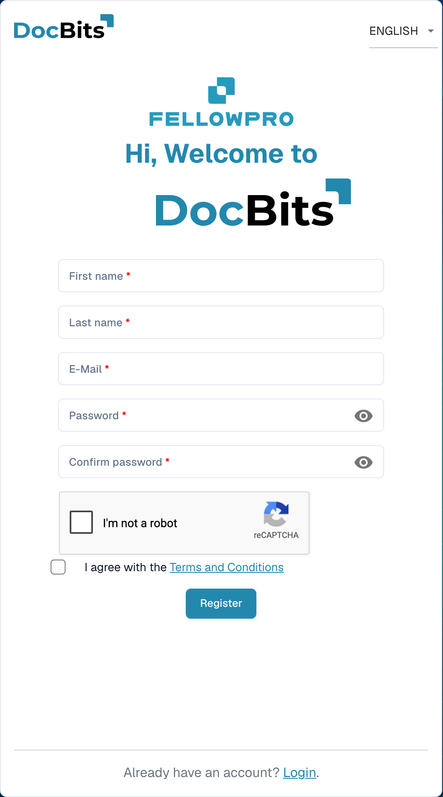

# Supplier registration

This guide is for suppliers invited to an organisation’s DocBits portal. Use the link in your invitation. You have your own supplier account; the inviting organisation determines which information is available and which registration steps are required.

## 1. Open the invitation

Check which organisation sent the invitation and which email address it is intended for. Open the registration link in that invitation. If it has expired or was sent to the wrong person, ask the inviting organisation for a new invitation.

## 2. Set up your own account

Check any prefilled name and email address. Enter the requested account details and follow the displayed password rules. Read the terms and privacy information shown. Complete account registration using the registration control. An existing account and a new registration are different cases; follow the process intended for your invitation.

<figure><figcaption>
Supplier account registration form. This example shows an empty entry form; an invitation may prefill some details.
</figcaption></figure>

## 3. Complete supplier information

Enter the information and any supporting documents requested by the organisation. Fields and sections depend on its supplier layout. Required-field indicators and validation messages show what is needed. Save your progress if the screen offers this option; saving is not automatically the final submission.

## 4. Check registration and approval

Submit your information using the designated completion action. If a review or approval is configured, wait for its result. Then sign in with your own account. The organisation determines which purchase orders, invoices and other information you can view.

## If you cannot access the portal

Contact the inviting organisation if your invitation link is invalid, permissions are missing or required information is unclear. An internal supplier record does not replace your registration or the necessary access approval.

[Supplier portal setup](README.md).
