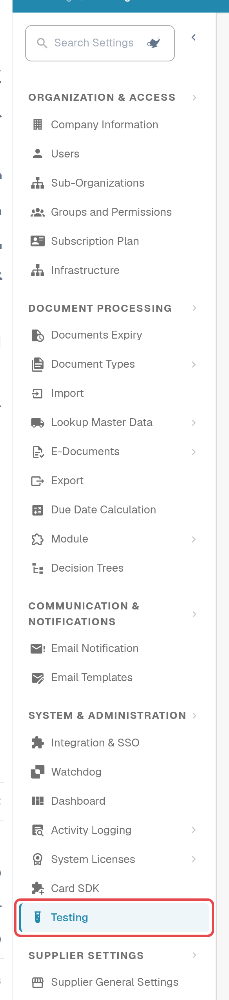
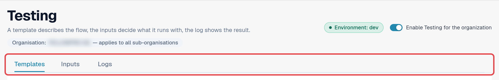
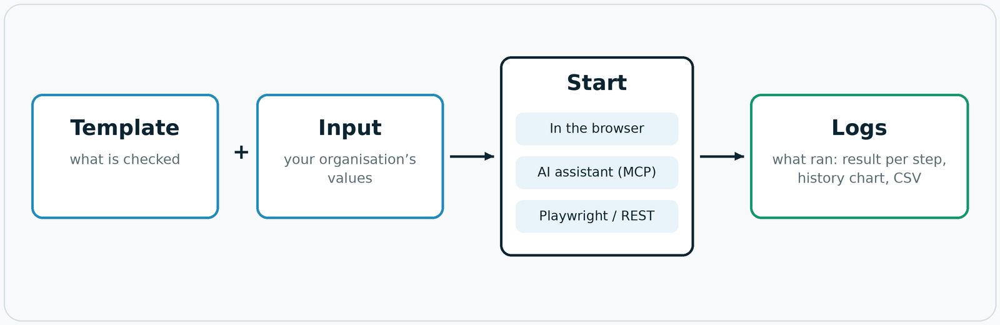
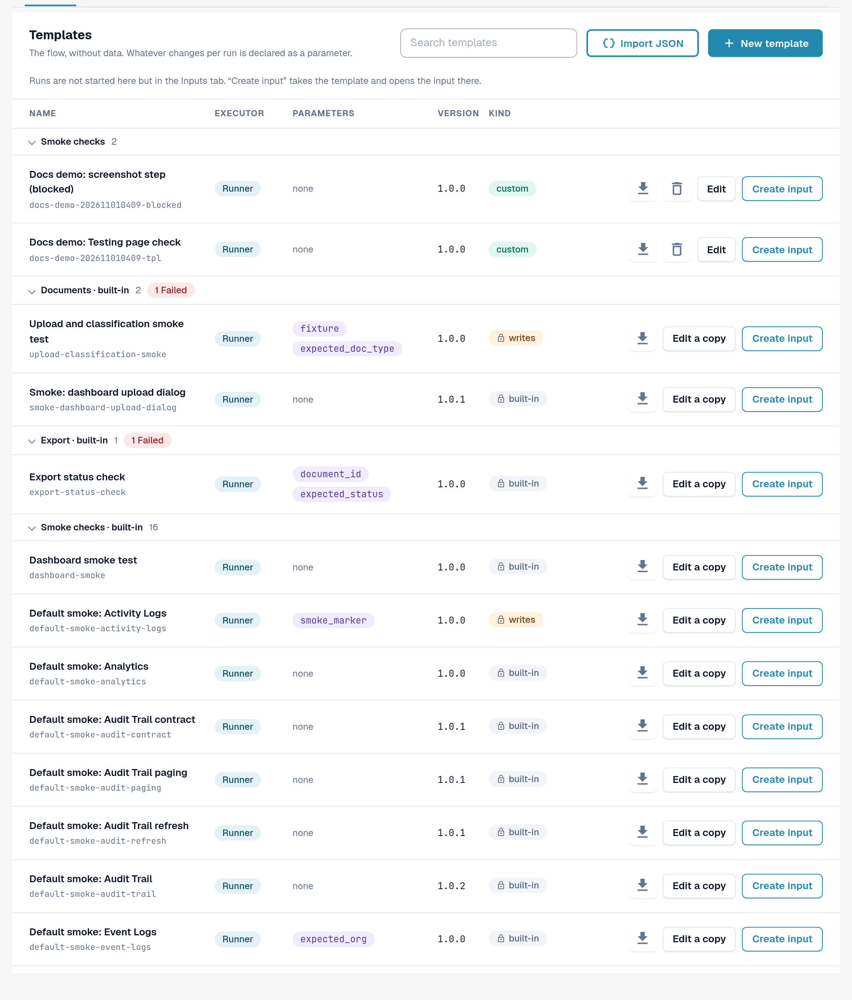

# Testing Module

## What the Testing module is for

The **Testing** module runs browser tests inside your own signed-in DocBits session. A test drives the real
screens instead of a mock: it opens the dashboard, uploads a sample invoice, checks that a new document reaches
validation, or confirms that an export reports the expected status. It checks that DocBits behaves correctly
**in your organisation**, and it records the result of every step.

You find the module in **Settings → Testing**. It is meant for administrators who look after the test suites of an
organisation.

Use it when you want to:

* confirm that everything still works after a release, a configuration change or an import of settings;
* repeat the same acceptance check for several organisations during an implementation;
* give QA a list of checks that anyone can start and whose results everyone can read;
* let your test automation or an AI assistant start the same checks and read the results.

## Who can use it

The module is available to **organisation admins** (see [Admin Privileges](https://docs.docbits.com/administration-and-setup/settings/global-settings/groups-users-and-permissions/users/admin-privileges)).
It is switched off for every organisation until an organisation admin switches it on.

1. Open **Settings**. In the sidebar, under **System & Administration**, select **Testing**.
2. Switch on **Enable Testing for the organization**.

<figure><figcaption>
Settings sidebar with the Testing entry highlighted.
</figcaption></figure>

<figure><figcaption>
Testing page header with the environment badge, the switch and the three tabs.
</figcaption></figure>

Under the title, **Organisation: … — applies to all sub-organisations** shows the organisation this page works for. What you set up here applies to that organisation and all its sub-organisations.

While the switch is off, the page only shows *Testing is switched off. Nothing runs until an organization
admin switches it on.* Switching it off again also ends every browser tab that was registered for starts from outside.

The badge **Environment** shows where you are. On a customer environment (sandbox or production) it is red, and
DocBits applies extra protection: tests that change data need an explicit confirmation, and export, delete or
approve steps are blocked unless the template declares that it writes data.

## How it works: template, input, start, log

The page has three tabs: **Templates**, **Inputs** and **Logs**. A template describes the flow, an input decides
what it runs with, and the log shows the result.

<figure><figcaption>
Diagram: Template plus Input gives a test; it is started in the browser, by an AI assistant or from outside; every run ends in the Logs.
</figcaption></figure>

| Part | Tab | What it is |
|---|---|---|
| **Template** | **Templates** | A reusable test definition: *what* is checked, step by step. It contains no data of your organisation. Whatever changes from organisation to organisation is a **parameter**. |
| **Input** | **Inputs** | Your organisation's saved values for the parameters of one template, for example the document to open. **Template + input = a test you can start.** |
| **Start** | **Inputs** | The module runs and steers the test. There are three equal ways to start it: in the browser, from an AI assistant via MCP, or from outside with Playwright or a REST call. |
| **Log** | **Logs** | What actually ran, whichever way it was started: the result, every step, the parameters used. A history chart shows results over time; you can export logs as CSV. |

DocBits ships **default templates** (their IDs start with `default-smoke-`) and a few built-in ones. They are the
same for every organisation and cannot be changed or deleted. A default template can run in any organisation; the
input supplies what is specific to yours. You can also create your own templates and delete them again.

## Quick start: run a default test

1. Open **Settings → Testing**, tab **Templates**.
2. In the group **Smoke checks**, find a default template without parameters (the **Parameters** column shows *none*), for example *Default smoke: log metrics*.
3. Select **Create input**. The **Inputs** tab opens with a new input for this template.
4. Enter an **Input name** and select **Save input**.
5. Select **Start**. The test runs in this browser tab; do not reload or close the tab while it runs.
6. Open the **Logs** tab. The newest row shows the result: **Passed**, **Failed** or **Blocked**.

<figure><figcaption>
Templates tab with the Smoke checks group.
</figcaption></figure>

Read on:

* [Templates](templates.md): defaults, your own templates, import and delete
* [Inputs](inputs.md): save your organisation's values
* [Start a Test](start-a-test.md): in the browser, from an AI assistant or from Playwright
* [Logs and History](logs.md): results, chart and CSV export
* [Troubleshooting](troubleshooting.md)
* [For Developers](for-developers.md)
