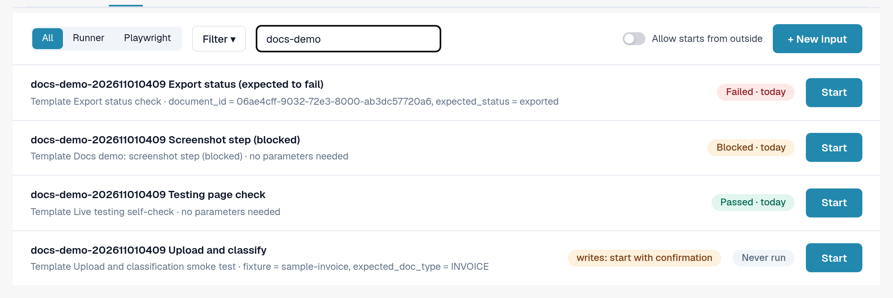
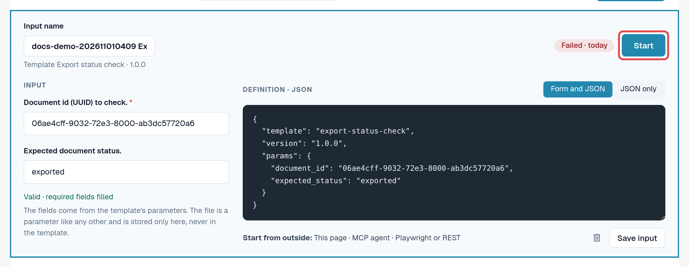
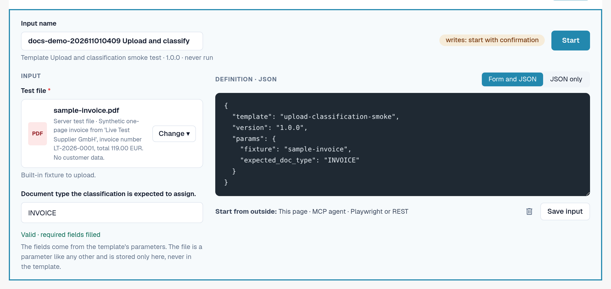

# Inputs

An input stores **your organisation's values** for the parameters of one template, under a name of your choice.
A template plus an input is a test you can start again and again, by hand or automatically.

Example: the default template *Default smoke: validation contract* opens a document and checks its status and
document type. It needs a document ID. Your input *Invoice LT-2026-0001 ready for validation* stores the ID of a
document in your organisation and the status you expect.

Open **Settings → Testing**, tab **Inputs**.

<figure><figcaption>
Inputs tab with saved inputs and their last results.
</figcaption></figure>

Each row shows the input name, its template and version, the last result and **Start**. **Update available**
means the template has a newer version than the one this input was saved for. A **writes: start with confirmation**
chip marks inputs whose template changes data.

## Create an input

1. In the **Templates** tab, select **Create input** on the template. (Or, in the **Inputs** tab, select
   **+ New input** and choose the template.)
2. Enter an **Input name**, for example the purpose and the organisation.
3. Fill in the parameters. Required fields are marked with an asterisk. You can switch between **Form and JSON**
   and **JSON only**; both stay in step.
4. Check the line under the form: *Valid · required fields filled* means the input can start.
5. Select **Save input**.

<figure><figcaption>
Input editor with name, parameters and validity line.
</figcaption></figure>

### Files as parameters

Some templates upload a document. Their file parameter offers **Organisation files** (PDF, PNG or JPEG up to 10 MB
that your organisation uploaded for testing) and **Server test files** (synthetic test files provided by DocBits).
The file is stored in your organisation, never in the template.

<figure><figcaption>
File parameter with organisation files and server test files.
</figcaption></figure>

### Values that are never saved

Parameters marked as sensitive (for example a password for an external system) are never stored. The input
remembers only that the value is needed; you enter it at every start (*Only sent at start; never saved.*).
Logs show such values as *Provided at start*.

## Change or delete an input

Open the input from the list, change it and select **Save input**. To delete it, select the bin icon in the
editor and confirm. Deleting an input does not delete its logs.


If your organisation keeps **test cases**, the **Test cases** link in the filter menu of the Inputs tab lists their
cases and shows which have a template. A case without a template can be confirmed manually by an authorised person.

