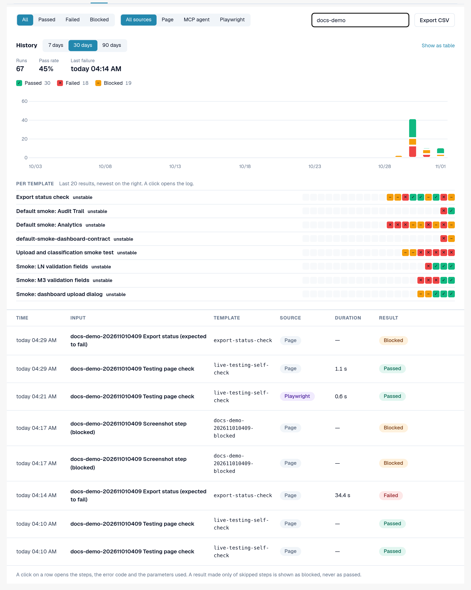
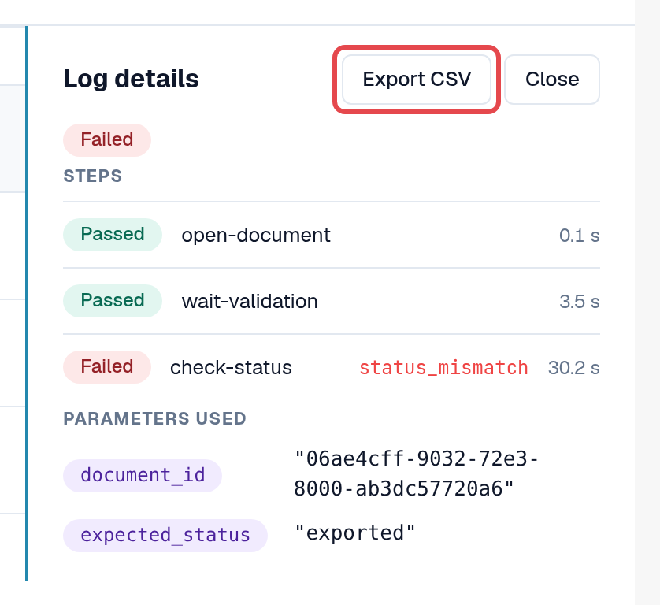
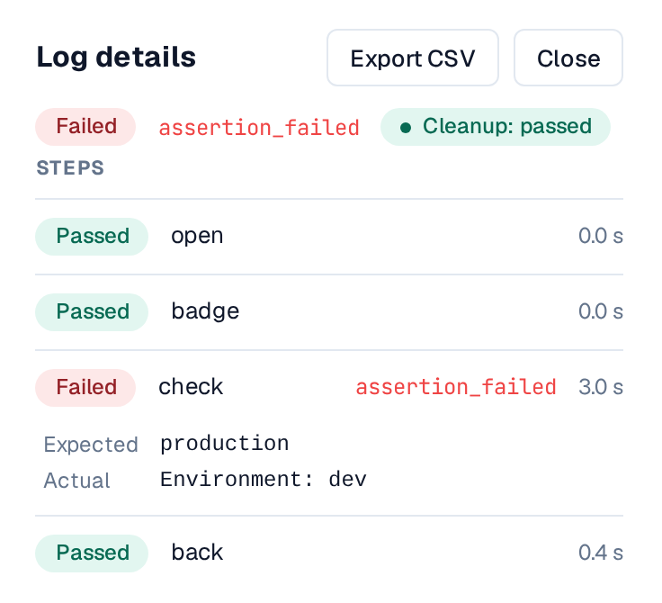
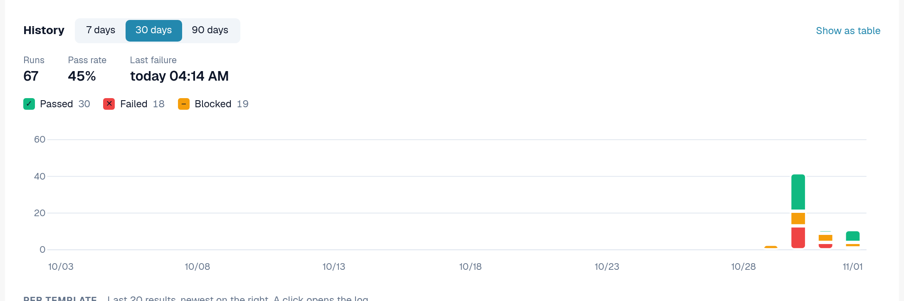
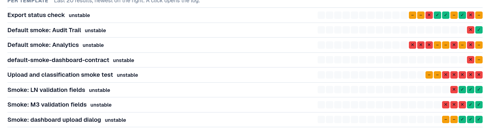
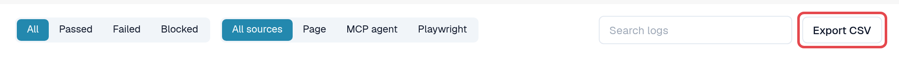

# Logs and History

Every run, whichever way it was started, ends up in the **Logs** tab: the result, the steps, the error code of a failed
step and the parameters that were used. Logs store no page content and no screenshots.

Open **Settings → Testing**, tab **Logs**.

<figure><figcaption>
Logs tab with mixed results and sources.
</figcaption></figure>

## Read the list

| Column | Meaning |
|---|---|
| **Time** | When the run started. |
| **Input** | The input that was started (or the test plan case). |
| **Template** | The template ID. |
| **Source** | **Page** (started in the browser), **MCP agent**, **Playwright**, **Manual** (a case confirmed by hand). |
| **Duration** | How long the run took. |
| **Result** | **Passed**: every step passed. **Failed**: a step failed. **Blocked**: the run could not be judged, for example because steps were skipped; a run made only of skipped steps is never shown as passed. |

Filter with **All / Passed / Failed / Blocked**, with **All sources / Page / MCP agent / Playwright**, or with
**Search logs**.

## Open a log

Select a row. **Log details** shows every step with its result, the error code of a failed step and the
**Parameters used** (sensitive values only as *Provided at start*). **Open case** jumps to the test plan case, if
there is one.

<figure><figcaption>
Log details of a failed run.
</figcaption></figure>

### Expected and actual value

Under a check that failed, **Log details** shows what the check expected and what it found:

* **Expected**: the value the template asks for.
* **Actual**: the value that was on the page.

Both appear on **development and test environments** only, are shortened to 120 characters and are left out when the
step uses a sensitive value. On a customer environment (sandbox, production) the log keeps only the error code.

### Cleanup

If the template has [cleanup steps](steps-and-blocks.md), the chip next to the result shows how they ended:
**Cleanup: passed**, **Cleanup: failed** or **Cleanup: skipped** (for example because the run was stopped). Cleanup steps
run even after a failed check. A failed cleanup does not change the result of the run, but test data, for example an
uploaded document, may be left behind. Open the log to see which cleanup step failed.

<figure><figcaption>
Log details: the failed check with Expected and Actual, and the chip Cleanup: passed.
</figcaption></figure>

## History chart

Above the list, **History** shows how tests ran over time. Switch between **Show as chart** and **Show as table**.

* **Results per day**: how many runs passed, failed or were blocked on each day, in your time zone. Choose the
  **Time range** (7 to 90 days, default 30). Select a day to filter the list to it; **Show all days again** removes the filter.
* **Pass rate** and **Last failure** summarise the range. Runs that are still going count as *without a result yet*.
* **Per template**: the last 20 results of each template, newest on the right, with a label: **stable** (only
  passed), **unstable** (mixed results) or **not passing** (only failed or blocked). Select a result to open its log.
  Unstable templates are listed first.

<figure><figcaption>
History: results per day.
</figcaption></figure>

<figure><figcaption>
Per template: last 20 results and stability.
</figcaption></figure>

## Export as CSV

Select **Export CSV** in the toolbar to download the logs that match the selected result and source (up to 5,000;
the search text is not applied). In **Log details**, **Export CSV** downloads a single log with all its steps.

The file opens directly in Excel (UTF-8). Times are in UTC. It contains the same information as the page: no
sensitive values, no page content.

<figure><figcaption>
Export CSV in the Logs toolbar.
</figcaption></figure>
