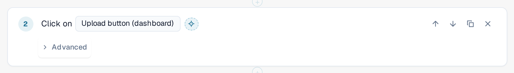
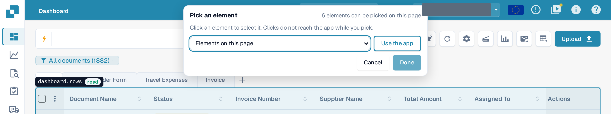
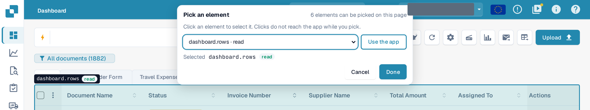
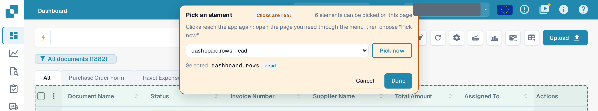

# Pick an Element in the App

Every step needs to know **which element** of the page it acts on: a button, a field, a table. Instead of looking
for it in a long list, you can point at it in the real application.

## Pick an element

1. In the template editor, select the crosshair button **Pick in app** next to the element of a step.

<figure><figcaption>
The Pick in app button next to the element of a Click step
</figcaption></figure>

2. DocBits opens the page that the test is on at this step: the page of the nearest earlier **Open page** step.
   If that step uses an input value, DocBits asks which page to open. Your draft is kept, unsaved, and the
   application stays in this browser tab.
3. A bar **Pick an element** appears at the top. It tells how many elements can be picked on this page. Move the
   mouse over the page: DocBits outlines the element under the pointer and names it, together with its class:
   **read** (only reads), **changes data**, **irreversible** or **unknown**.

<figure><figcaption>
Hovering over the document list: the outline names the element dashboard.rows and its class read
</figcaption></figure>

4. Click the element. The bar shows it under **Selected**. You can also choose an element from the list
   **Elements on this page** in the bar, which works with the keyboard and with a screen reader.

<figure><figcaption>
The bar after a click: dashboard.rows is selected, Done is enabled
</figcaption></figure>

5. Select **Done**. The editor opens again with your draft and the element in the step. Select **Cancel** to return
   without a change. In both cases the draft stays unsaved: select **Save** in the editor when you are happy with it.

While you pick, **the application does not see your clicks.** Picking a **Delete** button deletes nothing. Leave the
picker with **Done** or **Cancel**; no key (not even Escape) closes it. The button is switched off while a test
runs in this tab.

## Pick a table, a column or a row action

Steps of the group **Table** (**Check table row**, **Click table row**, **Remember value** from a table cell) accept
only tables. Click a cell of the table: DocBits takes the table and offers the column of that cell and the other
columns of the row as suggestions for the column fields of the step. For **Click table row**, click the button
inside the row to take that row action. **Check count** accepts any element, a table included.

## Use the app while picking

The element you need may be on another page. Select **Use the app**. The bar turns orange and shows **Clicks are
real**: from now on your clicks reach the application again, so you can open the other page through its normal menu.
The bar stays and its list follows the page. Select **Pick now** to pick again.

<figure><figcaption>
Use the app mode: clicks are real, Pick now returns to picking
</figcaption></figure>


In **Use the app** mode a click is a real click: it can save, delete or send data in your organisation.
Switch back with **Pick now** before you click anything you do not want to do.

