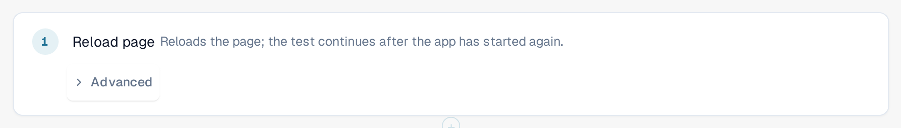

# Reload and Resume

Some things can only be checked after the page has been loaded again, for example that a setting is still there
after a reload. The step **Reload page** reloads the browser page in the middle of a test, and the test continues
afterwards.

## Add a reload step

1. In the template editor, select **+ Add step**, then the group **Page**, then **Reload page**.
2. Put the step where the reload should happen. Steps after it run in the reloaded page.

<figure><figcaption>
The step Reload page in the template editor
</figcaption></figure>

## What happens during a run

1. The tab saves the progress of the test, then reloads the page.
2. While the application starts again, a banner at the top says **Page reloaded, the test continues**, followed by
   the name of the test. Do not close the tab.
3. The reloaded page takes the run back and goes on with the next step. The steps before the reload keep their
   results, the **Reload page** step is shown as passed, and the clock of the test keeps running during the reload.

<figure><figcaption>
Banner after a reload: Page reloaded, the test continues
</figcaption></figure>

Remembered values are kept over the reload, except values you marked as secret (see
[Steps and Ready-made Blocks](steps-and-blocks.md)). Make sure no step after the reload needs a secret value.

## Good to know

* Only this step reloads the page without ending the test. If you reload or close the tab yourself, the run ends
  as **Cancelled**.
* The page has to come back within about two minutes. Otherwise the run ends as **Cancelled** or **Undeliverable**.
* A test can contain up to five reload steps.
* The test continues in the same browser tab and with the same user. If the browser does not let the tab save the
  progress (for example because storage is blocked), the reload step fails before the page is reloaded.
* The test needs template schema 1.3, which the editor sets when you add the step.
