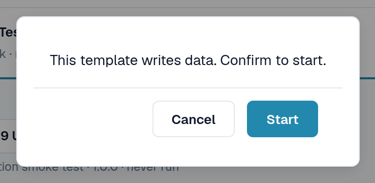
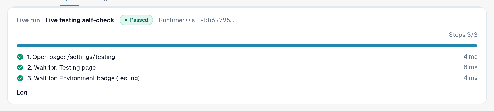
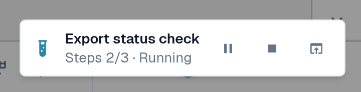
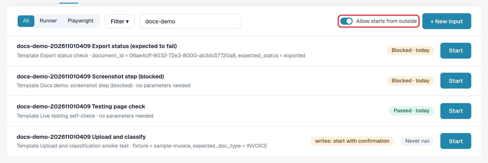
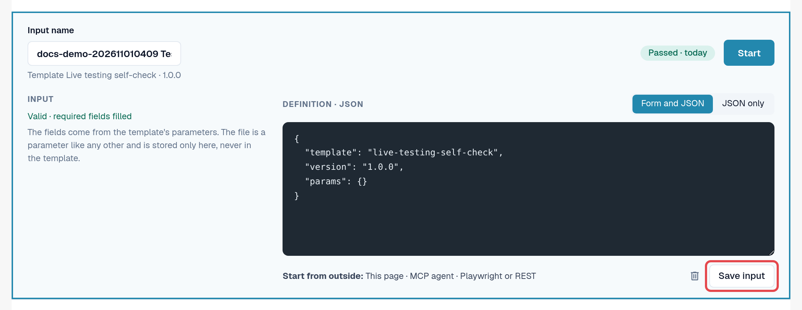

# Start a Test

A test is a template plus an input. The Testing module runs and steers it; you choose how to start it. All three
ways are equal and every run ends up in the [Logs](logs.md).

| Way | When to use it | Shown in the logs as |
|---|---|---|
| **In the browser** | You want to run a check now and watch it. | **Page** |
| **AI assistant (MCP)** | You work with an AI assistant connected to DocBits and want it to run and evaluate checks. | **MCP agent** |
| **From outside (Playwright or REST)** | Your test automation or CI pipeline starts checks, for example after a deployment. | **Playwright** |

In every case the clicks happen in a **DocBits browser tab of an organisation admin**, with that person's
permissions. The tab must stay open; reloading or closing it ends the run.

## Start in the browser

1. Open **Settings → Testing**, tab **Inputs**.
2. Select **Start** on the input (or open the input and select **Start**).
3. If the template changes data, DocBits asks: *This template writes data. Confirm to start.* Select **Start** to continue.
4. The test runs in this tab. On the Testing page the panel **Live run** shows the status, the **Current action**,
   the step progress and **Pause**, **Resume** and **Stop**. When the test opens another page, a small indicator in
   the bottom right corner shows the progress there. When the test ends, the indicator shows the result with
   **Open log** and **Dismiss**.
5. When the test ends, open the **Logs** tab to read the result.

<figure><figcaption>
Confirmation before a test that writes data.
</figcaption></figure>

<figure><figcaption>
Live run panel after the test passed.
</figcaption></figure>

<figure><figcaption>
Run indicator in the bottom right corner on another page.
</figcaption></figure>

## Allow starts from outside

An AI assistant or a Playwright script cannot click by itself; it asks DocBits to run a test **in a browser tab that
you registered**:

1. Open **Settings → Testing**, tab **Inputs**, in the browser tab that should run the tests.
2. Switch on **Allow starts from outside**. The tab now accepts starts and shows its session ID.
3. Leave the tab open. The registration ends when the tab is reloaded or closed.

<figure><figcaption>
Allow starts from outside switched on, with the session ID.
</figcaption></figure>

The input editor reminds you of the three ways under **Start from outside:** **This page**, **MCP agent**,
**Playwright or REST**.

<figure><figcaption>
Start from outside line in the input editor.
</figcaption></figure>

## Start from an AI assistant (MCP)

If your AI assistant is connected to DocBits (see [DocBits MCP](https://docs.docbits.com/advanced-functions-and-tools/docbits-mcp)
and [Configure DocBits with Claude or Codex](https://docs.docbits.com/advanced-functions-and-tools/docbits-mcp/configuration-with-claude-or-codex)):

1. Allow starts from outside in a browser tab (see above).
2. Ask the assistant, for example: *"List my DocBits test inputs and start 'Invoice LT-2026-0001 ready for validation'
   in my registered browser tab. Then tell me the result."*
3. The assistant asks which tab to use if more than one is registered, and asks you before it starts a test that
   changes data. It then reads the log and reports the result.

## Start from Playwright or another tool (REST)

Your test automation starts an input with one API call and then reads its log. It needs:

* a token of an organisation admin of the organisation (see [API Key](https://docs.docbits.com/administration-and-setup/settings/global-settings/integration/api-key));
* the ID of the input;
* the session ID of a browser tab with **Allow starts from outside** switched on.

The call and an example are on [For Developers](for-developers.md).

## Customer environments

On sandbox and production the **Environment** badge is red. Tests that change data need an explicit confirmation at
every start, and export, delete or approve steps are blocked unless the template declares that it writes data. Run
writing tests on a test environment where possible.
