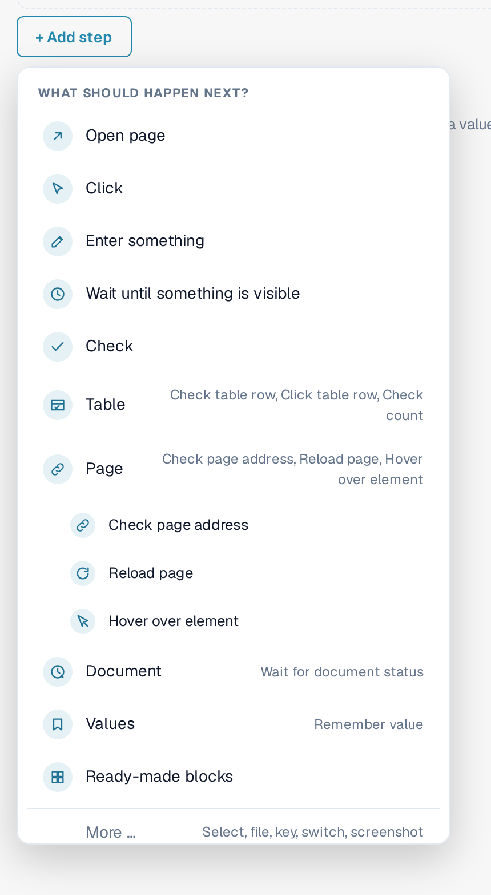
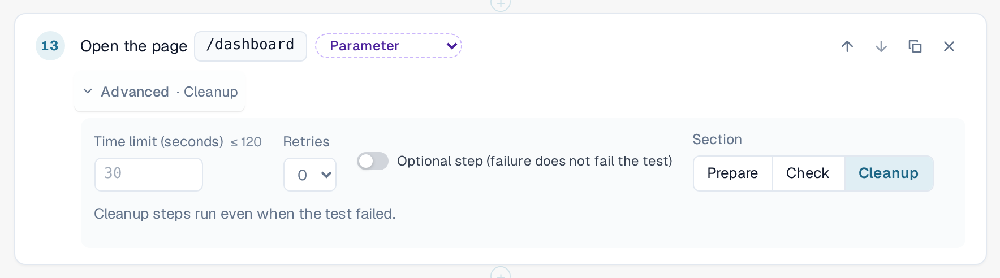
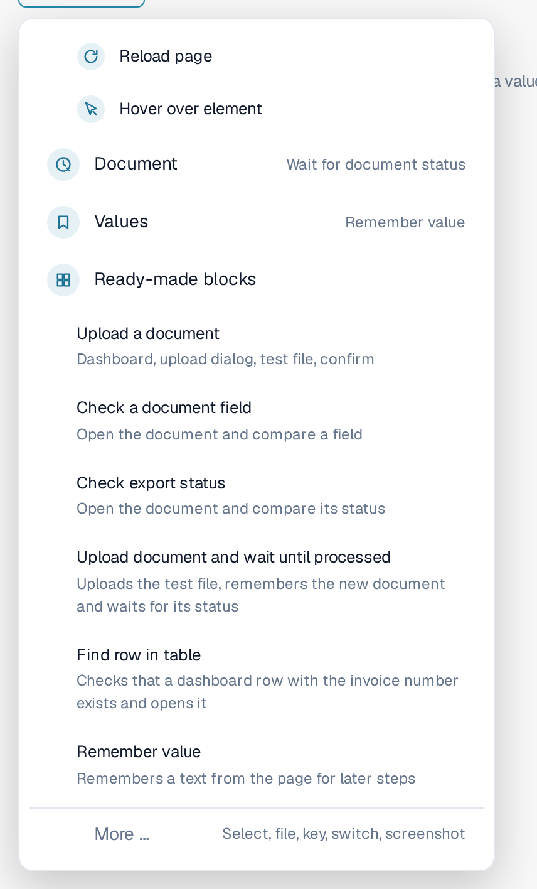
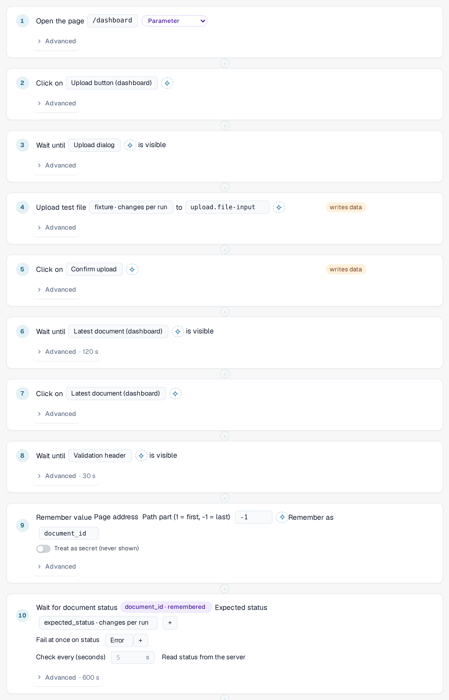
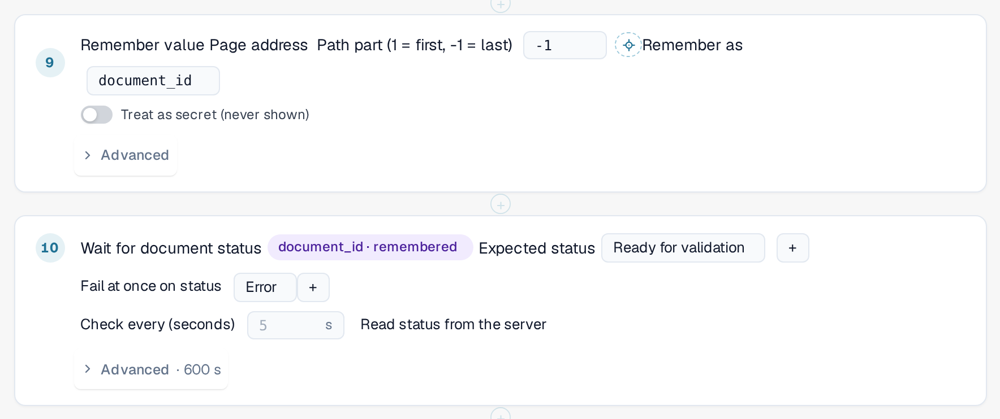
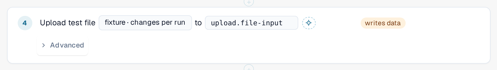

# Steps and Ready-made Blocks

This page explains how to build a template in the editor ([Templates](templates.md)): the step groups, the
**Advanced** settings of a step, the ready-made blocks and how a test passes values from one step to the next.

## Add a step

In the template editor, select **+ Add step**. The menu **What should happen next?** lists the steps. The five
basic steps are **Open page**, **Click**, **Enter something**, **Wait until something is visible** and **Check**.
Four **groups** hold the more specialised steps. Select a group to see its steps:

| Group | Steps |
|---|---|
| **Table** | **Check table row**, **Click table row**, **Check count**. For lists such as the document list on the dashboard. |
| **Page** | **Check page address**, **Reload page** (see [Reload and Resume](reload-and-resume.md)), **Hover over element**. |
| **Document** | **Wait for document status**: waits until a document reaches a status, for example *Ready for validation*. |
| **Values** | **Remember value**: keeps a text from the page for later steps. |

**Ready-made blocks** add several steps at once (see below). **More …** offers further steps: select an option, upload a file, press a key,
switch a toggle and take a screenshot (screenshot steps are skipped by the in-browser runner).

<figure><figcaption>
Add step menu with the groups Table, Page, Document and Values; the group Page is open
</figcaption></figure>

To point a step at an element of the page, select it in the list or use **Pick in app**
([Pick an Element in the App](pick-in-app.md)).

## Advanced settings of a step

Every step has an **Advanced** line. Select it to open the settings of that step. The collapsed line shows what you
changed, for example *Advanced · 120 s* or *Advanced · Cleanup*.

| Setting | Meaning |
|---|---|
| **Time limit (seconds)** | How long the step may take, up to 120 seconds. Leave it empty for the default of 30 seconds. Steps that wait for a document have their own, longer limit. |
| **Retries** | How often DocBits repeats the step if it fails (0 to 3). |
| **Optional step (failure does not fail the test)** | If the step fails, the log shows it as skipped with its error, and the test goes on. |
| **Section** | **Prepare**, **Check** or **Cleanup**. **Check** is the default. |

**Prepare** steps set the test up. **Check** steps are the test itself. **Cleanup** steps remove what the test left
behind, for example a document that it uploaded. **Cleanup steps run even when the test failed** or timed out, and
a failed cleanup step never changes the result of the test. They must be the last steps of the template; the editor reports an error if a
normal step follows a cleanup step. They do not run if you stop the test or close the tab.
A template with cleanup steps is saved as schema 1.3 (see [For Developers](for-developers.md)).

<figure><figcaption>
Advanced settings of a step: time limit, retries, optional step and section, with Cleanup selected
</figcaption></figure>

## Ready-made blocks

Select **+ Add step**, then **Ready-made blocks**. A block adds the steps of a common sequence together with the
parameters it needs. You can change every step afterwards.

| Block | What it adds |
|---|---|
| **Upload a document** | Opens the dashboard, opens the upload dialog, selects the test file and confirms. |
| **Check a document field** | Opens a document and compares a field with an expected value. |
| **Check export status** | Opens a document and compares its status. |
| **Upload document and wait until processed** | Uploads the test file, remembers the new document and waits for its status. |
| **Find row in table** | Checks that a row of the dashboard list with a given invoice number exists and opens it. |
| **Remember value** | Remembers a text from the page for later steps. |

<figure><figcaption>
Ready-made blocks in the Add step menu
</figcaption></figure>

### Upload document and wait until processed

Use this block when a later step needs the document that the test has just uploaded. It recognises the new document
by itself, not by the top row of the list, so an older document is never picked by mistake. It then reads the
document ID from the page address and waits until the document reaches the expected status
(default *Ready for validation*, up to 10 minutes; it stops at once if the document gets the status *Error*).
It adds the input values **fixture** (the test file) and **expected_status**, and raises the time of the whole test to at least 15 minutes.

<figure><figcaption>
Steps of the block Upload document and wait until processed
</figcaption></figure>


**Where uploads go:** if your organisation has sub-organisations and the dashboard shows all of them, the upload
dialog normally asks which sub-organisation the document belongs to. A test cannot answer that question. While a
test runs in the tab, the upload goes to the **first sub-organisation that the dialog offers**, without asking.
Outside a test nothing changes. To upload into a particular sub-organisation, start the test from that
sub-organisation's view.


### Find row in table

The block checks that the dashboard list has a row with the given invoice number (the input value **row_value**)
and opens it. To search by another column, change the column and the value in the step. Both steps belong to the
**Table** group; **Check count** counts rows or any other element.

## Remember a value and use it later

A test often needs a value that exists only while it runs, for example the ID of a document it has just uploaded.

1. Add **Remember value** (group **Values**). Choose where the value comes from: a text of the page, the page
   address (a part of the path or a query parameter) or a cell of a table row. Enter a name under **Remember as**,
   for example `document_id`. Switch on **Treat as secret (never shown)** for values that must not appear anywhere.
2. In a later step, choose the remembered value instead of typing one. The step shows a chip such as
   *document_id · remembered*. In the template JSON it is written `{{vars.document_id}}`.

Two kinds of values can be used in a step:

| Kind | Written as | Comes from | Example |
|---|---|---|---|
| **Input** | `{{params.name}}` | The saved [input](inputs.md): it is the same for every run of that input. Create it with the parameter button next to a value. | *fixture · changes per run* |
| **Remembered value** | `{{vars.name}}` | An earlier **Remember value** step of the same run. | *document_id · remembered* |

<figure><figcaption>
Remember value stores the document ID; the next step waits for that document
</figcaption></figure>

<figure><figcaption>
A step that uses the input value fixture
</figcaption></figure>

A remembered value exists only for the current run and is never saved in the template or the log. Remembered
values survive a [page reload](reload-and-resume.md) inside the test, unless they are marked as secret.
