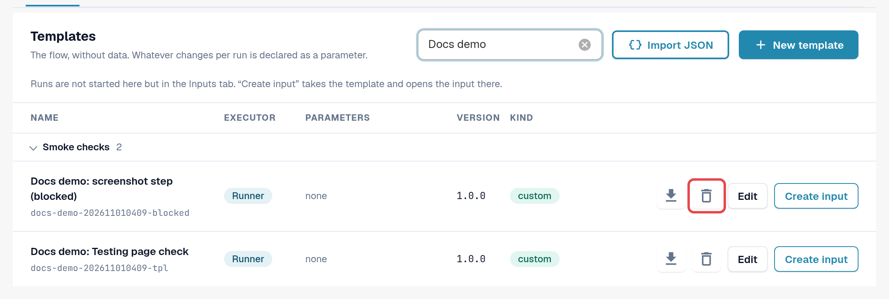
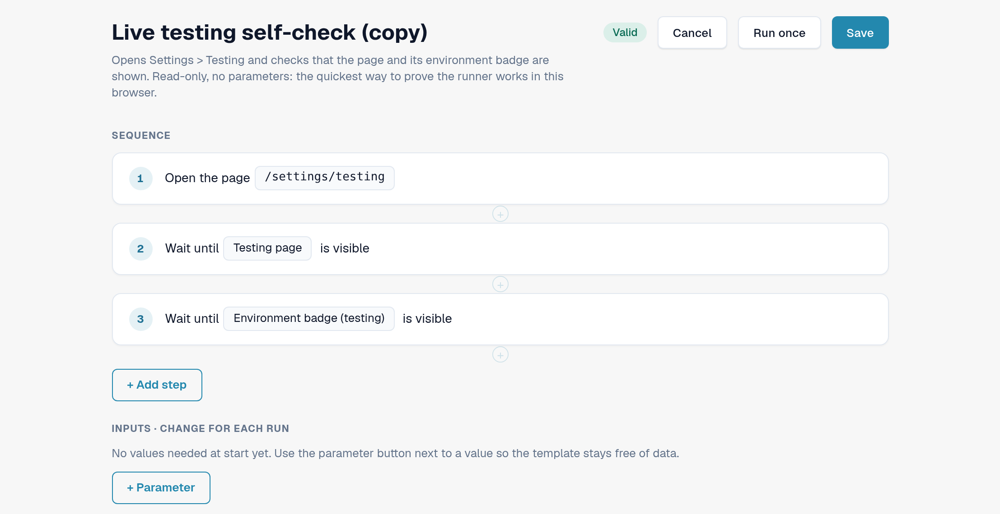
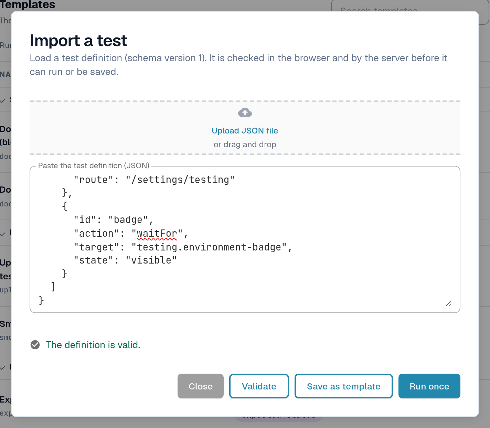
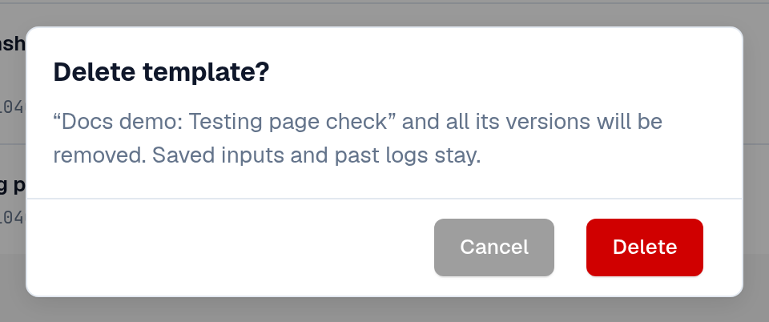

# Templates

A template describes **what** is checked: which page opens, what is clicked or filled in, and what must be
visible or true at the end. It contains no data of your organisation. Values that differ per organisation or per
run, such as a document ID, are declared as **parameters** and filled in by an [input](inputs.md).

Open **Settings → Testing**, tab **Templates**.

<figure><figcaption>
Templates tab: groups, columns and row actions.
</figcaption></figure>

## Read the list

Templates are grouped by category (for example **Smoke checks**, **Validation**, **Documents**, **Export**).
Select a group name to fold it; a red chip on the group counts templates whose last run failed.
**Search templates** filters by name.

| Column | Meaning |
|---|---|
| **Name** | The template name and, below it, its ID. |
| **Executor** | **Runner**: runs in your browser tab from this page. **Playwright**: a check run by your test automation; it can be documented here but not started from this page. |
| **Parameters** | The values an input must supply. *none* means the template runs as it is. |
| **Version** | Saved versions never change. A change is saved as a new version. |
| **Kind** | **built-in** (lock icon): part of the default set, the same for every organisation, read-only. **custom**: your organisation's own template. **writes**: the template changes data (for example uploads a document) and needs a confirmation before it starts. |

Row actions:

| Action | What it does |
|---|---|
| Download icon (**Export as JSON**) | Downloads the template definition as a JSON file, for example to keep it or to import it into another organisation. |
| **Edit a copy** (built-in) / **Edit** (custom) | Opens the template editor with a copy you can change and save as your own template. |
| **Create input** | Opens the [Inputs](inputs.md) tab with a new input for this template. Tests are started there, not here. |
| Bin icon (**Delete template**) | Only on your own templates. See *Delete your own template* below. |

<figure><figcaption>
A default row and an own template row with their actions.
</figcaption></figure>

## Create your own template

You need your own template when no default checks what you need, or when you want a changed copy of a default.

**Start from a default:** select **Edit a copy** on its row. **Start empty:** select **New template**.

In the template editor:

1. Enter a **Template name** and, optionally, what the template is for.
2. Select **+ Add step** and choose a block, for example **Open page**, **Click**, **Fill in**, **Select**,
   **Wait for**, **Check text**, **Check field** or **Check status**. **Ready-made blocks** add a common sequence in one go, for example
   **Upload a document** or **Check a document field**.
3. For every value that differs per organisation or per run, use the parameter button next to the value. The value
   becomes a parameter under **Inputs · change for each run**, with a type (**Text**, **Number**, **Yes/No**,
   **Server test file**), a default value and **Required** if it must be filled in.
4. Select **Save**. To try the draft once without saving, select **Run once**.

Steps that change data (for example uploading a document) are marked **writes data**. A template with such steps
asks for a confirmation every time it starts.

<figure><figcaption>
Template editor with two steps and one parameter.
</figcaption></figure>

If someone saved the same version of this template in the meantime (for example in another tab), DocBits keeps your
draft and offers **Save as the next free version** or **Reload the latest version**.

## Import a template from JSON

1. Select **Import JSON**.
2. Select **Upload JSON file**, or paste the definition into **Paste the test definition (JSON)**.
3. Select **Validate**. DocBits checks the definition in the browser and on the server and lists any problems.
4. Select **Save as template** to add it to your templates, or **Run once** to try it without saving.

<figure><figcaption>
Import a test dialog with a validated definition.
</figcaption></figure>

The format is described in [For Developers](for-developers.md).

## Delete your own template

1. On the row of your own template, select the bin icon (**Delete template**).
2. Read the confirmation **Delete template?** and select **Delete**.

The template and **all its versions** are removed. Saved inputs and past logs stay, so the history remains readable.
Inputs that pointed to the template stay in the list; edit or delete them. You can later save a template with the
same ID again. Built-in and default templates cannot be deleted.

<figure><figcaption>
Delete template confirmation.
</figcaption></figure>
