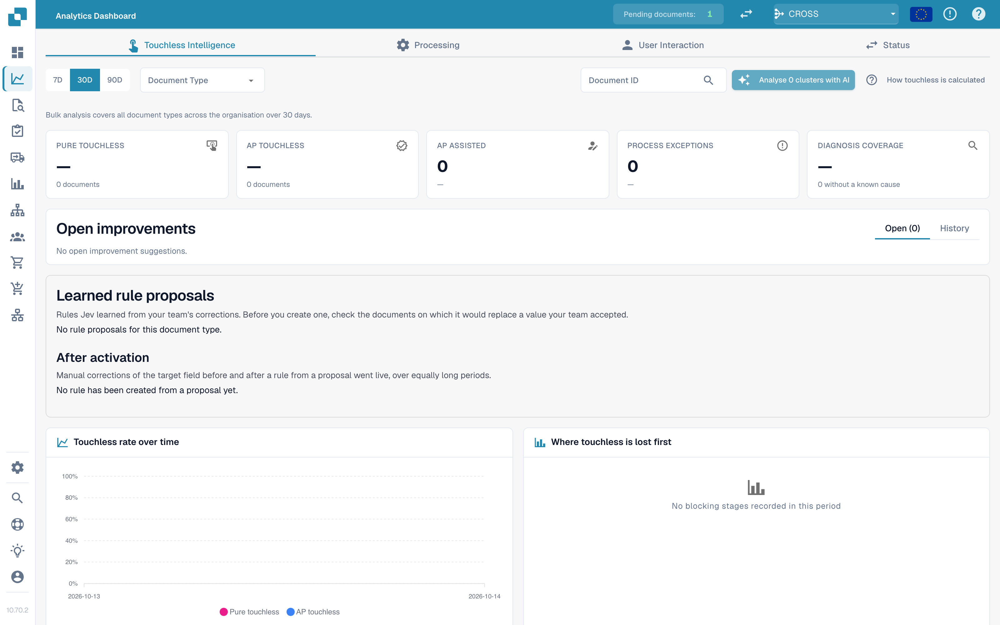
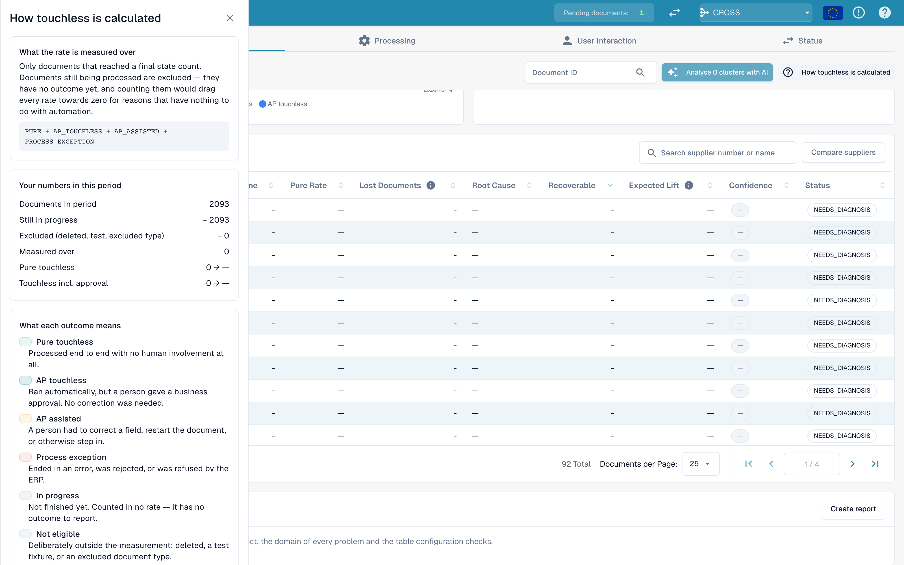
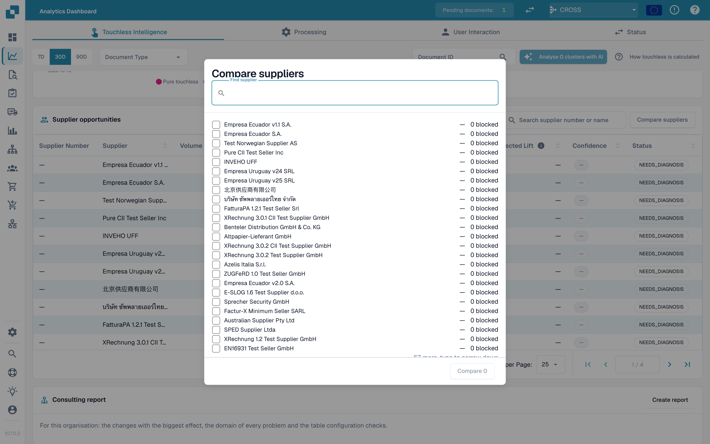

# Touchless Intelligence

## Overview

**Touchless Intelligence** answers two questions about your document processing:

1. **How many documents run through DocBits without anyone touching them?** This is your *touchless rate*.
2. **Why do the others stop, and what should we change so that fewer stop?** This is the *diagnosis*.

It is a tab of the [Analytics Dashboard](analytics-dashboard.md). It does not add any work for your team: DocBits records what happens to every document in the processing pipeline and evaluates the result every 15 minutes.

<figure><figcaption><p>The Touchless Intelligence tab: key figures, improvements, the rate over time and the lost-first chart. Example organisation with demo data; supplier names are fictional.</p></figcaption></figure>

### What you can do with it

| You want to… | Use | Example |
| --- | --- | --- |
| See how automated you are | The five **key figures** at the top | "63.2 % of our documents ran without a person last month" |
| See the trend | **Touchless rate over time** | "The rate rose from 55 % to 68 % since we fixed supplier master data" |
| Find out where documents get stuck | **Where touchless is lost first** | "Most documents stop at Field Validation" |
| Decide which supplier to fix first | **Supplier opportunities** | "Supplier A would give us +4.0 percentage points" |
| Understand one supplier | **Supplier Diagnosis** page | "Their invoices have no PO number, so PO matching fails" |
| Understand one document | **Document Trace** | "This invoice stopped at stage 8, Field Validation" |
| Compare suppliers | **Compare suppliers** | "Supplier A and B use the same template, but only B fails" |
| Change a setting that helps | **Change proposals** | "Switch on automatic PO match: preview, apply, measure, undo" |

## Who can see it

* The tab is part of the Analytics Dashboard. Your administrator enables it for the organisation. If the tab is missing, ask your administrator.
* **Organisation administrators** always see it.
* Other users see it when an administrator granted their role the **Analytics dashboard** tab (**Settings → Roles**). Without a grant, only administrators have access.
* Some actions are for administrators only: **AI analysis**, **applying and undoing a change**, **learned rule proposals** and the **Consulting report**.

If you are not allowed, the page shows *Action not allowed, please contact the administrator*.

## What "touchless" means

Every document ends in exactly **one** outcome:

| Outcome | Meaning | Counts in the rate |
| --- | --- | --- |
| **Pure touchless** | Processed from import to export with **no human involvement at all** | Yes, as a success |
| **AP touchless** | Ran automatically, and a person only gave the **business approval**. No correction was needed | Yes, as a success |
| **AP assisted** | A person had to **correct a field, restart the document** or otherwise step in | Yes, as a miss. It is not a failure, only automation that did not fully carry the document |
| **Process exception** | Ended in an **error**, was **rejected**, was **refused by the ERP**, or **stalled** in the pipeline | Yes, as a miss |
| **In progress** | Not finished yet | **No**. It has no outcome yet |
| **Not eligible** | Deleted, archived, a test document, or an excluded document type | **No** |

The **touchless rate** is:

```
rate = (Pure touchless + AP touchless)
       ÷ (Pure touchless + AP touchless + AP assisted + Process exception)
```

Documents that are still **in progress** or **not eligible** are never in the calculation. This protects the rate: a document that arrived five minutes ago cannot pull it down.


**One touch counts for good.** Once a person has touched a document, it stays counted as touched, even if a later automatic run would have needed nobody. **Restarting a document does not make it touchless again.** The rate reflects the work that happened.


### Example calculation (illustrative numbers)

In 30 days, 200 documents arrived:

| Outcome | Documents |
| --- | --- |
| Pure touchless | 120 |
| AP touchless | 30 |
| AP assisted | 30 |
| Process exception | 10 |
| In progress | 8 |
| Not eligible (test documents) | 2 |

* Denominator: 120 + 30 + 30 + 10 = **190**. The 8 in-progress and 2 not-eligible documents are left out.
* **Pure touchless**: 120 ÷ 190 = **63.2 %**
* **AP touchless**: 30 ÷ 190 = **15.8 %**
* **Touchless rate**: (120 + 30) ÷ 190 = **78.9 %**

The tab shows a **target** (70 % unless your organisation uses a different one). In this example the rate is above the target.

Click **How touchless is calculated** at the top right to open this explanation inside DocBits, with the numbers of your own period (documents in period, still in progress, excluded, measured).

<figure><figcaption><p>The drawer <strong>How touchless is calculated</strong>: the formula, <strong>Your numbers in this period</strong> (here 2,425 documents, 2,115 still in progress, 310 measured) and what each outcome means. Example organisation with demo data; supplier names are fictional.</p></figcaption></figure>

### How current are the numbers

Outcomes are **recalculated every 15 minutes**. A document's outcome can still change after it first appears: the ERP may confirm an export hours later. The line **Data as of …** at the bottom of the tab shows when the numbers were last computed.

## The overview tab

### Filters

| Filter | What it does |
| --- | --- |
| **7D / 30D / 90D** | The period for the key figures and the queue. The default is 30 days |
| **Document Type** | Restricts every number to one type, for example INVOICE |
| **Segment field / Segment value** | Only if your organisation runs several processes through one document type (for example direct, indirect and EAM orders in the field `order_type`). Pick a field to see the breakdown, pick a value to narrow everything to it |
| **Document ID** | Opens the **Document Trace** for one document |

The **sub-organisation** you selected at the top of DocBits narrows the key figures and the supplier queue. Issue clusters and the AI analysis always cover the whole organisation.

### The five key figures

<figure><figcaption><p>The five key figures. Here the pure rate is 50.3 % (156 documents), which is 19.7 points under the 70 % target, and diagnosis coverage is 100 %. Example organisation with demo data; supplier names are fictional.</p></figcaption></figure>

| Card | Shows | Example (illustrative) |
| --- | --- | --- |
| **Pure touchless** | The percentage and the difference to the target | **63.2 %** · "120 documents" · "−6.8 pp vs 70 % target" (red, below target) |
| **AP touchless** | The percentage | **15.8 %** · "30 documents" |
| **AP assisted** | The number of documents and their share | **30** · 15.8 % |
| **Process exceptions** | The number of documents and their share | **10** · 5.3 % |
| **Diagnosis coverage** | How many blocked documents have a **known** cause | **80 %** · "10 without a known cause" |

* A card shows a dash (—) instead of **0 %** when there is nothing to measure. A dash means "no data", not "zero".
* **Diagnosis coverage** = documents with a known blocking reason ÷ all blocked documents. Example: 50 blocked documents, 10 with an unknown cause → 40 ÷ 50 = **80 %**. A low value means "we do not yet understand why documents stop". Improve it before you try to fix individual causes.
* **Click a card** to open the document list behind the number in a new tab ("View the documents behind this number"). Cards with 0 documents are not clickable.

### Touchless rate over time

<figure><figcaption><p>The rate per day with the target line. Here the rate stays between 40 and 60 % and drops sharply from 10 October. Example organisation with demo data; supplier names are fictional.</p></figcaption></figure>

A chart with one line for **Pure touchless**, one for **AP touchless** and the **target line**. Short periods show daily points, long periods weekly points.

**Example.** After you switched on automatic PO matching on 1 October, the pure rate climbs from 55 % to 68 % within two weeks. The chart shows the day the curve turns, so you can match it to your change.

### Where touchless is lost first

<figure><figcaption><p>Blocked documents by the stage and reason where they stopped first. Here <strong>Field validation: Required field missing</strong> costs the most documents (58), then <strong>Export mapping failed</strong> (46) and <strong>PO item mismatch</strong> (27). Example organisation with demo data; supplier names are fictional.</p></figcaption></figure>

A bar chart of **Blocked documents** per pipeline stage: the **first** stage that stopped a document.

**Example.** Bars: Supplier Identification 12, Field Validation 41, PO Line Match 7. The biggest bar tells you to look at **Field Validation** first, usually because a required field is not extracted.

### Supplier opportunities

<figure><figcaption><p>The supplier queue (shortened to the first four rows). The first supplier has 106 documents, a pure rate of 38.7 % and 65 recoverable documents, so fixing it is worth <strong>+21 pp</strong>. Example organisation with demo data; supplier names are fictional.</p></figcaption></figure>

The queue answers **"Which supplier should we fix first?"** It is sorted by **Recoverable** documents, highest first, 25 rows per page.

| Column | Meaning |
| --- | --- |
| **Supplier Number / Supplier** | The supplier. Documents without a recognised supplier appear as **No supplier identified (n documents)** |
| **Volume** | Eligible documents of the supplier in the period |
| **Pure Rate** | Share of pure touchless documents. Green if at or above the target, red if below |
| **Lost Documents** | Documents that ended as AP assisted or as a process exception. Not always a person: an ERP rejection or a document that stalled for seven days counts too |
| **Root Cause** | Who owns the fix: Configuration, ERP integration, Export, Extraction, Master data, Measurement, PO matching, User process, Validation or Unknown |
| **Recoverable** | Lost documents whose cause DocBits can fix: configuration, master data or supplier template |
| **Expected Lift** | How many **percentage points** your organisation's rate would gain if every recoverable document of this supplier ran touchless (**+x pp**) |
| **Confidence** | **High**, **Medium** or **Low**: how sure the diagnosis is |
| **Status** | New, Open, Investigating, In progress, Confirmed, Resolved, Dismissed. A supplier with too few documents shows **NEEDS_DIAGNOSIS** |

**Example.** Your organisation has 1,000 eligible documents in the period. Supplier A has 40 recoverable documents, Supplier B has 90 lost documents but only 10 recoverable (their problem is on their side).

* Supplier A: 40 ÷ 1,000 = **+4.0 pp expected lift**
* Supplier B: 10 ÷ 1,000 = **+1.0 pp**, although B has more lost documents

The queue ranks A above B because **expected lift** is measured against your whole organisation, not against the supplier. A supplier with four bad documents cannot outrank one with four hundred.

Use the search box ("Search supplier number or name") to find a supplier. Click a row to open the **Supplier Diagnosis**.

### Compare suppliers

<figure><figcaption><p>Three suppliers side by side: pure rate, lost and recoverable documents, root cause, expected lift and a bar chart of the outcomes. Each <strong>Open</strong> leads to the Supplier Diagnosis. Example organisation with demo data; supplier names are fictional.</p></figcaption></figure>

Click **Compare suppliers**, tick **two to five** suppliers (each is listed with its number of blocked documents) and click **Compare**.

The comparison shows the suppliers side by side: **Pure rate**, **Lost documents**, **Recoverable**, **Root cause**, **Expected lift**, a bar chart of the outcomes, and a link to each **Supplier Diagnosis**.

**Example.** Supplier A and B send the same invoice layout. B has a pure rate of 80 %, A only 35 %. Both have the root cause "Master data". The comparison shows that the layout is fine and that A's supplier record is incomplete. Fix A's master data instead of changing the template.

### Analyse with AI

The button **Analyse n clusters with AI** analyses the issue clusters with the highest touchless potential (at least a minimum number of documents each). It takes about 13 seconds per cluster and covers the **whole organisation**. Only administrators can start it.

While it runs you see **Queued**, **Running**, **Done**, **Already analysed** or **Error** for each cluster, with a link **Open cluster**. If AI is switched off or not configured in the environment, the button is disabled with the reason, and **everything else on the page keeps working**.

## Go deeper

| Page | What it covers |
| --- | --- |
| [Supplier Diagnosis and Issue Clusters](touchless-supplier-diagnosis.md) | One supplier in detail: outcome tiles, trend, issue clusters, where a recommendation comes from |
| [PO Matching Diagnosis](touchless-po-matching-diagnosis.md) | Why documents stop at PO lookup or PO line match, and the decision flow that shows how DocBits matches invoice lines to PO lines |
| [Document Trace](touchless-document-trace.md) | What happened to one document, stage by stage |
| [Change Proposals and Reports](touchless-change-proposals.md) | Preview, apply, measure and undo a change; learned rule proposals; the Consulting report |

## Work with Touchless Intelligence: a routine

1. **Weekly**: open the tab and check the **rate** and the **trend** against the target.
2. Look at **Diagnosis coverage**. Below about 80 %, first find out why documents stop.
3. Read **Where touchless is lost first** and pick the biggest stage.
4. Open **Supplier opportunities**. Sort by **Expected lift** and take the top supplier with the status **RECOVERABLE**.
5. Read the **issue clusters**, check **Missing evidence**, then follow **What to change**.
6. Apply one change at a time with a **preview**, so the **Change history** can measure it.
7. After two weeks check the **before/after** result.

## Ask in plain language: DocBits MCP

All of this is also available to your AI assistant through the [DocBits MCP](../advanced-functions-and-tools/docbits-mcp/README.md). Examples you can ask:

* "What is our touchless rate for the last 30 days?"
* "Which three suppliers cost us the most touchless documents?"
* "Why do documents of this supplier stop for a human?"
* "Why did the PO match fail for this document?"

## FAQ

**The rates show a dash (—).**
No document has reached a final outcome in the period, or fewer documents than the minimum were measured. Documents that are still in progress are not counted.

**The tab is missing.**
Ask your administrator to enable the module and to grant your role the **Analytics dashboard** tab.

**A document is counted as touched, but it ran through without anyone this time.**
It was touched in an earlier run (a correction or a restart). The rate counts the work that happened.

**Why does the number change after a few hours?**
The ERP may confirm an export hours after it was sent. The outcome is recalculated every 15 minutes.

**Does the AI change anything on its own?**
No. AI writes explanations only. A setting changes only after an administrator previews and applies it.

## Related pages

* [Supplier Diagnosis and Issue Clusters](touchless-supplier-diagnosis.md)
* [PO Matching Diagnosis](touchless-po-matching-diagnosis.md)
* [Document Trace](touchless-document-trace.md)
* [Change Proposals and Reports](touchless-change-proposals.md)
* [Analytics Dashboard](analytics-dashboard.md)
* [Settings Assistant](settings/global-settings/company-information/settings-assistant.md)
* [DocBits MCP](../advanced-functions-and-tools/docbits-mcp/README.md)

<!-- Source notes (not shown): screenshots come from the dev test organisation with synthetic demo data (seed script) and fictional supplier names; the PO matching decision flow has no screenshot yet. facts read from the doc2app code (TouchlessIntelligence pages and components) and the dev UI on 14 Oct 2026; NOVA gates the tab with its own organisation flag, VESTA with the Analytics module. Consulting report export format not verified, so no export is described.