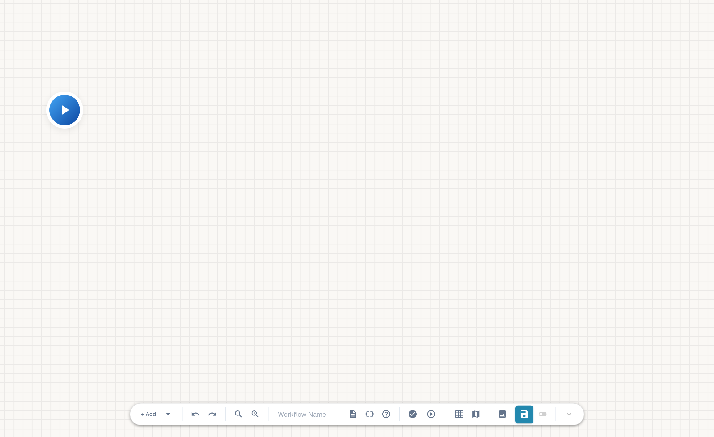
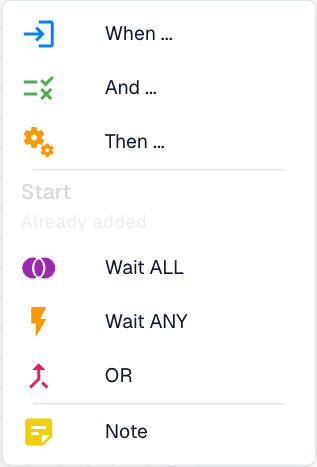

# Advanced Workflows

An **Advanced Workflow** routes a document through a graph of triggers, conditions and actions. Use it when the next action depends on a result, several checks feed a common action, or an error needs its own handling path. **Connections determine execution order**; placing a card farther to the right does not make it run later.

Use a [Standard Workflow](../standard-workflow-builder/README.md) for a linear **When → And → Then** automation. Both builders use the same [card catalog](../cards-overview/README.md). The advanced builder adds explicit connections and control nodes.

## Watch: an invoice routing example

Meet Mike, then follow his explanation and real actions in the English DocBits interface: inspect Workflow List and License, name a workflow, configure an invoice amount check and two actions, arrange the cards, connect both routes and inspect the document and Custom Data test options.



[Open video](https://docbits-videos.fra1.cdn.digitaloceanspaces.com/settings-assistant/advanced_workflows_canvas-admin/v1/en.mp4) · [Captions (WebVTT)](https://docbits-videos.fra1.cdn.digitaloceanspaces.com/settings-assistant/advanced_workflows_canvas-admin/v1/en.vtt) · [Transcript (text)](https://docbits-videos.fra1.cdn.digitaloceanspaces.com/settings-assistant/advanced_workflows_canvas-admin/v1/en.txt) · 5:00

The recording shows an unsaved demonstration draft. The fields `total_amount` and `approval_route` are example keys. `Approval` and `Standard` label the routes; configure the actual business actions for your process. This demo account has no Advanced Workflow subscription, so validation is blocked and no test, server save or activation is performed.

Transcript

**Meet the administrator**

I look after DocBits here. Let me show you how I build an invoice check and connect its two routes.

**Check workflow access**

I start on Workflow Dashboard and open Workflow List. Then I check License. Workflow and Advanced Workflow both need active access. With those enabled, New Workflow offers Advanced Workflow. This documentation account has no active workflow subscription, so this video continues with an unsaved designer preview.

**Name the workflow**

I'm working in the real DocBits designer. First, I give this draft a clear name. We'll check an invoice amount, then use two simple actions to show the possible routes. This demonstration stays unsaved.

**Configure the amount check**

I open Add and choose And. Under Document Field, I select the Docfield condition. I set the field to total amount. Then I choose Greater Than. And enter one thousand. Use your own document field key. Exactly one thousand does not pass this comparison.

**Add the Approval action**

Now I add a Then card from Document Field. The action sets a document field. I use the demonstration key approval route, and enter Approval. This labels the route. A real approval process needs its own business actions.

**Add the Standard action**

I add a second Then card using the same action. This time, the demonstration field gets the value Standard. Both cards are configured. They still need connections to define which action runs.

**Arrange the canvas**

I drag the cards into a readable layout. The two actions go on the right. The condition sits in the middle, with Start on the left. Moving cards changes their position. It does not create a connection.

**Connect the routes**

I drag from Start's output to the condition's input. The Success route goes to Approval, with a blue connection. The orange Failed Condition route goes to Standard. Red Error is a separate output for evaluation failures. Here it remains unconnected. In a production workflow, decide how you will handle those failures.

**Prepare test cases**

The toolbar Test button opens Select Test Document. I can select a demonstration document, or prepare complete Custom Data. Test amounts above, below, and exactly at one thousand. Check a missing amount too. This account has no Advanced Workflow subscription. I'm showing test preparation, not an executed result.

**Validate, save and activate**

I locate Validate to check connections and card settings. This account blocks validation because the subscription is unavailable. In an enabled account, I would save explicitly to the server. Then check activation separately. The switch is disabled before the first save. The automatic draft indicator refers to a local browser copy. It does not mean this workflow is saved or enabled.

Continue with the [five-part video guide](videos.md) for nodes and routes, variables and testing, finding log entries and diagnosing an execution. All chapters on this English page use English narration, caption files and transcripts.

## Open or create an Advanced Workflow

1. Open **Workflow Dashboard → Workflow List**.
2. Select **New Workflow → Advanced Workflow**. Some versions label the button **Add Workflow**.
3. Enter a name in the toolbar. Add a description that explains the business purpose.
4. Use the automatic **Start** node for a manual entry point, or add a **When** card for an event trigger.
5. Add and configure conditions and actions. Connect their appropriate result handles.
6. [Validate and test](validation-and-testing.md), save explicitly and check the enabled state.

The Workflow Builder module and Advanced Workflow option must be enabled for the organization, and the required subscription must be available. If the creation option is missing or an operation is refused, ask your administrator to check both module access and licensing. Opening a designer URL alone does not establish execution or log access.

<figure><figcaption>
Start provides the manual entry. The toolbar adds nodes, configures the workflow, validates, tests, saves and activates it.
</figcaption></figure>

## Building blocks

| Building block | Purpose | Details |
| --- | --- | --- |
| **Start / When** | Start a manual test or respond to an event. Entry nodes have no input. | [Nodes](nodes.md) |
| **And** | Route success, false condition and error separately. | [Condition cards](../cards-overview/condition-cards-complete-guide.md) |
| **Then** | Perform an action, such as assigning a task or setting a field. Actions can connect to further actions. | [Action cards](../cards-overview/then/README.md) |
| **Wait ALL / Wait ANY / OR** | Merge incoming routes according to their results. | [Merge rules](nodes.md#merge-branches) |
| **Note** | Explain the design without executing an operation. | [Toolbar and canvas](toolbar-and-canvas.md) |
| **Variables** | Share typed values that compatible cards can read or update. | [Variables and scope](variables.md) |

<figure><figcaption>
The available node types. Start is already present and cannot be added a second time from this menu.
</figcaption></figure>

## Example: route a high-value invoice for approval

1. Choose the appropriate invoice event in a **When** card.
2. Add an **And** card that compares the invoice amount with the threshold. Configure its field, comparison and value.
3. Connect the trigger to the condition's input.
4. Connect **blue success** to a **Then** card that creates or assigns an approval task.
5. Connect **orange failed condition** to the intended normal-processing action.
6. Connect **red error** to a separate handling action if evaluation fails.
7. Test an amount above the threshold, below it, at the exact boundary and with missing or invalid data.

Connections create the behavior. Two unconnected actions do not create alternatives. A false condition is also different from an execution error.


An Advanced Workflow can continue through an explicitly connected **Failed Condition** route. The Standard Workflow rule that stops remaining linear cards after a false condition does not apply to the entire advanced graph.


## Save, activation and automatic drafts

**Save** writes the workflow to the server. The activation switch changes the enabled state of a saved workflow and is unavailable before the first save. Check the resulting state in **Workflow List**, including after the first save. Saving and checking activation are separate steps.

The automatic-save indicator refers to a **local browser draft**, normally stored every 30 seconds after changes. It does not replace a server save. A draft belongs to that browser and can expire after 24 hours. A restore prompt can appear after a reload; a newer server version can make an old draft stale. Save explicitly before relying on the workflow from another session.

Organization variables persist independently. Discarding a canvas draft does not undo a variable change.

## Complete guide

- [Video guide](videos.md): five narrated chapters in English, with captions and transcripts.
- [Toolbar and canvas](toolbar-and-canvas.md): every control, selection, editing, notes and shortcuts.
- [Nodes and connections](nodes.md): entry points, versions, result handles, merges and connection rules.
- [Variables](variables.md): all four types, organization scope and immediate persistence.
- [Validation and testing](validation-and-testing.md): structural checks, document and custom input, results and regression scenarios.
- [Workflow Logs](../workflow-logs.md): inspect document executions and their messages.
