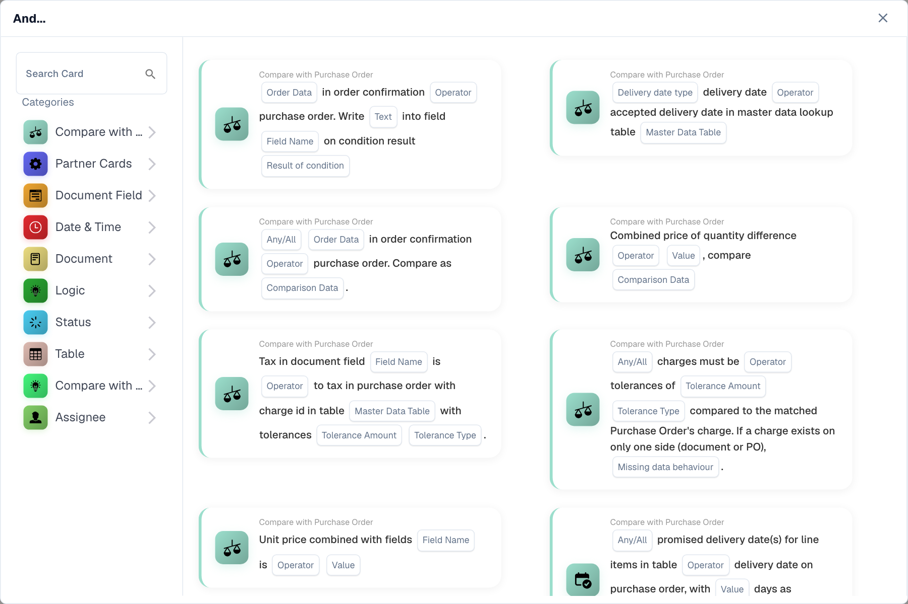
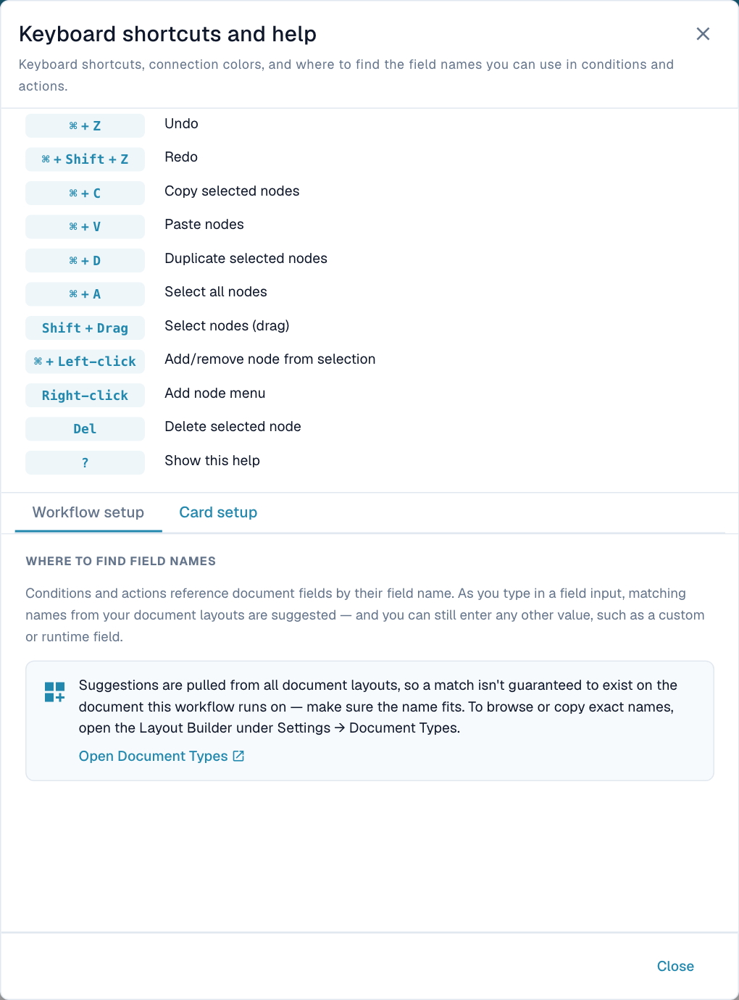
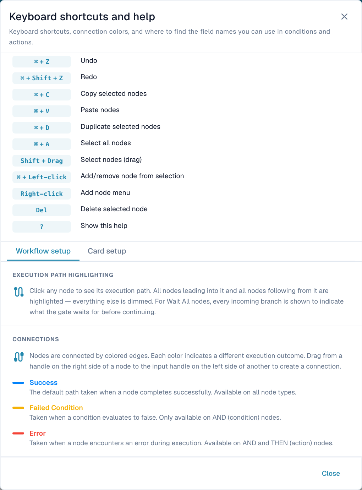

# Nodes

Nodes perform work; connections carry their results to the next node. Use **+ Add** or right-click the canvas. **When**, **And** and **Then** open the card picker. Choose a category or search, select a card, then configure its fields.

<figure><figcaption>
Choose a category or search for the operation you need. The card's highlighted fields are configuration inputs.
</figcaption></figure>

## Entry, condition and action nodes

| Node | Purpose | Connections |
| --- | --- | --- |
| **Start** | Manual entry point with a direct test control; added automatically. | Success output; no input. |
| **When** | Event trigger. Configure the trigger card, document type and other parameters. | Success output; no input. |
| **And** | Evaluate a condition against available data. | Input; success, failed-condition and error outputs. |
| **Then** | Perform an action such as setting a field, creating a task or calling an integration. | Input; success and error outputs. |
| **Note** | Explain a decision. Does not execute. | No execution connections. |

A manual Start test does not prove that the event-specific When path is selected during normal processing. Test the relevant trigger and its route.

### Card versions

The version pill on a card opens its available versions. A version change can change fields and behavior: review the configuration and repeat the affected tests. Prefer supported card versions with structured results. A missing-card warning means the saved card is unavailable in the current catalog, for example an unavailable partner card.

**Card version** and **Advanced Workflow type** describe different things. See the [card catalog](../cards-overview/README.md) for card-specific behavior.

### Document field names

Conditions and actions identify document fields by their **field names**. Input suggestions can include names from all document layouts. A suggested name is not proof that the selected document contains that field. Confirm the exact name in **Settings → Document Types → Layout Builder** and test with the relevant document type. Cards can also accept custom or runtime field names where supported.

Open **Help → Card setup** for this guidance and the link to Document Types. A display label and a field's technical name can differ.

<figure><figcaption>
Verify field names against the document's layout before relying on a suggested name.
</figcaption></figure>

## Result handles

Drag a source handle to the next node's **input**. And has two outcomes on the right and an error output below. Then has success on the right and error below.

| Designer connection | Meaning | Example |
| --- | --- | --- |
| **Blue — Success** | Operation succeeded or condition was true. | Amount above threshold → approval task. |
| **Orange — Failed Condition** | Condition evaluated normally but was false. Available on And. | Amount below threshold → normal processing. |
| **Red — Error** | Evaluation or action could not complete. Available on And and Then. | Required data unavailable → error handling. |

Success is **blue in the designer** and **green in execution results**. Card category colors are not execution results.

<figure><figcaption>
The built-in legend distinguishes an expected false result from an execution error.
</figcaption></figure>

If the taken result has no connection, that route has no next node. Other reachable routes can still execute. An error handler does not erase the original error from the overall result.

## Merge branches

Merge nodes combine incoming routes; they do not create branches. Connect the intended upstream **outcomes** to the gate's input, then its success output to the next action.

| Node | Inputs | Requirement to continue |
| --- | --- | --- |
| **Wait ALL** | At least two connections. Use distinct sources for independent requirements. | Every incoming source takes an outcome connected to this gate. |
| **Wait ANY** | At least two connections. | At least one source takes an outcome connected to this gate. |
| **OR** | At least two **different source nodes**. | At least one source takes an outcome connected to this gate. |

The connected handle matters. A false condition can satisfy an input when its **orange** handle is connected. A successful source does not satisfy a connection drawn from its failed-condition handle.

Several handles from one source are still one source. A matching handle can satisfy that source, but two lines do not represent independent approvals.

### Both checks are required

Connect two reachable checks to **Wait ALL**. Confirm that both sources can execute and take the connected outcomes. Joining mutually exclusive success paths can leave a required input unavailable.

### Either check is sufficient

Use **Wait ANY** or **OR** when one matching source is sufficient. Test only A matching, only B matching, neither matching and both matching. These gates are not exclusive switches and do not cancel other actions. They are not a promise that real-world approvals race and the first cancels another.

## Delay in an existing graph

The current Add menu does **not** offer Delay. An existing or imported graph can contain one. Its duration must be positive and no more than **86,400 seconds (24 hours)**. Test mode skips the actual wait; a short test runtime does not prove a production delay was ignored.

## Connection rules

- Keep processing nodes reachable from a Start or When entry.
- Include at least one Then action.
- Entry nodes cannot receive incoming connections.
- Do not connect a node to itself or create a cycle.
- Connect valid output handles to inputs.
- Meet each merge's input requirements.
- Reconnect or remove unused processing nodes; use Note for commentary.

Select a node to highlight its upstream and downstream paths, including all inputs to Wait ALL. Highlighting shows connectivity. [Tests](validation-and-testing.md) and [execution logs](../workflow-logs.md) show which paths actually ran.
